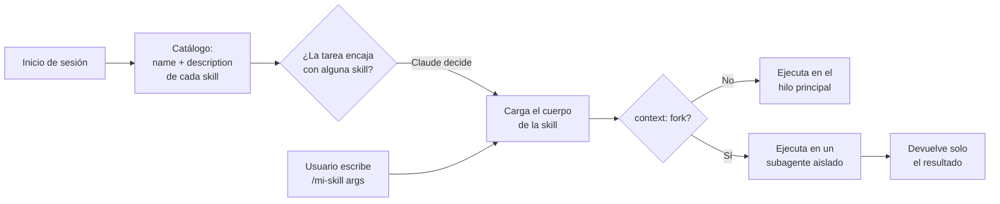
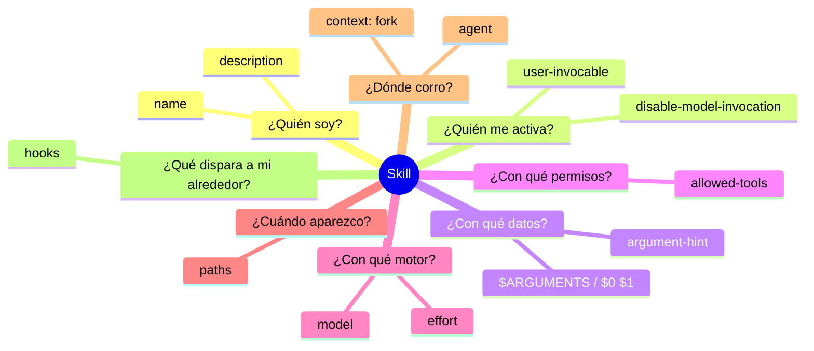
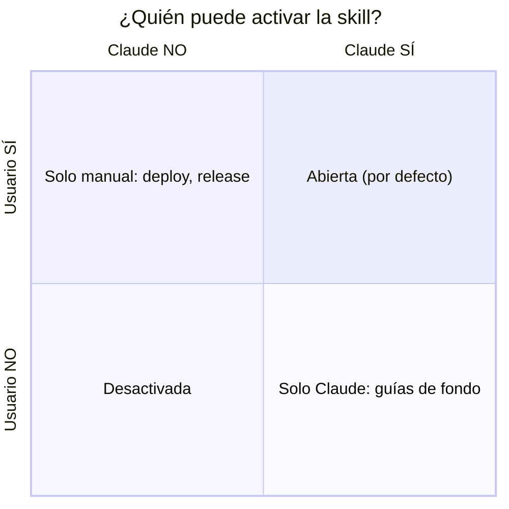
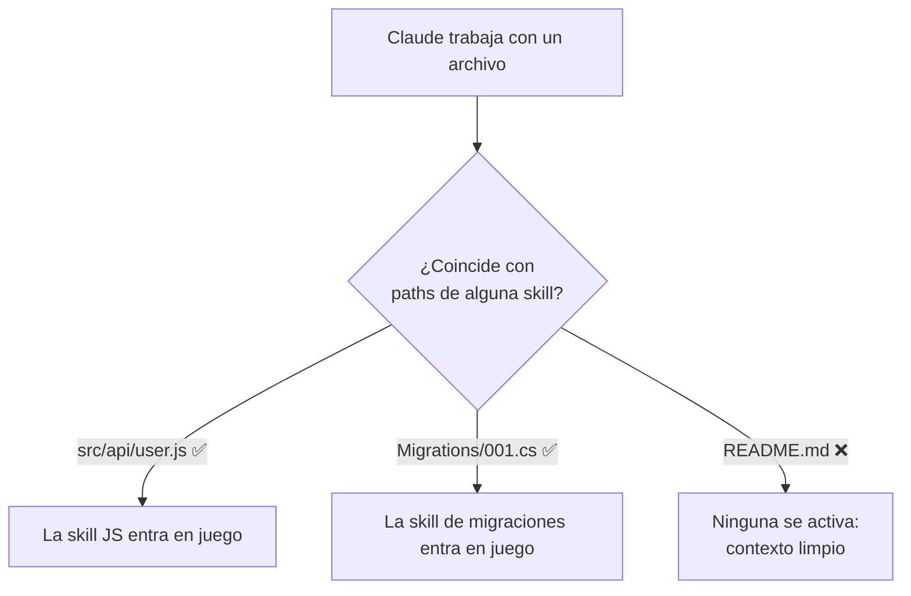
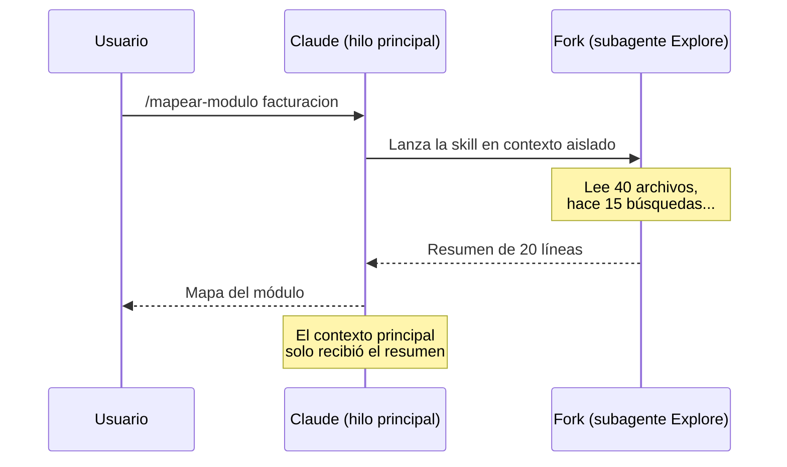
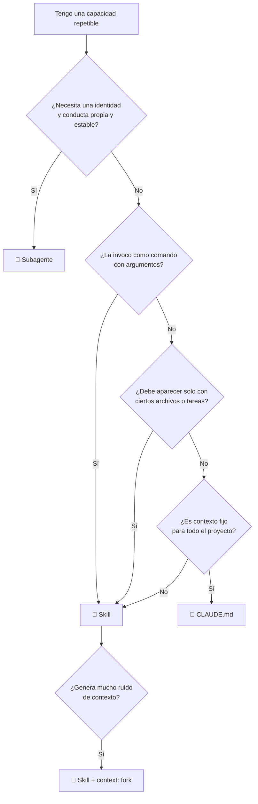

# 🧩 Campos de configuración de una Skill en Claude Code — De cero a avanzado

> Esta lectura explica **cómo se construye una skill personalizada** campo por campo: desde *qué es* hasta **composición con subagentes, hooks locales y activación condicional**, con ejemplos listos para copiar.
>
> **Idea central:** una skill **no es un trabajador con su propio cerebro** (eso es un subagente). Es un **paquete de capacidad** —instrucciones, herramientas y condiciones de activación— que Claude **se trae a su propia sesión** cuando le resulta útil. Por eso, al diseñarla, la pregunta no es *"¿cómo se comporta este trabajador?"*, sino:
>
> **¿Cuándo entra en juego esta capacidad, con qué argumentos, con qué permisos y sobre qué archivos?**

> [!NOTE]
> Los diagramas usan **Mermaid**, que se renderiza en GitHub y en VS Code (vista previa de Markdown o la extensión *Markdown Preview Mermaid Support*).

> [!IMPORTANT]
> Claude Code evoluciona rápido. Los campos descritos corresponden a la documentación vigente al escribir esta lectura. Ante la duda, consulta la documentación oficial de *skills* o escribe `/` dentro de Claude Code para ver las skills disponibles.

---

## 📑 Tabla de contenido

**Nivel 0 — Fundamentos**
1. [¿Qué es una skill (y qué no es)?](#1-qué-es-una-skill-y-qué-no-es)
2. [Modelo mental: la caja de herramientas que se abre sola](#2-modelo-mental-la-caja-de-herramientas-que-se-abre-sola)
3. [Dónde viven las skills](#3-dónde-viven-las-skills)
4. [Tu primera skill en 2 minutos](#4-tu-primera-skill-en-2-minutos)

**Nivel 1 — Anatomía: el frontmatter campo por campo**
5. [El esqueleto completo](#5-el-esqueleto-completo)
6. [Identidad: `name` y `description`](#6-identidad-name-y-description)
7. [Invocación: `disable-model-invocation` y `user-invocable`](#7-invocación-disable-model-invocation-y-user-invocable)
8. [Parámetros: `argument-hint` y variables dinámicas](#8-parámetros-argument-hint-y-variables-dinámicas)
9. [Permisos: `allowed-tools`](#9-permisos-allowed-tools)
10. [Motor: `model` y `effort`](#10-motor-model-y-effort)

**Nivel 2 — Intermedio**
11. [Activación condicional: `paths`](#11-activación-condicional-paths)
12. [Archivos de soporte y `${CLAUDE_SKILL_DIR}`](#12-archivos-de-soporte-y-claude_skill_dir)

**Nivel 3 — Avanzado**
13. [Aislamiento: `context: fork` + `agent`](#13-aislamiento-context-fork--agent)
14. [Hooks locales a la skill](#14-hooks-locales-a-la-skill)
15. [Recetario: skills completas](#15-recetario-skills-completas)
16. [Skill vs. subagente: tabla de decisión](#16-skill-vs-subagente-tabla-de-decisión)
17. [Errores comunes y depuración](#17-errores-comunes-y-depuración)
18. [Checklist final](#18-checklist-final)

---

# Nivel 0 — Fundamentos

## 1. ¿Qué es una skill (y qué no es)?

Una skill es un **archivo Markdown con frontmatter YAML** que empaqueta una capacidad reutilizable. Visualmente se parece a un subagente, pero **casi ningún campo coincide**, y esa es la pista de que resuelven problemas distintos.

| | 🧩 Skill | 🤖 Subagente |
|---|---|---|
| **¿Qué es?** | Un paquete de instrucciones + permisos | Un trabajador con su propio contexto |
| **¿Dónde corre?** | En la sesión de Claude (o en un fork si lo pides) | Siempre en una ventana de contexto aislada |
| **¿Quién la activa?** | Claude automáticamente **y/o** tú con `/nombre` | Claude delega o tú lo pides |
| **Recibe…** | Argumentos tipo CLI (`$ARGUMENTS`, `$0`, `$1`) | Una instrucción conversacional |
| **Pregunta de diseño** | *¿Cuándo y con qué parámetros?* | *¿Cómo se comporta este trabajador?* |

> [!TIP]
> Piensa en una skill como un **comando CLI inteligente**: tiene nombre, argumentos, permisos y ayuda en autocompletado… pero además Claude puede decidir usarlo por su cuenta.

---

## 2. Modelo mental: la caja de herramientas que se abre sola

Claude no carga todas las skills completas al inicio. Solo lee su **nombre y descripción** (el "catálogo"). El cuerpo se carga **cuando hace falta**. Esto se llama *progressive disclosure* y es lo que permite tener decenas de skills sin llenar el contexto.



**Tres capas de carga:**

| Capa | Qué se carga | Cuándo |
|---|---|---|
| 1. Metadatos | `name`, `description` | Siempre (son baratos) |
| 2. Cuerpo | Instrucciones del `SKILL.md` | Al activarse la skill |
| 3. Recursos | Plantillas, scripts, referencias | Solo si las instrucciones los piden |

---

## 3. Dónde viven las skills

Cada skill es una **carpeta** con un archivo `SKILL.md` dentro:

```text
.claude/skills/
└── revisar-pr/
    ├── SKILL.md          ← obligatorio: frontmatter + instrucciones
    ├── plantilla.md      ← opcional: recursos de apoyo
    └── scripts/
        └── diff-stats.sh
```

| Alcance | Ruta | Para qué |
|---|---|---|
| **Personal** | `~/.claude/skills/<nombre>/SKILL.md` | Tus skills en todos los proyectos |
| **Proyecto** | `.claude/skills/<nombre>/SKILL.md` | Compartidas con el equipo vía git |
| **Plugin** | Dentro del plugin instalado | Distribuidas como paquete |

> [!NOTE]
> Los antiguos *custom slash commands* (`.claude/commands/*.md`) siguen funcionando y aceptan el mismo frontmatter. Las skills son su evolución: añaden carpeta propia, archivos de soporte e invocación automática.

---

## 4. Tu primera skill en 2 minutos

**Objetivo:** una skill que genere mensajes de commit con la convención del equipo.

```markdown
---
name: commit-msg
description: Genera un mensaje de commit siguiendo la convención HD/DESARROLLO/INTERNO del equipo. Úsala cuando el usuario pida hacer o redactar un commit.
argument-hint: "[HD-123 | TAREA-45] [descripción]"
allowed-tools: Bash(git diff *) Bash(git status)
---

# Generar mensaje de commit

1. Ejecuta `git status` y `git diff --staged` para entender el cambio.
2. Usa el identificador recibido: **$0**
3. Redacta el mensaje con el formato `PREFIJO - descripción` en español.
4. Contexto adicional del usuario: $ARGUMENTS
```

**Uso:**

```text
/commit-msg HD-1234 corrige cálculo de IVA
```

✅ Listo: tiene nombre (`/commit-msg`), ayuda en autocompletado, herramientas pre-aprobadas y Claude también puede usarla sola cuando le pidas "haz el commit".

---

# Nivel 1 — Anatomía: el frontmatter campo por campo

## 5. El esqueleto completo

```yaml
---
name: mi-skill                    # ID para /mi-skill
description: >                    # Claude usa esto para decidir cuándo cargarla
  Qué hace. Max 250 chars visibles.
argument-hint: "[param]"          # Hint en autocompletado
disable-model-invocation: true    # Solo tú, no Claude automáticamente
user-invocable: false             # Solo Claude, no aparece en /
allowed-tools: Read Bash(git *)   # Pre-aprobados sin prompt
model: sonnet                     # Modelo cuando está activa
effort: high                      # low | medium | high | max
context: fork                     # Ejecutar en subagente aislado
agent: Explore                    # Subagente para context: fork
hooks: { ... }                    # Hooks limitados a esta skill
paths: "src/**/*.js"              # Solo activar con estos archivos
---

Instrucciones en Markdown...
$ARGUMENTS            = todo lo escrito tras /nombre
$0, $1                = argumentos posicionales
${CLAUDE_SKILL_DIR}   = directorio de la skill
${CLAUDE_SESSION_ID}  = id de la sesión
```

**Mapa mental de los campos** — cada grupo responde una pregunta:



---

## 6. Identidad: `name` y `description`

### `name`
- Es el **identificador** y el comando: `name: revisar-pr` → `/revisar-pr`.
- Usa minúsculas y guiones (`kebab-case`). Si se omite, se usa el nombre de la carpeta.

### `description` — el campo más importante

No es decorativa: **es exactamente el texto que Claude lee para decidir si carga la skill.** Solo se ven ~250 caracteres en el catálogo, así que lo esencial va al inicio.

| ❌ Mala | Problema | ✅ Buena |
|---|---|---|
| `Ayuda con código` | Tan vaga que nunca se activa, o se activa siempre | `Revisa migraciones SQL de EF Core buscando pérdidas de datos. Úsala al crear o editar archivos en Migrations/.` |
| `Hace cosas de git` | No dice cuándo usarla | `Genera notas de release a partir de los commits entre dos tags. Úsala cuando pidan changelog o release notes.` |

**Fórmula recomendada:**

```text
[Qué hace] + [sobre qué] + "Úsala cuando…" + [disparadores concretos]
```

> [!TIP]
> Si tu skill **nunca se activa sola**, el 90 % de las veces el problema es la `description`. Añade palabras que el usuario realmente diría ("changelog", "release", "migración").

---

## 7. Invocación: `disable-model-invocation` y `user-invocable`

Esta pareja es lo que diferencia a las skills de casi cualquier otra pieza del ecosistema. Controla **dos puertas** independientes:

- 🚪 **Puerta automática** (Claude): `disable-model-invocation: true` la **cierra**.
- 🚪 **Puerta manual** (`/nombre`): `user-invocable: false` la **cierra**.

| `disable-model-invocation` | `user-invocable` | ¿Claude la activa? | ¿Aparece en `/`? | Caso de uso |
|---|---|---|---|---|
| `false` *(def.)* | `true` *(def.)* | ✅ | ✅ | Skill general: ambos pueden usarla |
| `true` | `true` | ❌ | ✅ | **Acciones con efectos**: deploy, publicar, borrar. Solo cuando *tú* lo decides |
| `false` | `false` | ✅ | ❌ | **Conocimiento de fondo**: convenciones, guías de estilo que Claude consulta sola y no tiene sentido invocar a mano |
| `true` | `true` + `paths` | ❌ | ✅ | Comando manual que solo tiene sentido en ciertos archivos |



> [!WARNING]
> Una skill de **deploy a producción** sin `disable-model-invocation: true` podría activarse porque Claude "creyó que era útil". Las acciones irreversibles deben ser **siempre manuales**.

---

## 8. Parámetros: `argument-hint` y variables dinámicas

Una skill puede diseñarse como **comando parametrizado**. Claude sustituye estas variables antes de leer las instrucciones:

| Variable | Contiene | Ejemplo con `/migrar Users AddEmail` |
|---|---|---|
| `$ARGUMENTS` | Todo lo escrito tras el nombre | `Users AddEmail` |
| `$0` | Primer argumento | `Users` |
| `$1` | Segundo argumento | `AddEmail` |
| `${CLAUDE_SKILL_DIR}` | Ruta de la carpeta de la skill | `.claude/skills/migrar` |
| `${CLAUDE_SESSION_ID}` | ID de la sesión actual | `f1bbc009-…` |

`argument-hint` muestra en el autocompletado qué espera la skill, por lo que se **autodocumenta**:

```text
/migrar  [tabla] [nombre-migración]
         └─────── argument-hint ───────┘
```

**Ejemplo:**

```markdown
---
name: migrar
description: Crea una migración de EF Core para una tabla. Úsala al pedir una migración nueva.
argument-hint: "[tabla] [nombre-migración]"
disable-model-invocation: true
allowed-tools: Bash(dotnet ef migrations add *)
---

Crea la migración **$1** para la tabla **$0**:

1. Revisa la entidad `$0` y su configuración en el `DbContext`.
2. Ejecuta `dotnet ef migrations add $1`.
3. Revisa el archivo generado y avisa si hay `DropColumn` o `DropTable`.
4. Registra el resultado en `logs/${CLAUDE_SESSION_ID}.md`.
```

> [!TIP]
> Usa `$ARGUMENTS` cuando la entrada sea **texto libre** y `$0`, `$1` cuando sean **piezas con significado propio**.

---

## 9. Permisos: `allowed-tools`

Este campo hace **dos cosas a la vez**:

1. **Pre-aprueba** las herramientas listadas: no saldrá ventana de permiso mientras la skill esté activa.
2. Funciona como **contrato de confianza puntual**: vale solo durante la ejecución de esa skill.

```yaml
allowed-tools: Read Grep Bash(git log *) Bash(git diff *)
```

| Patrón | Significado |
|---|---|
| `Read` | Leer cualquier archivo |
| `Bash(git *)` | Cualquier comando que empiece por `git` |
| `Bash(npm test)` | Exactamente ese comando |
| `mcp__github__*` | Todas las herramientas del MCP de GitHub |

**Principio de mínimo privilegio:**

| ❌ Demasiado amplio | ✅ Ajustado |
|---|---|
| `Bash` | `Bash(git log *) Bash(git diff *)` |
| `Bash(npm *)` | `Bash(npm test) Bash(npm run lint)` |

> [!CAUTION]
> `allowed-tools: Bash` sin patrón equivale a pre-aprobar **cualquier comando** del sistema mientras la skill corre. Evítalo, sobre todo en skills que Claude puede activar automáticamente.

---

## 10. Motor: `model` y `effort`

Igual que en los subagentes, pero con una diferencia clave: **la decisión es por tarea, no por trabajador**. Una misma conversación puede invocar varias skills, cada una con su configuración.

| Tipo de skill | `model` | `effort` | Por qué |
|---|---|---|---|
| Formatear, listar, resumir | `haiku` | `low` | Rápido y barato |
| Revisión de código habitual | `sonnet` | `medium` | Equilibrio |
| Refactor complejo, arquitectura | `opus` | `high` / `max` | Requiere razonamiento profundo |

```yaml
model: haiku
effort: low
```

> [!NOTE]
> Si no declaras `model` ni `effort`, la skill hereda los de la sesión actual.

---

# Nivel 2 — Intermedio

## 11. Activación condicional: `paths`

Con `paths` la skill solo se vuelve **relevante cuando trabajas con ciertos archivos**. Así puedes tener decenas de skills sin saturar el razonamiento del modelo.

```yaml
paths: "src/**/*.js"
```



**Ejemplos útiles:**

| `paths` | Skill |
|---|---|
| `"**/*.test.ts"` | Convenciones de testing |
| `"**/Migrations/**"` | Revisión de migraciones EF Core |
| `"src/components/**/*.tsx"` | Guía de componentes React |
| `"**/*.sql"` | Buenas prácticas de SQL Server |

> [!TIP]
> `paths` transforma la skill de *"capacidad siempre disponible"* a *"capacidad que aparece cuando hace falta"*. Es una forma de mantener el contexto limpio que los subagentes no ofrecen de forma nativa.

---

## 12. Archivos de soporte y `${CLAUDE_SKILL_DIR}`

Las instrucciones no tienen por qué estar todas en `SKILL.md`. Pon el material pesado en archivos aparte y **referéncialos**: solo se leerán si hace falta (capa 3 del modelo mental).

```text
.claude/skills/release-notes/
├── SKILL.md
├── plantilla.md
└── scripts/
    └── commits-entre-tags.sh
```

```markdown
---
name: release-notes
description: Genera notas de release entre dos tags de git. Úsala cuando pidan changelog o release notes.
argument-hint: "[tag-desde] [tag-hasta]"
allowed-tools: Read Bash(bash ${CLAUDE_SKILL_DIR}/scripts/*)
---

1. Ejecuta `bash ${CLAUDE_SKILL_DIR}/scripts/commits-entre-tags.sh $0 $1`.
2. Agrupa los commits por prefijo (HD, DESARROLLO, INTERNO).
3. Rellena la plantilla `${CLAUDE_SKILL_DIR}/plantilla.md`.
```

✅ **Ventajas:** `SKILL.md` queda corto, la lógica determinista vive en scripts (más fiable que pedirle a Claude que "cuente commits") y la skill es **portable**: funciona igual en cualquier máquina porque las rutas son relativas a su carpeta.

---

# Nivel 3 — Avanzado

## 13. Aislamiento: `context: fork` + `agent`

Por defecto, una skill corre **en el hilo principal**: todo lo que lee y produce ocupa tu contexto. Con `context: fork` se ejecuta en un **subagente aislado** y solo vuelve el resultado.

```yaml
context: fork
agent: Explore     # opcional: qué subagente ejecuta el fork
```



| Sin fork | Con `context: fork` |
|---|---|
| Ve toda la conversación | Empieza limpio |
| Lo que lee llena tu contexto | Solo vuelve el resultado |
| Ideal para tareas cortas o que necesitan el historial | Ideal para exploración masiva o análisis pesados |

Es la **mezcla deliberada de ambos mundos**: la skill aporta *la definición de la tarea y sus condiciones*; el subagente aporta *el entorno aislado* para ejecutarla.

> [!WARNING]
> Un fork **no ve la conversación previa**. Si la skill necesita algo dicho antes, debe llegar por `$ARGUMENTS` o estar escrito en las instrucciones.

---

## 14. Hooks locales a la skill

Las skills admiten hooks del ciclo de vida, pero **limitados a su alcance**: solo se disparan **mientras esa skill está activa**.

| Hook global (`settings.json`) | Hook en la skill |
|---|---|
| Siempre activo en el proyecto | Solo mientras la skill corre |
| Afecta a todo | Afecta solo a esa tarea |
| Puede ensuciar la configuración | Encapsulado y portable con la skill |

```yaml
---
name: refactor-ts
description: Refactoriza archivos TypeScript manteniendo el estilo. Úsala al pedir refactors en TS.
paths: "**/*.ts"
allowed-tools: Read Edit
hooks:
  PostToolUse:
    - matcher: "Edit|Write"
      hooks:
        - type: command
          # El hook recibe por stdin un JSON con tool_input.file_path
          command: "jq -r '.tool_input.file_path' | xargs -I{} sh -c 'npx prettier --write {} && npx eslint --fix {}'"
---
```

Cada edición que haga la skill se formatea y se lintea automáticamente… **pero solo durante este refactor**, sin tocar la configuración global.

> [!NOTE]
> La sintaxis de `hooks` es la misma que viste en la sección de Hooks (eventos, `matcher`, `type: command`). Revisa allí los eventos disponibles y las variables que recibe cada uno.

---

## 15. Recetario: skills completas

### 🚀 A. Deploy manual y seguro

```markdown
---
name: deploy
description: Despliega la aplicación al entorno indicado.
argument-hint: "[dev | qa | prod]"
disable-model-invocation: true
allowed-tools: Bash(npm run build) Bash(npm test) Bash(./deploy.sh *)
model: sonnet
effort: medium
---

Despliega a **$0**:

1. Si `$0` no es `dev`, `qa` o `prod`, detente y pregunta.
2. Ejecuta `npm test`. Si falla, **detente**.
3. Ejecuta `npm run build`.
4. Si `$0` es `prod`, pide confirmación explícita antes de seguir.
5. Ejecuta `./deploy.sh $0` y resume el resultado.
```

**Claves:** solo manual, validación de argumentos, permisos exactos.

### 📘 B. Guía de estilo de fondo (solo Claude)

```markdown
---
name: estilo-csharp
description: Convenciones de C# y .NET 6 del equipo (nombres, async, inyección de dependencias). Consúltala al escribir o revisar código C#.
user-invocable: false
paths: "**/*.cs"
---

- Métodos asíncronos terminan en `Async` y usan `async/await`.
- Inyección de dependencias por constructor; nada de `new` para servicios.
- Consultas SQL parametrizadas, nunca concatenación de strings.
```

**Claves:** no aparece en `/`, solo se activa con archivos `.cs`, sin herramientas (es conocimiento).

### 🔍 C. Explorador aislado

```markdown
---
name: mapear-modulo
description: Genera un mapa de arquitectura de un módulo (entradas, dependencias, flujo de datos). Úsala cuando pidan entender un módulo grande.
argument-hint: "[ruta-o-nombre-del-módulo]"
context: fork
agent: Explore
model: haiku
effort: low
allowed-tools: Read Grep Glob
---

Explora **$ARGUMENTS** y devuelve como máximo 30 líneas con:
- Puntos de entrada
- Dependencias principales
- Flujo de datos
- 3 archivos clave para empezar a leer
```

**Claves:** fork para no llenar el contexto, modelo barato, solo lectura, salida acotada.

---

## 16. Skill vs. subagente: tabla de decisión



| Necesito… | Usa |
|---|---|
| Un comando `/algo` con parámetros | Skill |
| Conocimiento que Claude cargue solo cuando toca | Skill con buena `description` (+ `paths`) |
| Un "rol" persistente con su propio prompt de sistema | Subagente |
| Una tarea pesada sin contaminar el contexto | Skill con `context: fork` o subagente |
| Algo que pase **siempre**, de forma determinista | Hook |
| Reglas que apliquen a **todo** el proyecto | CLAUDE.md |

---

## 17. Errores comunes y depuración

| Síntoma | Causa probable | Solución |
|---|---|---|
| La skill nunca se activa sola | `description` vaga o `disable-model-invocation: true` | Reescribe la descripción con disparadores concretos |
| Se activa cuando no debe | `description` demasiado genérica | Acota: "Úsala **solo** cuando…" y añade `paths` |
| No aparece en `/` | `user-invocable: false` o carpeta/archivo mal nombrado | Verifica `.claude/skills/<nombre>/SKILL.md` |
| Pide permiso en cada paso | `allowed-tools` no cubre el comando exacto | Ajusta el patrón: `Bash(git log *)` |
| `$1` aparece vacío | El usuario pasó menos argumentos | Valida en las instrucciones: "si falta `$1`, pregunta" |
| El fork "no sabe" de qué hablábamos | `context: fork` empieza limpio | Pasa el contexto por `$ARGUMENTS` |
| YAML inválido | Indentación, `:` sin comillas | Pon entre comillas valores con `:`, `*` o `[` |

> [!TIP]
> Para probar la activación automática, abre una sesión nueva y pide la tarea **con las palabras que usaría un usuario real**, sin nombrar la skill. Si no se activa, ajusta la `description`.

---

## 18. Checklist final

- [ ] `name` en kebab-case y coherente con la carpeta
- [ ] `description` dice **qué hace** y **cuándo usarla**, lo esencial en los primeros 250 caracteres
- [ ] Acciones irreversibles con `disable-model-invocation: true`
- [ ] Conocimiento de fondo con `user-invocable: false`
- [ ] `argument-hint` si recibe parámetros, y validación de argumentos en el cuerpo
- [ ] `allowed-tools` con el **mínimo privilegio** (patrones concretos, nunca `Bash` a secas)
- [ ] `model` / `effort` acordes al costo real de la tarea
- [ ] `paths` si solo tiene sentido en ciertos archivos
- [ ] `context: fork` si lee mucho y solo importa el resultado
- [ ] Material pesado en archivos de soporte referenciados con `${CLAUDE_SKILL_DIR}`
- [ ] Probada en una sesión nueva, por invocación manual **y** automática

---

## 🎯 Resumen en una frase por campo

| Campo | Responde a… |
|---|---|
| `name` | ¿Cómo me llamo y cuál es mi comando? |
| `description` | ¿Cuándo debería Claude traerme? |
| `disable-model-invocation` | ¿Puede Claude activarme solo? |
| `user-invocable` | ¿Puede el usuario activarme con `/`? |
| `argument-hint` | ¿Qué parámetros espero? |
| `allowed-tools` | ¿Qué puedo hacer sin pedir permiso? |
| `model` / `effort` | ¿Con cuánta potencia trabajo? |
| `paths` | ¿En qué archivos soy relevante? |
| `context` / `agent` | ¿Corro en el hilo o aislado, y con quién? |
| `hooks` | ¿Qué se dispara mientras estoy activa? |

> **Una skill bien diseñada no es un prompt largo: es una capacidad con nombre, parámetros, permisos y condiciones de activación claras.**
