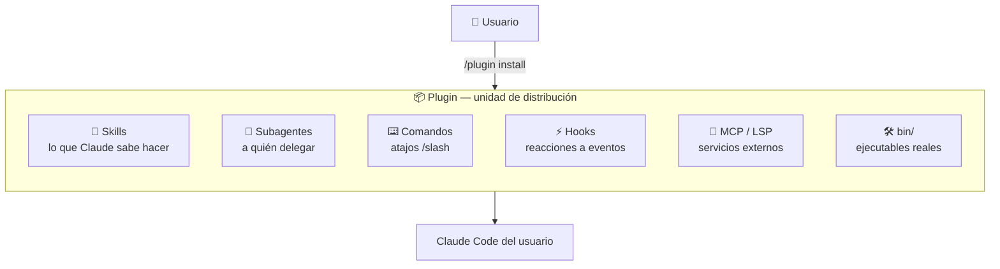
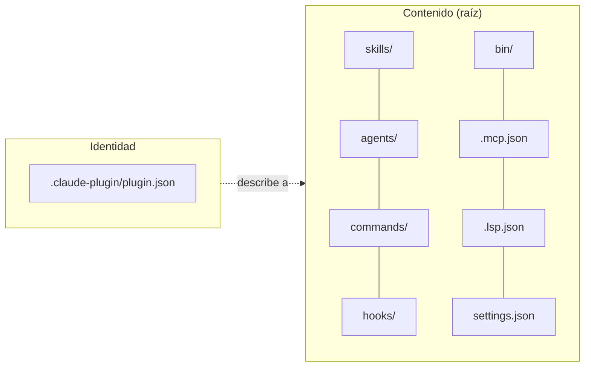
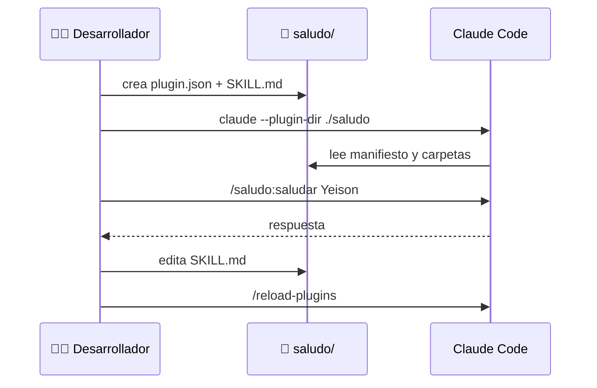
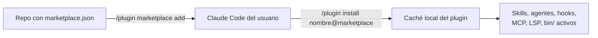

# 📦 Plugins en Claude Code — De cero a experto

> Esta lectura explica **qué es un plugin, cómo se estructura, cómo se construye, cómo se prueba y cómo se distribuye**, desde el primer `plugin.json` hasta marketplaces de equipo, binarios propios y servidores MCP empaquetados.
>
> **Idea central:** un plugin **no define comportamiento por sí mismo**. No es un trabajador (eso es un subagente) ni una capacidad activable (eso es una skill). Es un **paquete distribuible** que agrupa varias de esas piezas —skills, subagentes, hooks, servidores MCP/LSP y ejecutables— para **instalarlas, versionarlas y compartirlas como una sola unidad**.
>
> Por eso, al diseñarlo, la pregunta no es *"¿qué quiero que haga Claude?"*, sino:
>
> **¿Qué conjunto coherente de capacidades, herramientas y servicios quiero poder instalar de una sola vez en cualquier máquina?**

> [!NOTE]
> Los diagramas usan **Mermaid**, que se renderiza en GitHub y en VS Code (vista previa de Markdown o la extensión *Markdown Preview Mermaid Support*).

> [!IMPORTANT]
> Claude Code evoluciona rápido. La estructura y los campos descritos corresponden a la documentación vigente al escribir esta lectura. Ante la duda, consulta la documentación oficial de *plugins* o ejecuta `/plugin` dentro de Claude Code.

---

## 📑 Tabla de contenido

**Nivel 0 — Fundamentos**
1. [¿Qué es un plugin (y qué no es)?](#1-qué-es-un-plugin-y-qué-no-es)
2. [Modelo mental: la escalera del ecosistema](#2-modelo-mental-la-escalera-del-ecosistema)
3. [¿Cuándo conviene crear un plugin?](#3-cuándo-conviene-crear-un-plugin)

**Nivel 1 — Anatomía**
4. [La estructura de un plugin](#4-la-estructura-de-un-plugin)
5. [El manifiesto aislado: `.claude-plugin/plugin.json`](#5-el-manifiesto-aislado-claude-pluginpluginjson)
6. [Capacidades como carpetas de primer nivel](#6-capacidades-como-carpetas-de-primer-nivel)
7. [Namespacing: cómo se nombran las piezas del plugin](#7-namespacing-cómo-se-nombran-las-piezas-del-plugin)

**Nivel 2 — Intermedio**
8. [Tu primer plugin paso a paso](#8-tu-primer-plugin-paso-a-paso)
9. [Hooks a nivel de plugin y `${CLAUDE_PLUGIN_ROOT}`](#9-hooks-a-nivel-de-plugin-y-claude_plugin_root)
10. [Binarios: `bin/` y la extensión del PATH](#10-binarios-bin-y-la-extensión-del-path)
11. [Servidores MCP y LSP empaquetados](#11-servidores-mcp-y-lsp-empaquetados)
12. [Un `settings.json` deliberadamente limitado](#12-un-settingsjson-deliberadamente-limitado)

**Nivel 3 — Avanzado**
13. [Distribución: marketplaces](#13-distribución-marketplaces)
14. [Plugins para todo un equipo](#14-plugins-para-todo-un-equipo)
15. [Versionado, validación y depuración](#15-versionado-validación-y-depuración)
16. [Seguridad: qué instala realmente un plugin](#16-seguridad-qué-instala-realmente-un-plugin)
17. [Recetario: un plugin completo](#17-recetario-un-plugin-completo)

**Cierre**
18. [Errores frecuentes](#18-errores-frecuentes)
19. [Chuleta final](#19-chuleta-final)

---

# Nivel 0 — Fundamentos

## 1. ¿Qué es un plugin (y qué no es)?

Un **plugin** es un directorio con un manifiesto (`plugin.json`) y un conjunto de piezas que Claude Code sabe cargar: skills, subagentes, comandos, hooks, servidores MCP, servidores LSP y ejecutables.

| Un plugin **es** | Un plugin **no es** |
|---|---|
| Un paquete instalable y versionable | Un agente con su propio contexto |
| Una forma de compartir configuración entre máquinas y personas | Una instrucción que Claude sigue por sí sola |
| Un contenedor de piezas que *sí* definen comportamiento | Un mecanismo para cambiar los ajustes globales del usuario |
| Algo que se activa/desactiva como una unidad | Un sustituto de `CLAUDE.md` |

> 💡 **Analogía:** si las skills y los subagentes son *librerías de código*, el plugin es el **paquete npm** que las publica: tiene manifiesto, versión, contenido y documentación.

## 2. Modelo mental: la escalera del ecosistema



- **Subagente** → *alguien* a quien delegar una tarea.
- **Skill** → *algo* que Claude sabe hacer cuando toca.
- **Hook** → *algo que pasa* automáticamente ante un evento.
- **MCP** → *un servicio* con el que Claude puede hablar.
- **Plugin** → **la caja** donde metes varias de esas piezas para que viajen juntas.

## 3. ¿Cuándo conviene crear un plugin?

| Situación | ¿Plugin? | Alternativa |
|---|---|---|
| Una skill que solo usas tú en un proyecto | ❌ | `.claude/skills/` del proyecto |
| Un conjunto de skills + subagentes + hooks que repites en varios repos | ✅ | — |
| Herramientas internas que todo el equipo debe tener igual | ✅ | — |
| Integrar un MCP que exige configuración manual en cada máquina | ✅ | `.mcp.json` del proyecto (si es solo uno) |
| Ajustar permisos o el modelo por defecto | ❌ | `settings.json` del usuario/proyecto |
| Reglas de estilo del repo | ❌ | `CLAUDE.md` |

> **Regla práctica:** empieza con configuración suelta en `.claude/`. Cuando te sorprendas **copiando la misma carpeta de un repo a otro**, es momento de convertirla en plugin.

---

# Nivel 1 — Anatomía

## 4. La estructura de un plugin

```text
mi-plugin/
├── .claude-plugin/
│   └── plugin.json       # SOLO el manifiesto vive aquí
├── skills/               # En la RAÍZ, no dentro de .claude-plugin/
│   └── revisar-pr/
│       └── SKILL.md
├── agents/
│   └── auditor.md
├── commands/
│   └── release.md
├── hooks/
│   └── hooks.json
├── bin/                  # Ejecutables añadidos al PATH
│   └── mi-cli
├── .mcp.json             # Servidores MCP
├── .lsp.json             # Servidores LSP
├── settings.json         # Solo admite el campo "agent"
└── README.md
```

Lo primero que llama la atención: **el manifiesto vive aislado** en `.claude-plugin/`, mientras que **todo lo que el plugin aporta** está en la raíz. Ese reparto no es estético: es como Claude Code separa **la identidad del paquete** de **lo que el paquete contiene**.



> Todas las carpetas son **opcionales**. Un plugin válido puede contener solo el manifiesto y una skill.

## 5. El manifiesto aislado: `.claude-plugin/plugin.json`

`plugin.json` es el **único habitante legítimo** de `.claude-plugin/`. Declara los metadatos que Claude Code necesita para reconocer el plugin como unidad instalable.

### Manifiesto mínimo

```json
{
  "name": "herramientas-equipo"
}
```

### Manifiesto completo

```json
{
  "name": "herramientas-equipo",
  "version": "1.2.0",
  "description": "Skills, agentes y hooks estándar del equipo de backend",
  "author": {
    "name": "Equipo Backend",
    "url": "https://github.com/mi-org"
  },
  "homepage": "https://github.com/mi-org/herramientas-equipo",
  "repository": "https://github.com/mi-org/herramientas-equipo",
  "license": "MIT",
  "keywords": ["backend", "revisión", "release"]
}
```

| Campo | Obligatorio | Para qué sirve |
|---|---|---|
| `name` | ✅ | Identificador único en *kebab-case*. Se usa como **namespace** de las piezas. |
| `version` | Recomendado | Versión semántica. Controla cuándo los usuarios reciben actualizaciones. |
| `description` | Recomendado | Lo que se ve al explorar el plugin en `/plugin`. |
| `author`, `homepage`, `repository`, `license`, `keywords` | ❌ | Metadatos de descubrimiento y atribución. |

### Rutas personalizadas (opcional)

Si no quieres usar las carpetas por defecto, el manifiesto puede apuntar a otras rutas (siempre **relativas** y empezando por `./`). Estas rutas **complementan** las carpetas por defecto, no las reemplazan:

```json
{
  "name": "herramientas-equipo",
  "commands": ["./extra/comandos/"],
  "agents": "./custom/agentes/",
  "hooks": "./config/hooks.json",
  "mcpServers": "./config/mcp.json"
}
```

> ⚠️ **Regla de oro:** **nada más** vive dentro de `.claude-plugin/`. Si metes ahí `skills/`, `agents/` o `hooks/`, Claude Code **no los detectará**. Es exactamente la misma lógica que un `package.json`: por un lado el manifiesto, por otro el contenido.

## 6. Capacidades como carpetas de primer nivel

| Carpeta / archivo | Contiene | Formato |
|---|---|---|
| `skills/<nombre>/SKILL.md` | Skills que el plugin aporta | Igual que una skill suelta (frontmatter + instrucciones + archivos de soporte) |
| `agents/<nombre>.md` | Subagentes | Igual que en `.claude/agents/` (frontmatter + system prompt) |
| `commands/<nombre>.md` | Comandos slash | Markdown con frontmatter opcional. Para contenido nuevo se prefieren **skills** |
| `hooks/hooks.json` | Hooks del ciclo de vida | Mismo esquema que la clave `hooks` de `settings.json` |
| `.mcp.json` | Servidores MCP | Mismo esquema que el `.mcp.json` de un proyecto |
| `.lsp.json` | Servidores LSP | Configuración de servidores de lenguaje |
| `bin/` | Ejecutables | Se añaden al PATH mientras el plugin está habilitado |

La gran ventaja: **no hay formato nuevo que aprender**. Una skill dentro de un plugin es idéntica a una skill suelta; lo único que cambia es que **viaja y se instala junto con el plugin**.

> 🧭 Que estas carpetas estén en la raíz y no dentro de `.claude-plugin/` es **la causa número uno de errores** al crear un plugin desde cero. Es tentador meterlo todo "dentro del paquete"; es exactamente lo que **no** hay que hacer.

## 7. Namespacing: cómo se nombran las piezas del plugin

Para evitar colisiones entre plugins, las piezas se exponen con el **nombre del plugin como prefijo**:

| Pieza | Suelta en `.claude/` | Dentro del plugin `herramientas-equipo` |
|---|---|---|
| Skill `revisar-pr` | `/revisar-pr` | `/herramientas-equipo:revisar-pr` |
| Comando `release` | `/release` | `/herramientas-equipo:release` |
| Subagente `auditor` | `auditor` | `herramientas-equipo:auditor` |

Consecuencias prácticas:

- Dos plugins pueden tener una skill llamada `revisar-pr` sin pisarse.
- Elige un `name` de plugin **corto y descriptivo**: lo vas a escribir a menudo.
- Cambiar el `name` del plugin **rompe** todas las invocaciones existentes; trátalo como una API pública.

---

# Nivel 2 — Intermedio

## 8. Tu primer plugin paso a paso

### Paso 1 — Crear la estructura

```bash
mkdir -p saludo/.claude-plugin saludo/skills/saludar
```

### Paso 2 — Manifiesto

`saludo/.claude-plugin/plugin.json`

```json
{
  "name": "saludo",
  "version": "0.1.0",
  "description": "Plugin de ejemplo con una skill de saludo"
}
```

### Paso 3 — Una skill

`saludo/skills/saludar/SKILL.md`

```markdown
---
name: saludar
description: Saluda al usuario de forma personalizada. Úsala cuando pida un saludo.
argument-hint: "[nombre]"
---

Saluda con entusiasmo a $ARGUMENTS y dile qué día es hoy.
Si no se pasa un nombre, saluda al equipo.
```

### Paso 4 — Probarlo en local, sin instalar

```bash
claude --plugin-dir ./saludo
```

Dentro de la sesión:

```text
/saludo:saludar Yeison
```

### Paso 5 — Iterar

Edita los archivos y ejecuta `/reload-plugins` para recargar sin reiniciar la sesión.



## 9. Hooks a nivel de plugin y `${CLAUDE_PLUGIN_ROOT}`

Los hooks declarados en `hooks/hooks.json` se registran **mientras el plugin esté habilitado**, para toda la sesión: no dependen de una skill ni de un subagente concreto.

`hooks/hooks.json`

```json
{
  "hooks": {
    "PostToolUse": [
      {
        "matcher": "Write|Edit",
        "hooks": [
          {
            "type": "command",
            "command": "${CLAUDE_PLUGIN_ROOT}/scripts/formatear.sh"
          }
        ]
      }
    ]
  }
}
```

### ¿Por qué `${CLAUDE_PLUGIN_ROOT}`?

Cuando un usuario instala un plugin, Claude Code **lo copia a una caché local**; no sabes en qué ruta terminará. Esta variable resuelve la ruta absoluta del plugin instalado y está disponible en hooks, configuraciones MCP/LSP y scripts.

| Variable | Apunta a | Úsala para |
|---|---|---|
| `${CLAUDE_PLUGIN_ROOT}` | Directorio de instalación del plugin | Referenciar scripts, configs y recursos propios |
| `${CLAUDE_PLUGIN_DATA}` | Directorio persistente del plugin | Datos que deben sobrevivir a actualizaciones (cachés, estado) |

> ⚠️ Como el plugin se copia, **las rutas que salen de su carpeta** (`../compartido/script.sh`) **no funcionan** tras la instalación. Todo lo que el plugin necesite debe estar dentro de él.

## 10. Binarios: `bin/` y la extensión del PATH

Aquí aparece lo que convierte al plugin en algo mucho más potente que una colección de skills. Los ejecutables que pongas en `bin/` se **añaden al PATH** de la herramienta Bash mientras el plugin está habilitado. Cualquier skill, subagente o hook del plugin puede llamarlos **por su nombre**, como si fueran comandos del sistema.

`bin/validar-migracion`

```bash
#!/usr/bin/env bash
# Valida que las migraciones SQL tengan script de reversa
set -euo pipefail
for f in migrations/*.up.sql; do
  down="${f%.up.sql}.down.sql"
  [[ -f "$down" ]] || { echo "❌ Falta $down"; exit 1; }
done
echo "✅ Todas las migraciones tienen reversa"
```

Y la skill simplemente lo usa:

```markdown
---
name: revisar-migraciones
description: Revisa las migraciones SQL del proyecto antes de un release.
allowed-tools: Bash(validar-migracion)
---

1. Ejecuta `validar-migracion`.
2. Si falla, explica qué archivo falta y propone su contenido.
```

| Sin `bin/` | Con `bin/` |
|---|---|
| "Te doy instrucciones para que Claude haga X" | "Te doy las instrucciones **y el ejecutable** que las hace posibles" |
| Cada usuario instala la herramienta a mano | La herramienta llega con el plugin |
| Las skills deben adivinar si el comando existe | Las skills pueden **asumir** que existe |

> 💡 Recuerda: en Windows/macOS/Linux el ejecutable debe tener permisos de ejecución y un *shebang* válido. Si tu herramienta es Node o Python, el binario puede ser un pequeño *wrapper* que llame al script con `${CLAUDE_PLUGIN_ROOT}`.

## 11. Servidores MCP y LSP empaquetados

`.mcp.json` y `.lsp.json` en la raíz permiten que el plugin **traiga consigo sus propios servicios**. Al habilitar el plugin, se registran automáticamente y quedan disponibles para sus skills, subagentes y comandos.

`.mcp.json`

```json
{
  "mcpServers": {
    "tickets": {
      "command": "${CLAUDE_PLUGIN_ROOT}/servers/tickets-mcp",
      "args": ["--modo", "lectura"],
      "env": {
        "TICKETS_API_URL": "https://tickets.mi-org.com"
      }
    }
  }
}
```

`.lsp.json`

```json
{
  "csharp": {
    "command": "csharp-ls",
    "extensionToLanguage": {
      ".cs": "csharp"
    }
  }
}
```

| Antes | Con plugins |
|---|---|
| Configurar el MCP a mano en cada máquina | El MCP viaja dentro del paquete y se auto-configura |
| Documentar "instala este LSP y configúralo así" | El LSP queda declarado y listo |
| Las skills dependen de algo que quizá no existe | Las skills dependen de algo que **el mismo plugin** garantiza |

> ⚠️ El plugin declara **cómo arrancar** el servidor, pero el binario del LSP (por ejemplo `csharp-ls`) o las credenciales del MCP pueden seguir siendo responsabilidad del usuario. Documéntalo en el README.

## 12. Un `settings.json` deliberadamente limitado

Dentro de un plugin, `settings.json` existe pero **solo admite el campo `agent`**:

```json
{
  "agent": "auditor"
}
```

Ese campo activa uno de los subagentes del propio plugin como **agente del hilo principal** cuando el plugin está habilitado, es decir, cambia "quién" responde por defecto.

¿Por qué tan limitado? Porque **un plugin debe aportar capacidades, no imponer preferencias**. No puede tocar tus permisos, tu modelo, tus variables de entorno ni tus hooks globales vía `settings.json`. Es una decisión de diseño que protege al usuario frente a plugins invasivos.

---

# Nivel 3 — Avanzado

## 13. Distribución: marketplaces

Un **marketplace** es un catálogo de plugins: un repositorio (o carpeta) con un archivo `.claude-plugin/marketplace.json` que lista qué plugins ofrece y dónde están.

```text
mi-marketplace/
├── .claude-plugin/
│   └── marketplace.json
└── plugins/
    ├── herramientas-equipo/
    └── saludo/
```

`.claude-plugin/marketplace.json`

```json
{
  "name": "mi-org-plugins",
  "owner": { "name": "Equipo Plataforma" },
  "plugins": [
    {
      "name": "herramientas-equipo",
      "source": "./plugins/herramientas-equipo",
      "description": "Estándares del equipo backend"
    },
    {
      "name": "saludo",
      "source": "./plugins/saludo"
    },
    {
      "name": "plugin-externo",
      "source": { "source": "github", "repo": "otra-org/plugin-externo" }
    }
  ]
}
```

### Flujo del usuario

```text
/plugin marketplace add mi-org/mi-marketplace      # registra el catálogo (repo de GitHub, URL git o ruta local)
/plugin install herramientas-equipo@mi-org-plugins # instala un plugin del catálogo
/plugin                                            # gestor interactivo: explorar, habilitar, deshabilitar, desinstalar
```



## 14. Plugins para todo un equipo

Para que cualquiera que clone el repo reciba los mismos plugins, decláralos en el `.claude/settings.json` **del proyecto** (versionado en git):

```json
{
  "extraKnownMarketplaces": {
    "mi-org-plugins": {
      "source": { "source": "github", "repo": "mi-org/mi-marketplace" }
    }
  },
  "enabledPlugins": {
    "herramientas-equipo@mi-org-plugins": true
  }
}
```

Cuando un compañero confía en la carpeta del proyecto, Claude Code le propone instalar el marketplace y los plugins declarados.

| Ámbito de instalación | Dónde se guarda | Quién lo recibe |
|---|---|---|
| Usuario | `~/.claude/settings.json` | Tú, en todos tus proyectos |
| Proyecto | `.claude/settings.json` (en git) | Todo el equipo en ese repo |
| Local | `.claude/settings.local.json` | Tú, solo en ese repo |
| Administrado | Políticas de la organización | Toda la organización |

## 15. Versionado, validación y depuración

### Versionado

- Usa **SemVer** en `version`: `MAJOR` si cambias nombres de skills/agentes o rompes el comportamiento, `MINOR` para capacidades nuevas, `PATCH` para correcciones.
- Si cambias el código pero **no** subes la versión, los usuarios pueden seguir viendo la copia en caché.
- Mantén un `CHANGELOG.md` junto al README.

### Validación

```bash
claude plugin validate ./mi-plugin
```

Comprueba el JSON del manifiesto, las rutas y la estructura antes de publicar.

### Depuración

| Síntoma | Revisa |
|---|---|
| La skill no aparece | ¿Está `skills/` en la raíz y no dentro de `.claude-plugin/`? |
| El hook no se ejecuta | ¿Usaste `${CLAUDE_PLUGIN_ROOT}`? ¿El script tiene permisos de ejecución? |
| El MCP no arranca | Revisa `/mcp` y ejecuta `claude --debug` para ver errores de carga |
| Los cambios no se reflejan | `/reload-plugins` en local; subir `version` si está instalado desde marketplace |
| Comando no encontrado en `bin/` | ¿Está el plugin habilitado? ¿El archivo es ejecutable? |

## 16. Seguridad: qué instala realmente un plugin

Instalar un plugin es **instalar código que se ejecuta en tu máquina**: hooks que corren comandos, binarios en el PATH y servidores MCP con acceso a red y archivos.

Antes de instalar uno de terceros:

1. **Lee** `hooks/hooks.json`, `.mcp.json` y el contenido de `bin/`.
2. Desconfía de hooks en eventos amplios (`PreToolUse` sin `matcher`, `SessionStart`) que ejecuten scripts opacos.
3. Prefiere marketplaces de tu organización o de fuentes que conozcas.
4. Fija versiones en entornos de equipo y revisa los cambios al actualizar.

Al **publicar** uno:

- No incluyas secretos en `.mcp.json`; usa variables de entorno que el usuario define.
- Restringe las herramientas de cada skill con `allowed-tools`.
- Documenta en el README **todo** lo que el plugin añade al entorno.

## 17. Recetario: un plugin completo

Plugin `dotnet-equipo` para un equipo .NET 6 + SQL:

```text
dotnet-equipo/
├── .claude-plugin/
│   └── plugin.json
├── skills/
│   ├── revisar-migraciones/SKILL.md
│   └── crear-endpoint/
│       ├── SKILL.md
│       └── plantillas/controller.cs.tmpl
├── agents/
│   └── revisor-sql.md
├── hooks/
│   └── hooks.json
├── scripts/
│   └── dotnet-format.sh
├── bin/
│   └── validar-migracion
├── .mcp.json
├── .lsp.json
└── README.md
```

`agents/revisor-sql.md`

```markdown
---
name: revisor-sql
description: Revisa consultas y migraciones SQL buscando problemas de rendimiento y seguridad. Úsalo proactivamente tras cambios en archivos .sql.
tools: Read, Grep, Glob, Bash
model: sonnet
---

Eres un DBA senior. Revisa índices faltantes, SELECT *, inyección SQL
y migraciones sin script de reversa (usa `validar-migracion`).
Devuelve una lista priorizada de hallazgos.
```

`hooks/hooks.json`

```json
{
  "hooks": {
    "PostToolUse": [
      {
        "matcher": "Write|Edit",
        "hooks": [
          { "type": "command", "command": "${CLAUDE_PLUGIN_ROOT}/scripts/dotnet-format.sh" }
        ]
      }
    ]
  }
}
```

`README.md` (fragmento)

```markdown
# dotnet-equipo

## Qué añade
- Skills: `/dotnet-equipo:revisar-migraciones`, `/dotnet-equipo:crear-endpoint`
- Subagente: `dotnet-equipo:revisor-sql`
- Hook: formatea archivos .cs tras cada edición
- Binario: `validar-migracion`
- MCP: `tickets` (requiere la variable `TICKETS_TOKEN`)
- LSP: C# (requiere `csharp-ls` instalado)

## Instalación
/plugin marketplace add mi-org/mi-marketplace
/plugin install dotnet-equipo@mi-org-plugins
```

---

# Cierre

## 18. Errores frecuentes

| ❌ Error | ✅ Corrección |
|---|---|
| Poner `skills/`, `agents/` o `hooks/` dentro de `.claude-plugin/` | Solo `plugin.json` (y `marketplace.json` en un marketplace) va ahí |
| Rutas absolutas o `../` en hooks y MCP | Usar `${CLAUDE_PLUGIN_ROOT}` y mantener todo dentro del plugin |
| Intentar cambiar permisos o modelo con el `settings.json` del plugin | Solo admite `agent`; lo demás va en la configuración del usuario/proyecto |
| Invocar `/revisar-pr` en vez de `/mi-plugin:revisar-pr` | Recordar el namespace |
| Olvidar subir `version` | Los usuarios siguen con la copia en caché |
| Plugin sin README | Nadie sabrá qué instaló ni qué dependencias necesita |
| Meter secretos en `.mcp.json` | Variables de entorno definidas por el usuario |
| Crear un plugin para una sola skill de un solo repo | Dejarla en `.claude/skills/` hasta que necesite viajar |

## 19. Chuleta final

```text
ESTRUCTURA
  .claude-plugin/plugin.json   → identidad (solo esto aquí)
  skills/ agents/ commands/    → capacidades (en la raíz)
  hooks/hooks.json             → hooks del plugin
  bin/                         → ejecutables en el PATH
  .mcp.json / .lsp.json        → servicios empaquetados
  settings.json                → solo "agent"
  README.md                    → qué añade y cómo usarlo

DESARROLLO
  claude --plugin-dir ./mi-plugin   → probar sin instalar
  /reload-plugins                   → recargar cambios
  claude plugin validate ./mi-plugin→ validar antes de publicar

DISTRIBUCIÓN
  /plugin marketplace add org/repo  → registrar catálogo
  /plugin install nombre@catalogo   → instalar
  /plugin                           → gestionar

VARIABLES
  ${CLAUDE_PLUGIN_ROOT}  → ruta del plugin instalado
  ${CLAUDE_PLUGIN_DATA}  → datos persistentes del plugin

INVOCACIÓN
  /nombre-plugin:skill    nombre-plugin:subagente
```

> 🎯 **La clave conceptual:** un plugin es una **unidad de distribución, no de comportamiento**. No dice cómo se comporta Claude: **agrupa, nombra, distribuye y conecta** las piezas que sí lo hacen. Cuando diseñes uno, pregúntate: *¿qué conjunto coherente de capacidades, herramientas y servicios quiero poder instalar de una sola vez en cualquier máquina?* Todo lo demás en la estructura está al servicio de esa pregunta.
