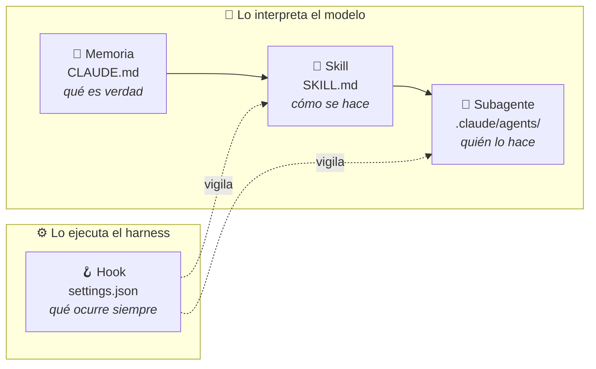
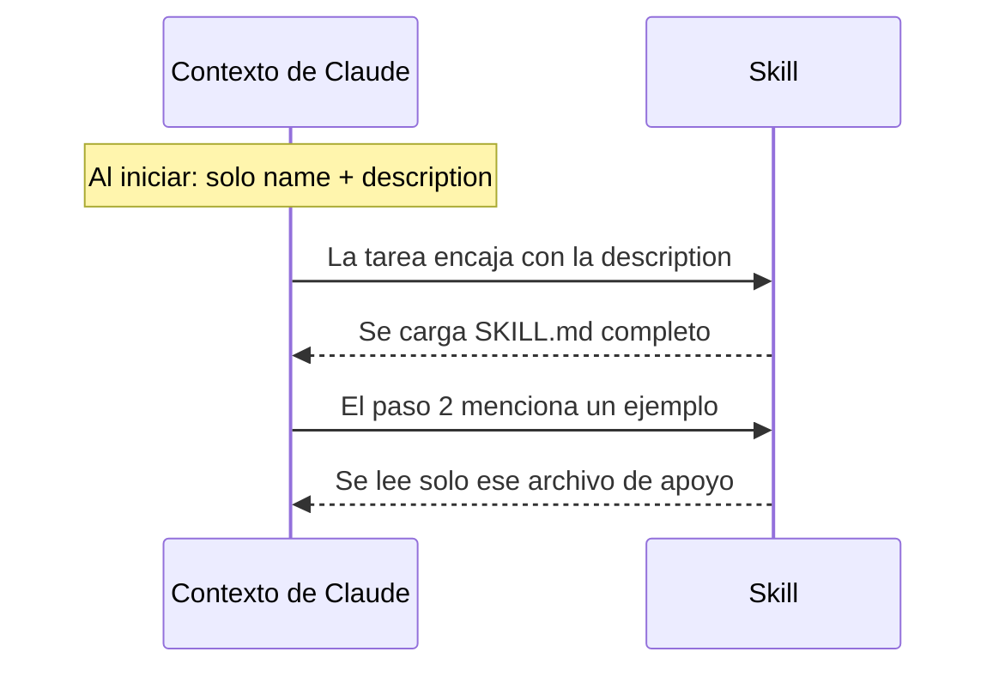
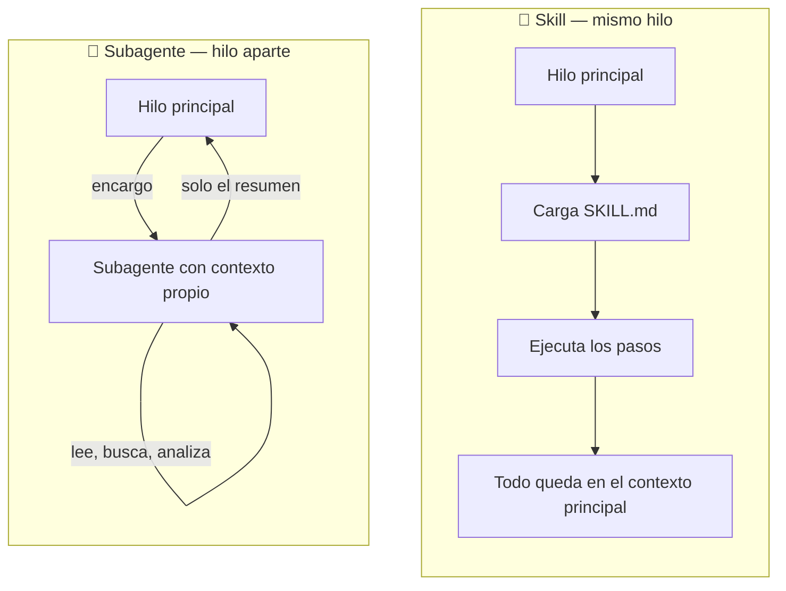
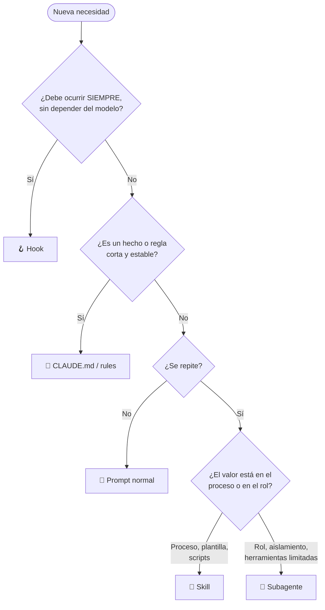
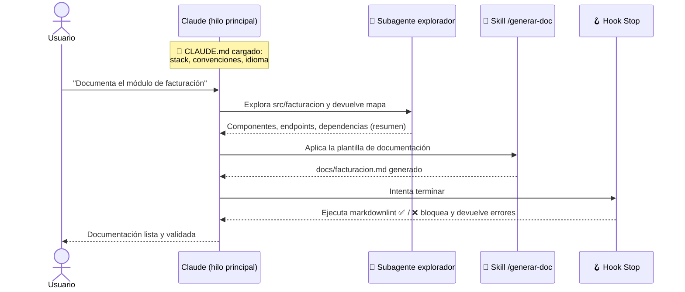

# 🧩 Skills vs Subagentes vs Memoria vs Hooks

> A medida que trabajas más con Claude Code, llega un momento en que deja de ser solo *"un asistente que responde prompts"* y empieza a parecerse a un **sistema de trabajo**. Ahí entran cuatro piezas que conviene diferenciar bien: **memoria (`CLAUDE.md`)**, **skills**, **subagentes** y **hooks**. Anthropic los presenta como mecanismos distintos para organizar **comportamiento**, **contexto** y **automatización** dentro de Claude Code.
>
> **Idea central:** la memoria dice **qué es verdad** en el proyecto, una skill dice **cómo se hace** algo, un subagente dice **quién lo hace**, y un hook dice **qué ocurre siempre**, decida lo que decida el modelo.

> [!NOTE]
> Los diagramas usan **Mermaid**, que se renderiza en GitHub y en VS Code (con la vista previa de Markdown o la extensión *Markdown Preview Mermaid Support*).

> [!IMPORTANT]
> Claude Code evoluciona rápido. Los nombres de campos, eventos y rutas aquí descritos corresponden a la documentación vigente al escribir esta lectura. Ante la duda, consulta `/memory`, `/agents`, `/hooks` y `/skills` dentro de Claude Code o la documentación oficial.

---

## 📑 Tabla de contenido

1. [El problema: "¿esto dónde va?"](#1-el-problema-esto-dónde-va)
2. [El mapa mental: cada pieza resuelve una necesidad distinta](#2-el-mapa-mental-cada-pieza-resuelve-una-necesidad-distinta)
3. [Memoria (`CLAUDE.md`): el contexto persistente](#3-memoria-claudemd-el-contexto-persistente)
4. [Skills: el método reutilizable](#4-skills-el-método-reutilizable)
5. [Subagentes: el especialista al que delegas](#5-subagentes-el-especialista-al-que-delegas)
6. [Hooks: la automatización determinista](#6-hooks-la-automatización-determinista)
7. [Skill vs subagente: la diferencia de fondo](#7-skill-vs-subagente-la-diferencia-de-fondo)
8. [Tabla comparativa de las cuatro piezas](#8-tabla-comparativa-de-las-cuatro-piezas)
9. [Cuándo NO crear cada pieza](#9-cuándo-no-crear-cada-pieza)
10. [Marco de decisión en 6 preguntas](#10-marco-de-decisión-en-6-preguntas)
11. [Combinarlas: el patrón completo](#11-combinarlas-el-patrón-completo)
12. [Antipatrones frecuentes](#12-antipatrones-frecuentes)
13. [Ejercicios de clasificación](#13-ejercicios-de-clasificación)
14. [Regla final para no equivocarte](#14-regla-final-para-no-equivocarte)

---

## 1. El problema: "¿esto dónde va?"

Mucha gente entiende rápido para qué sirve `CLAUDE.md`, pero duda con preguntas como:

- *"¿Esto debería ser una skill o un subagente?"*
- *"¿Lo pongo en `CLAUDE.md` o en un hook?"*
- *"Si ya tengo un subagente revisor, ¿para qué quiero una skill de revisión?"*

Son decisiones importantes porque, aunque todas **especializan** a Claude, lo hacen en capas diferentes:

| Pieza | Especializa... | Pregunta que responde |
|-------|----------------|------------------------|
| **Memoria** | El **conocimiento base** | ¿Qué debe saber Claude siempre sobre este proyecto? |
| **Skill** | El **método** | ¿Cómo quiero que se haga esta tarea? |
| **Subagente** | El **ejecutor** | ¿Quién debe hacer este trabajo, y con qué contexto y herramientas? |
| **Hook** | El **flujo** | ¿Qué debe pasar obligatoriamente en este punto del ciclo? |

---

## 2. El mapa mental: cada pieza resuelve una necesidad distinta

- **`CLAUDE.md` (memoria):** reglas y contexto persistente del proyecto. Se carga siempre.
- **Skill:** una receta reutilizable, expresada como instrucciones, ejemplos, plantillas o scripts. Se carga **cuando hace falta**.
- **Subagente:** un agente especializado al que Claude puede **delegar** una tarea concreta, con su propia ventana de contexto.
- **Hook:** una automatización **determinista** que se ejecuta sí o sí en un punto del flujo. No depende del modelo.

Dicho de forma simple:

- Si quieres que Claude **sepa** algo siempre → **memoria**.
- Si quieres que Claude **sepa cómo hacer** algo de una forma concreta → **skill**.
- Si quieres que Claude **delegue** una tarea especializada a otro agente → **subagente**.
- Si quieres que una acción **ocurra siempre**, sin depender de la decisión del modelo → **hook**.



> [!TIP]
> La frontera más importante no es entre skill y subagente, sino entre **lo que el modelo decide** (memoria, skills, subagentes) y **lo que el sistema garantiza** (hooks). Si algo *no puede* fallar, no lo dejes en manos del modelo.

---

## 3. Memoria (`CLAUDE.md`): el contexto persistente

La memoria es el conjunto de archivos que Claude Code **carga automáticamente al iniciar cada sesión**. Es la base sobre la que trabajan todas las demás piezas: skills y subagentes se apoyan en lo que la memoria ya establece.

### Dónde vive

| Nivel | Ubicación | Para qué |
|-------|-----------|----------|
| Usuario | `~/.claude/CLAUDE.md` | Preferencias personales en todos tus proyectos (idioma, estilo de commits…) |
| Proyecto | `./CLAUDE.md` o `./.claude/CLAUDE.md` | Reglas del equipo, versionadas en git |
| Local | `./CLAUDE.local.md` | Ajustes personales del proyecto, fuera de git |
| Reglas modulares | `./.claude/rules/*.md` | Reglas separadas por tema; pueden limitarse a rutas con `paths` |
| Auto memory | `~/.claude/projects/<proyecto>/memory/` | Lo que Claude aprende y anota por sí mismo entre sesiones |

### Qué SÍ debe ir en memoria

- Hechos del proyecto: stack, versiones, comandos de build y test.
- Convenciones estables: nomenclatura, estructura de carpetas, formato de commits.
- Preferencias cortas: *"usa async/await"*, *"responde en español"*.
- Punteros: *"la arquitectura está en `@docs/arquitectura.md`"*.

### Ejemplo

```markdown
# Proyecto: API de facturación

## Stack
- .NET 6, SQL Server, xUnit

## Comandos
- Build: `dotnet build`
- Tests: `dotnet test`

## Convenciones
- Commits: `HD-{NUMERO} - {DESCRIPCION}`
- Nunca modificar migraciones ya aplicadas
```

### Señal de que algo ya no es memoria

Cuando una sección de `CLAUDE.md` deja de ser **una regla** y se convierte en **un proceso largo** (20 pasos, plantillas, condiciones, ejemplos extensos), probablemente es una **skill**. Mantener `CLAUDE.md` corto importa porque **se carga en cada conversación** y consume contexto aunque la tarea no lo necesite.

> [!WARNING]
> La memoria es una **instrucción**, no una garantía. *"Ejecuta siempre los tests"* en `CLAUDE.md` funciona casi siempre, pero el modelo puede olvidarlo o priorizar otra cosa. Si debe ocurrir el 100 % de las veces, necesitas un **hook**.

---

## 4. Skills: el método reutilizable

Las skills son **unidades reutilizables de comportamiento**. Según la documentación oficial, extienden a Claude con instrucciones, recursos auxiliares y lógica de uso para tareas específicas. Pueden incluir `SKILL.md`, ejemplos, plantillas, scripts y otros archivos de apoyo. Claude puede invocarlas **automáticamente** si su `description` encaja con la tarea, o **manualmente** mediante `/nombre-de-skill`.

Una skill tiene sentido cuando el problema principal no es *"quién hace el trabajo"*, sino **cómo quieres que se haga**.

### Anatomía

```text
.claude/skills/generar-prd/
├── SKILL.md            ← instrucciones + frontmatter (obligatorio)
├── plantilla.md        ← recurso de apoyo
├── ejemplos/
│   └── prd-ejemplo.md
└── scripts/
    └── validar.py      ← script que la skill puede ejecutar
```

```markdown
---
name: generar-prd
description: Genera un PRD con la plantilla del equipo. Úsala cuando el usuario pida un PRD, especificación de producto o documento de requisitos.
allowed-tools: Read, Write, Bash(python *)
---

# Generar PRD

1. Lee `plantilla.md` y respeta todas sus secciones.
2. Revisa `ejemplos/prd-ejemplo.md` para el nivel de detalle esperado.
3. Rellena cada apartado; marca como `[PENDIENTE]` lo que no se pueda inferir.
4. Ejecuta `python scripts/validar.py <archivo>` y corrige los errores.
```

### Carga progresiva (por qué no inflan el contexto)



Al inicio, Claude solo conoce el **nombre y la descripción** de cada skill. El contenido completo se carga **cuando la tarea lo pide**, y los archivos de apoyo solo si se usan. Por eso puedes tener muchas skills sin pagar su costo en cada conversación, al contrario que con `CLAUDE.md`.

### Señales claras de que necesitas una skill

1. **Repites la misma receta una y otra vez.** Si cada semana escribes *"primero analiza, luego resume, luego conviértelo a formato X y luego valida Y"*, ya tienes una skill esperando nacer. Anthropic recomienda usar skills precisamente para encapsular *playbooks* y procedimientos repetibles.
2. **Una parte de `CLAUDE.md` ya no es una regla, sino un proceso largo.** `CLAUDE.md` debería contener hechos y preferencias persistentes; los flujos largos con plantillas y condiciones encajan mejor como skill.
3. **Quieres empaquetar instrucciones + ejemplos + scripts.** Una skill puede incluir materiales de referencia, salidas de ejemplo y scripts ejecutables.
4. **Quieres una salida con formato o estándar de calidad fijo.** Por ejemplo: posts de LinkedIn, PRDs, auditorías de automatizaciones, revisión de APIs con checklist, changelogs, documentación de incidentes.
5. **Quieres que el comportamiento solo se cargue cuando sea necesario**, en vez de inflar el contexto general de todas las conversaciones.

### Ejemplos donde una skill encaja muy bien

| Skill | Qué empaqueta |
|-------|---------------|
| `/crear-post-linkedin` | Plantilla, ejemplos, ajuste de tono, varias versiones |
| `/auditar-workflow-n8n` | Checklist de robustez, nomenclatura, logs, fallos, mantenibilidad |
| `/generar-prd` | Estructura fija, apartados obligatorios, validación de ambigüedades |
| `/review-api` | Naming, errores, autenticación, consistencia y DX |
| `/crear-commit` | Convención de prefijos (`HD-`, `DESARROLLO-HD-`, `INTERNO-TAREA-`) y sufijo de ajuste |

En todos estos casos, el valor está en el **playbook**. Claude necesita un buen marco, no otro agente distinto.

---

## 5. Subagentes: el especialista al que delegas

Los subagentes son **agentes especializados a los que Claude delega trabajo**. Claude Code incluye subagentes integrados —como **Explore**, **Plan** y uno de **propósito general**— y permite crear subagentes personalizados. Claude usa la `description` del subagente para decidir cuándo delegar.

La clave es que un subagente **no es solo "más instrucciones"**. Es otra unidad de trabajo, con:

- su **propia ventana de contexto** (no ve la conversación principal, solo el encargo);
- su propio **system prompt** (el cuerpo del archivo);
- sus propias **herramientas** y, opcionalmente, su propio **modelo**;
- y devuelve **solo el resultado** al hilo principal.

Por ejemplo, **Explore** está optimizado para búsqueda y análisis de código, usa un modelo rápido y tiene acceso **solo de lectura**.

### Anatomía

```markdown
---
name: revisor-seguridad
description: Revisa cambios en busca de vulnerabilidades. Úsalo proactivamente tras modificar código de autenticación, endpoints o dependencias.
tools: Read, Grep, Glob, Bash(git diff *)
model: sonnet
---

Eres un revisor de seguridad senior. Tu trabajo es:
1. Inspeccionar el diff actual.
2. Buscar secretos, inyecciones, validaciones ausentes y dependencias vulnerables.
3. Devolver una lista priorizada: severidad, archivo:línea, riesgo y corrección sugerida.

Nunca modifiques archivos: solo informa.
```

Ubicación: `.claude/agents/revisor-seguridad.md` (proyecto) o `~/.claude/agents/` (usuario).

### Señales claras de que necesitas un subagente

1. **Quieres separar el trabajo especializado del hilo principal.** Si la tarea requiere mucha exploración o análisis intermedio, el subagente lee 40 archivos y devuelve 10 líneas de conclusión: tu contexto principal queda limpio.
2. **La tarea es más "rol especializado" que "receta de formato".** Explorador de código, revisor de seguridad, analista de rendimiento, arquitecto de planificación, investigador del repo.
3. **Quieres limitar o especializar herramientas.** Un revisor que *no puede* escribir archivos es una restricción real de configuración, no una petición en el prompt.
4. **Necesitas dividir una tarea grande y delegar piezas,** incluso en **paralelo**: *"revisa seguridad, rendimiento y tests de estos cambios"* puede lanzar tres especialistas a la vez.
5. **Quieres un *worker* reutilizable para una categoría de tareas.** Una skill te da un procedimiento; un subagente te da un especialista.

### Ejemplos donde un subagente encaja muy bien

| Subagente | Rol |
|-----------|-----|
| Seguridad | Inspecciona cambios, dependencias, secretos, validaciones y superficies de ataque |
| Exploración | Busca archivos, entiende la arquitectura y devuelve un mapa del repo |
| Planificación | Propone la estrategia de implementación antes de tocar código |
| Rendimiento | Detecta cuellos de botella, queries caras, loops innecesarios y oportunidades de caché |

Aquí el valor está en la **delegación a una especialidad**, no en una plantilla de salida.

> [!NOTE]
> Un subagente **no hereda** el historial de la conversación. Lo que no esté en el encargo, en su prompt, en `CLAUDE.md` o en las skills que tenga disponibles, no lo sabe. Escribe encargos completos.

---

## 6. Hooks: la automatización determinista

Los hooks son **comandos (o prompts) que el propio Claude Code ejecuta** en puntos concretos del ciclo de vida: antes de usar una herramienta, después de editar un archivo, al enviar un prompt, al terminar una respuesta, al iniciar sesión… **No dependen de que el modelo decida hacerlos.**

### Dónde viven

En `settings.json` (`~/.claude/settings.json`, `.claude/settings.json` o `.claude/settings.local.json`), y también en el frontmatter de skills y subagentes para hooks con alcance limitado.

### Ejemplo

```json
{
  "hooks": {
    "PostToolUse": [
      {
        "matcher": "Edit|Write",
        "hooks": [
          { "type": "command", "command": "npx prettier --write \"$CLAUDE_PROJECT_DIR\"" }
        ]
      }
    ],
    "PreToolUse": [
      {
        "matcher": "Bash",
        "hooks": [
          { "type": "command", "command": "node .claude/hooks/bloquear-comandos-peligrosos.js" }
        ]
      }
    ]
  }
}
```

Si el script de `PreToolUse` termina con **código de salida 2**, la acción se **bloquea** y el mensaje de error se devuelve a Claude para que corrija el rumbo.

### Eventos más usados

| Evento | Cuándo se dispara | Uso típico |
|--------|-------------------|------------|
| `SessionStart` | Al iniciar o reanudar sesión | Inyectar contexto dinámico (rama, tickets abiertos) |
| `UserPromptSubmit` | Al enviar un prompt | Validar o enriquecer la petición |
| `PreToolUse` | Antes de ejecutar una herramienta | Bloquear comandos o rutas prohibidas |
| `PostToolUse` | Después de ejecutar una herramienta | Formatear, lint, registrar cambios |
| `Stop` / `SubagentStop` | Al terminar una respuesta / un subagente | Verificar que los tests pasen antes de cerrar |
| `Notification` | Cuando Claude necesita atención | Avisos de escritorio |

### Señales claras de que necesitas un hook

- La frase empieza por **"siempre"** o **"nunca"** y fallar una vez es inaceptable.
- Es algo **mecánico** que no requiere juicio (formatear, validar, registrar).
- Quieres **bloquear** una acción, no solo desaconsejarla.
- Quieres **auditar** lo que hace Claude.

> [!WARNING]
> Los hooks ejecutan comandos con **tus permisos** de usuario. Revisa cualquier hook antes de activarlo, sobre todo si viene de un repositorio de terceros.

---

## 7. Skill vs subagente: la diferencia de fondo

La confusión entre ambos viene de que los dos *especializan* a Claude, pero no lo hacen del mismo modo.

### Una skill especializa el **método**

> *"Cuando aparezca este tipo de tarea, sigue este playbook, usa estos recursos, este tono, esta plantilla y esta validación."*

Es un marco **procedural y de conocimiento**. Se ejecuta **en el mismo hilo** (salvo que se configure para correr en un contexto aislado) y todo lo que lee queda en tu contexto.

### Un subagente especializa al **ejecutor**

> *"Cuando aparezca esta clase de problema, delégaselo a este agente especializado, pensado para hacer este trabajo concreto."*

Es una especialización de **rol, delegación y contexto operativo**. Trabaja **aislado** y devuelve solo el resultado.



### Una comparación práctica (marketing técnico)

- **Caso A:** quieres que Claude escriba siempre tus posts con hook inicial, desarrollo claro, CTA final, tono profesional y validación de longitud → **skill**.
- **Caso B:** quieres que Claude analice una carpeta de contenidos y detecte patrones, errores de posicionamiento y oportunidades → **subagente analista**.
- **Caso C:** quieres ambas cosas → primero el **subagente** analiza y extrae insights; después la **skill** los transforma en un artículo o post. Esta combinación suele ser muy potente.

### Tabla mental rápida

| Usa una **skill** cuando… | Usa un **subagente** cuando… |
|---------------------------|------------------------------|
| el valor está en el **procedimiento** | el valor está en la **especialización del rol** |
| necesitas una plantilla o formato | quieres delegar una sub-tarea |
| quieres ejemplos de salida | necesitas exploración o análisis separado |
| quieres empaquetar scripts o validaciones | quieres herramientas o restricciones específicas |
| repites una receta exacta | la tarea se parece a *"pon a un experto a hacer esto"* |
| el resultado intermedio te interesa verlo | el resultado intermedio es ruido |

> [!TIP]
> No son excluyentes: un subagente puede **usar skills** (campo `skills` en su frontmatter), y una skill puede **ejecutarse en un subagente** (`context: fork`). La pregunta es dónde está el valor principal.

---

## 8. Tabla comparativa de las cuatro piezas

| Dimensión | 📘 Memoria | 📗 Skill | 🤖 Subagente | 🪝 Hook |
|-----------|-----------|----------|--------------|---------|
| **Qué es** | Contexto persistente | Playbook reutilizable | Agente especializado | Automatización del ciclo de vida |
| **Archivo** | `CLAUDE.md`, `.claude/rules/` | `.claude/skills/<n>/SKILL.md` | `.claude/agents/<n>.md` | `settings.json` |
| **Quién la activa** | Se carga siempre | El modelo (por `description`) o tú (`/nombre`) | El modelo (por `description`) o tú (por nombre/@) | El sistema, ante un evento |
| **¿Determinista?** | ❌ Es una guía | ❌ Es una guía | ❌ Es una guía | ✅ Siempre se ejecuta |
| **Costo de contexto** | Siempre presente | Solo al usarse | Contexto propio, aparte | Ninguno (salvo lo que devuelva) |
| **Contexto** | Compartido | Compartido (o `fork`) | Aislado | No aplica |
| **Puede restringir herramientas** | No | Sí (`allowed-tools`) | Sí (`tools`, `disallowedTools`) | Puede bloquearlas |
| **Incluye scripts/recursos** | Imports con `@` | ✅ Sí | Solo su prompt | Es un script |
| **Analogía** | El manual del empleado | Una receta de cocina | Un especialista contratado | Un detector de humo |
| **Frase típica** | "En este proyecto usamos…" | "Cuando hagas X, sigue estos pasos" | "Que el experto en X se encargue" | "Siempre que pase X, haz Y" |

---

## 9. Cuándo NO crear cada pieza

### ❌ No crees una skill si…

- la instrucción es una regla corta y estable → **`CLAUDE.md`**;
- solo ocurre una vez → **un prompt normal**;
- lo que necesitas no es un playbook sino una automatización obligatoria → **hook**;
- el flujo es tan pequeño que no justifica mantenimiento.

### ❌ No crees un subagente si…

- solo necesitas un formato de respuesta;
- la lógica es básicamente una plantilla;
- no hay delegación real de trabajo ni un rol separado;
- necesitas ver y ajustar los pasos intermedios en el hilo principal;
- la tarea es lineal y se resuelve bien con una skill.

> Un error común es usar subagentes para lo que en realidad son *"prompts largos con estructura"*. Si quieres una **receta**, no un **especialista**, basta con una skill.

### ❌ No metas algo en `CLAUDE.md` si…

- es un procedimiento de muchos pasos → **skill**;
- solo aplica a una carpeta o tipo de archivo → **`.claude/rules/` con `paths`**;
- es información volátil (el ticket de hoy, la rama actual) → **hook `SessionStart`** o el prompt;
- **debe** cumplirse siempre → **hook**.

### ❌ No crees un hook si…

- la acción requiere **juicio** (*"revisa si el código es legible"*) → skill o subagente;
- es lenta y se dispara en cada herramienta, ralentizando toda la sesión;
- basta con una preferencia que el modelo cumple bien casi siempre.

**Ejemplo clásico:**

- *"Prefiero que ejecutes lint antes de terminar"* → puede vivir en `CLAUDE.md`.
- *"Bloquea el cierre si el lint falla"* → ya es un **hook** (`Stop`).

---

## 10. Marco de decisión en 6 preguntas

Antes de crear nada, pregúntate:

1. **¿Debe ejecutarse sí o sí, sin depender del modelo?** → **Hook**.
2. **¿Es un hecho o una regla corta que Claude debe saber siempre?** → **`CLAUDE.md`**.
3. **¿Lo repito mucho?** Si no se repite, quizá no merece estructura.
4. **¿Lo importante es el formato/proceso o la especialidad?** Proceso → **skill**. Especialidad → **subagente**.
5. **¿Necesito ejemplos, plantillas o scripts?** → favorece una **skill**.
6. **¿Necesito separar exploración, análisis o trabajo auxiliar del hilo principal, o restringir herramientas?** → favorece un **subagente**.



---

## 11. Combinarlas: el patrón completo

En la práctica no compiten: **se complementan**. Un patrón muy sólido:

- **Memoria** para que todos (hilo principal y subagentes) compartan las convenciones;
- **subagente** para explorar, investigar o analizar;
- **skill** para convertir ese trabajo en una salida consistente;
- **hook** para garantizar validaciones automáticas.

### Ejemplo realista: documentar un módulo



1. **`CLAUDE.md`** fija el idioma, el stack y la convención de nombres.
2. Un **subagente** explora el repo y detecta componentes, endpoints y dependencias, sin ensuciar el contexto principal.
3. Una **skill** genera la documentación técnica con plantilla fija.
4. Un **hook** valida formato o ejecuta tests antes de cerrar el trabajo.

Cada pieza hace lo suyo, y ninguna intenta hacer el trabajo de otra.

---

## 12. Antipatrones frecuentes

| Antipatrón | Problema | Corrección |
|------------|----------|------------|
| `CLAUDE.md` de 800 líneas con procesos completos | Consume contexto en cada sesión y diluye las reglas importantes | Mueve los procesos a skills; deja solo hechos y reglas |
| "NUNCA hagas `git push --force`" solo en `CLAUDE.md` | Es una petición, no una barrera | Hook `PreToolUse` que bloquee el comando (o regla `deny` en permisos) |
| Subagente "formateador de posts" | No hay delegación real; pierdes visibilidad del proceso | Skill con plantilla |
| Skill que lee 50 archivos para un análisis | Llena el contexto principal de ruido | Subagente explorador, o skill con `context: fork` |
| Hook que pide "revisa si el diseño es bueno" | Los hooks de comando no razonan | Subagente revisor |
| Subagente sin `description` clara | Claude nunca sabe cuándo delegarle | Describe **cuándo** usarlo, no solo **qué** es |
| Duplicar las mismas reglas en `CLAUDE.md`, skill y subagente | Se desincronizan | Una fuente de verdad: memoria para reglas, skill para procesos |

---

## 13. Ejercicios de clasificación

Decide qué pieza usarías en cada caso antes de mirar la respuesta.

| # | Necesidad | Respuesta |
|---|-----------|-----------|
| 1 | "El proyecto usa .NET 6 y SQL Server" | <details><summary>Ver</summary>📘 `CLAUDE.md`</details> |
| 2 | "Formatea cada archivo `.cs` después de editarlo" | <details><summary>Ver</summary>🪝 Hook `PostToolUse` con matcher `Edit\|Write`</details> |
| 3 | "Genera notas de versión siguiendo nuestra plantilla" | <details><summary>Ver</summary>📗 Skill</details> |
| 4 | "Revisa el diff buscando vulnerabilidades, sin tocar archivos" | <details><summary>Ver</summary>🤖 Subagente con herramientas de solo lectura</details> |
| 5 | "Impide leer el archivo `.env`" | <details><summary>Ver</summary>🪝 Hook `PreToolUse` (o regla `deny` en permisos)</details> |
| 6 | "Los commits llevan el prefijo `HD-{NUMERO}`" | <details><summary>Ver</summary>📘 `CLAUDE.md` (y una skill `/crear-commit` si el proceso crece)</details> |
| 7 | "Analiza 200 tickets y dime los patrones de error más comunes" | <details><summary>Ver</summary>🤖 Subagente (mucho volumen, solo interesa la conclusión)</details> |
| 8 | "Las reglas de los tests solo aplican en `tests/**`" | <details><summary>Ver</summary>📘 `.claude/rules/tests.md` con `paths`</details> |
| 9 | "Al iniciar sesión, muestra la rama y los tickets abiertos" | <details><summary>Ver</summary>🪝 Hook `SessionStart`</details> |
| 10 | "Audita un workflow de n8n con nuestra checklist de 25 puntos" | <details><summary>Ver</summary>📗 Skill (si el workflow es enorme, ejecútala en un subagente)</details> |

---

## 14. Regla final para no equivocarte

> Si se parece a una **norma estable del proyecto**, llévalo a **`CLAUDE.md`**.
> Si se parece a un **manual de trabajo**, crea una **skill**.
> Si se parece a un **perfil profesional especializado**, crea un **subagente**.
> Si se parece a una **regla que debe ejecutarse siempre**, crea un **hook**.

| | Memoria | Skill | Subagente | Hook |
|---|---------|-------|-----------|------|
| **Verbo** | Saber | Saber hacer | Delegar | Garantizar |
| **Pregunta** | ¿Qué es verdad? | ¿Cómo se hace? | ¿Quién lo hace? | ¿Qué pasa siempre? |

---

### 📚 Referencias

- Documentación oficial de Claude Code: *Memory*, *Skills*, *Subagents* y *Hooks*.
- Lecturas relacionadas de este curso:
  - `Lecturas/Seccion 5/Auto memory en Claude Code.md`
  - `Lecturas/Seccion 5/Reglas modulares de memoria en Claude Code.md`
  - `Lecturas/Seccion 8/Hooks y automatizaciones basadas en eventos - De cero a experto.md`
  - `Lecturas/Seccion 9/Subagentes en Claude Code - De cero a experto.md`
