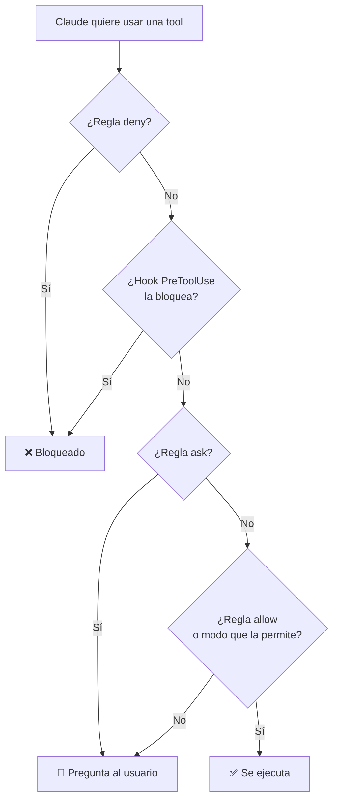
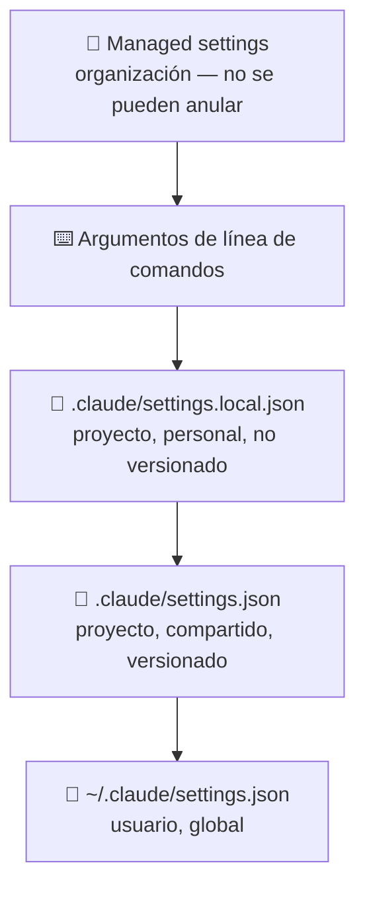
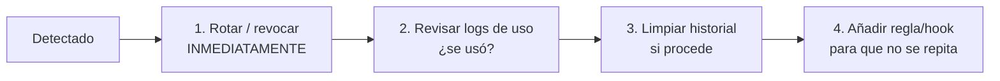
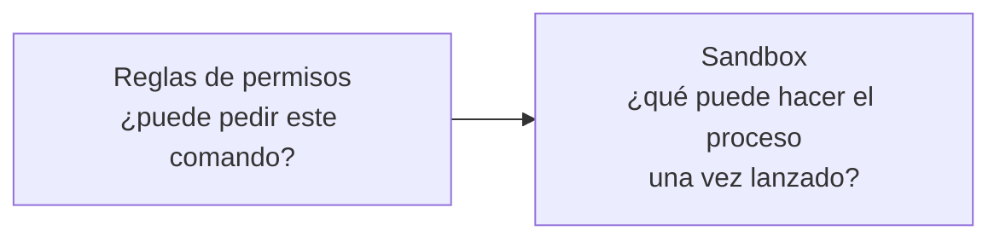
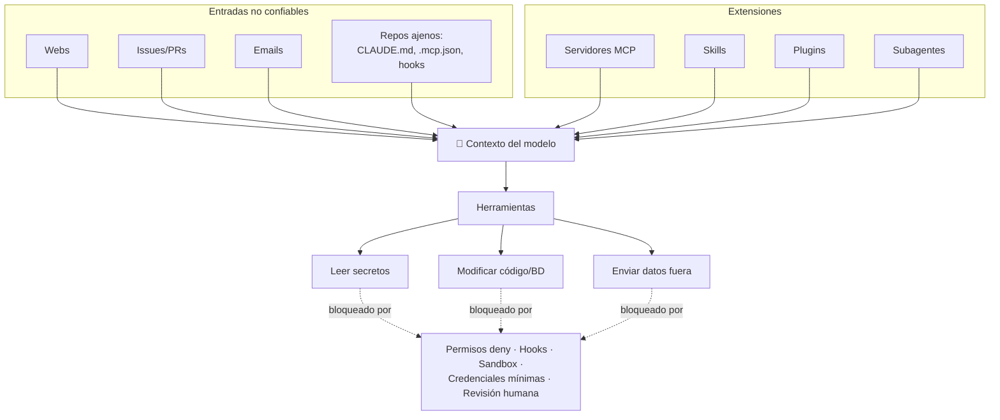

# 🔐 Ciberseguridad en Permisos, Sandbox y Secretos — De cero a experto

> Esta lectura explica **cómo configurar Claude Code para que trabaje con seguridad**: desde los modos de permiso hasta **reglas allow/ask/deny, sandbox, manejo de secretos, managed settings y uso en CI**.
>
> **Idea central:** todas las lecturas anteriores llegan a la misma conclusión: **no puedes garantizar que el modelo nunca será engañado**, así que debes limitar **lo que puede hacer** cuando lo sea. Los permisos, el sandbox y la gestión de secretos son esa limitación. La pregunta es:
>
> **Si mañana una prompt injection toma el control de esta sesión, ¿cuál es el peor daño posible?**

> [!NOTE]
> Los diagramas usan **Mermaid**, que se renderiza en GitHub y en VS Code.

> [!IMPORTANT]
> Los nombres de settings corresponden a la documentación vigente al escribir esta lectura. Usa `/permissions`, `/config` y la documentación oficial de *settings* e *IAM* para confirmarlos.

---

## 📑 Tabla de contenido

**Nivel 0 — Fundamentos**
1. [El modelo de permisos de Claude Code](#1-el-modelo-de-permisos-de-claude-code)
2. [Modos de permiso](#2-modos-de-permiso)

**Nivel 1 — Reglas de permisos**
3. [Sintaxis allow / ask / deny](#3-sintaxis-allow--ask--deny)
4. [Jerarquía de settings](#4-jerarquía-de-settings)
5. [Una configuración base segura](#5-una-configuración-base-segura)

**Nivel 2 — Secretos**
6. [Que Claude no lea tus secretos](#6-que-claude-no-lea-tus-secretos)
7. [Que Claude no escriba secretos](#7-que-claude-no-escriba-secretos)
8. [Si un secreto se filtra](#8-si-un-secreto-se-filtra)

**Nivel 3 — Aislamiento**
9. [Sandbox](#9-sandbox)
10. [Contenedores y devcontainers](#10-contenedores-y-devcontainers)
11. [`--dangerously-skip-permissions`](#11---dangerously-skip-permissions)

**Nivel 4 — Experto**
12. [Managed settings](#12-managed-settings)
13. [Claude Code en CI/CD](#13-claude-code-en-cicd)
14. [Modelo de amenazas completo](#14-modelo-de-amenazas-completo)
15. [Checklist final](#15-checklist-final)

---

## Nivel 0 — Fundamentos

## 1. El modelo de permisos de Claude Code



Por defecto, Claude Code es **de solo lectura** sin preguntar: leer archivos no pide permiso, pero editar o ejecutar comandos sí.

> [!IMPORTANT]
> **`deny` gana siempre.** Una regla `deny` no la anula un `allow`, una skill, un subagente ni un modo de permiso. Las prohibiciones críticas van en `deny`.

## 2. Modos de permiso

| Modo | Comportamiento | Uso recomendado |
|------|---------------|-----------------|
| `default` | Pide permiso la primera vez para cada herramienta | Día a día |
| `acceptEdits` | Acepta ediciones de archivos sin preguntar | Tareas de edición en las que confías, con Git limpio |
| `plan` | Solo analiza y planifica, no modifica | Explorar código desconocido |
| `auto` | Un clasificador decide qué acciones aprobar | Sesiones largas con supervisión ligera |
| `bypassPermissions` | No pregunta nada | **Solo** en entornos aislados y desechables |

Cambia de modo con `Shift+Tab` o `/permissions`.

---

## Nivel 1 — Reglas de permisos

## 3. Sintaxis allow / ask / deny

```json
{
  "permissions": {
    "allow": [
      "Bash(npm run test:*)",
      "Bash(npm run lint)",
      "Bash(git status)",
      "Bash(git diff:*)",
      "Read(./src/**)"
    ],
    "ask": [
      "Bash(git push:*)",
      "Bash(npm install:*)"
    ],
    "deny": [
      "Read(./.env)",
      "Read(./.env.*)",
      "Read(./secrets/**)",
      "Read(~/.ssh/**)",
      "Read(~/.aws/**)",
      "Bash(curl:*)",
      "Bash(wget:*)",
      "Bash(rm -rf:*)",
      "WebFetch"
    ]
  }
}
```

| Patrón | Significado |
|--------|-------------|
| `Bash(npm run test:*)` | Comandos que empiezan por `npm run test` |
| `Read(./src/**)` | Rutas relativas al proyecto, recursivo |
| `Read(~/.ssh/**)` | Ruta en el home |
| `WebFetch(domain:docs.microsoft.com)` | Solo ese dominio |
| `mcp__github__create_issue` | Herramienta MCP concreta |

> [!WARNING]
> Las reglas de `Bash` por prefijo son **evitables** (`bash -c "curl ..."`, `node -e "fetch(...)"`, `python -c ...`). Úsalas como fricción y señal de intención, y combínalas con sandbox para restricciones reales de red y sistema de archivos.

## 4. Jerarquía de settings



Las reglas se combinan; `deny` de cualquier nivel prevalece y la organización tiene la última palabra.

> [!TIP]
> Pon en `.claude/settings.json` (versionado) las reglas `deny` del proyecto para que **todo el equipo** las tenga, y en `settings.local.json` tus `allow` personales.

## 5. Una configuración base segura

Para un proyecto Node / .NET típico:

```json
{
  "permissions": {
    "defaultMode": "default",
    "allow": [
      "Bash(npm run test:*)", "Bash(npm run lint:*)", "Bash(npm run build)",
      "Bash(dotnet build:*)", "Bash(dotnet test:*)",
      "Bash(git status)", "Bash(git diff:*)", "Bash(git log:*)"
    ],
    "ask": [
      "Bash(git push:*)", "Bash(git commit:*)",
      "Bash(npm install:*)", "Bash(dotnet add package:*)",
      "Bash(docker:*)"
    ],
    "deny": [
      "Read(./.env)", "Read(./.env.*)", "Read(./**/appsettings.Production.json)",
      "Read(./**/*.pfx)", "Read(./**/*.pem)",
      "Read(~/.ssh/**)", "Read(~/.aws/**)", "Read(~/.azure/**)",
      "Bash(rm -rf:*)", "Bash(git push --force:*)", "Bash(git reset --hard:*)",
      "Bash(curl:*)", "Bash(wget:*)"
    ]
  }
}
```

---

## Nivel 2 — Secretos

## 6. Que Claude no lea tus secretos

1. **Reglas `deny`** sobre `.env`, certificados, `appsettings.*.json` con credenciales y carpetas de credenciales del home.
2. **No guardes secretos en el repo**: usa gestores (Azure Key Vault, AWS Secrets Manager, 1Password CLI, `dotnet user-secrets` en desarrollo).
3. **Variables de entorno con alcance mínimo**: no lances `claude` desde una terminal con `PROD_DB_PASSWORD` exportada si no hace falta (los subprocesos la heredan).
4. Proporciona un `.env.example` con valores falsos para que Claude entienda la estructura sin ver los reales.

## 7. Que Claude no escriba secretos

- Regla en `CLAUDE.md`: *"Ningún secreto en código; lee de variables de entorno y falla si falta"*.
- Hook `PreToolUse` de detección de secretos (ver *Ciberseguridad en Hooks*).
- **Pre-commit** con `gitleaks` o `git-secrets` como red final, independiente de Claude.
- `.gitignore` con `.env*`, `*.pfx`, `*.pem`, `appsettings.*.local.json`, `.claude/settings.local.json`.

## 8. Si un secreto se filtra



> [!IMPORTANT]
> El paso 1 es el único que importa en los primeros minutos. Borrar el commit **no** des-filtra el secreto: puede estar en forks, clones, caches o logs.

---

## Nivel 3 — Aislamiento

## 9. Sandbox

Claude Code incluye un **sandbox a nivel de sistema operativo** para el comando `Bash` (actívalo con `/sandbox`):

- **Sistema de archivos:** escritura limitada al directorio de trabajo.
- **Red:** solo dominios permitidos; el resto se bloquea o se pregunta.

Diferencia clave con las reglas de permisos: el sandbox restringe lo que **cualquier proceso hijo** puede hacer. Aunque el modelo consiga ejecutar `node -e "fetch('https://evil...')"`, la red lo bloquea.



> [!NOTE]
> La disponibilidad del sandbox depende del sistema operativo (macOS, Linux y WSL2 en el momento de escribir esto). En Windows nativo, usa WSL2 o contenedores.

## 10. Contenedores y devcontainers

Para trabajar con código no confiable o con modos permisivos:

- **Devcontainer** con Claude Code instalado, firewall que solo permite los dominios necesarios (registro de paquetes, API de Anthropic, GitHub) y sin montar tu `~/.ssh` ni `~/.aws`.
- Credenciales **específicas del contenedor**, de corta duración y con scope mínimo.
- Contenedor **desechable**: si algo sale mal, se destruye.

## 11. `--dangerously-skip-permissions`

Equivale a `bypassPermissions`: Claude ejecuta todo sin preguntar. El nombre es literal.

Úsalo **solo** si se cumplen todas:
- [ ] Contenedor o VM aislada y desechable.
- [ ] Sin credenciales valiosas dentro.
- [ ] Red restringida a lo imprescindible.
- [ ] Sin acceso a producción.

---

## Nivel 4 — Experto

## 12. Managed settings

La organización despliega un `managed-settings.json` (o por MDM/consola) que **no se puede anular**:

```json
{
  "permissions": {
    "deny": ["Read(**/.env)", "Read(**/.env.*)", "Bash(curl:*)", "WebFetch"],
    "disableBypassPermissionsMode": "disable"
  },
  "allowManagedPermissionRulesOnly": true,
  "allowManagedHooksOnly": true,
  "allowedMcpServers": [{ "serverName": "github" }],
  "strictKnownMarketplaces": [{ "source": "github", "repo": "mi-empresa/claude-plugins" }]
}
```

| Setting | Efecto |
|---------|--------|
| `disableBypassPermissionsMode` | Impide usar `bypassPermissions` / `--dangerously-skip-permissions` |
| `allowManagedPermissionRulesOnly` | Ignora reglas de permisos de usuario y proyecto |
| `allowManagedHooksOnly` | Solo se ejecutan hooks de la organización |
| `allowedMcpServers` / `deniedMcpServers` | Lista blanca/negra de servidores MCP |
| `strictKnownMarketplaces` | Solo marketplaces de plugins aprobados |

## 13. Claude Code en CI/CD

En pipelines (GitHub Actions, modo `-p` headless):

- **Nunca** exponer secretos de producción al job donde corre Claude.
- Lista blanca explícita con `--allowedTools` (y `--disallowedTools` para reforzar).
- Cuidado con workflows disparados por **contenido de terceros** (issues, PRs de forks): ese contenido es input no confiable que llega directamente al modelo.
- `GITHUB_TOKEN` con permisos mínimos (`contents: read`, `pull-requests: write` solo si comenta).
- Revisión humana obligatoria antes de hacer merge de cambios generados.

```yaml
permissions:
  contents: read
  pull-requests: write
steps:
  - run: claude -p "Revisa el diff de seguridad" --allowedTools "Read,Grep,Glob"
```

## 14. Modelo de amenazas completo

Resumen de toda la sección:



Y la pregunta que resume todas las lecturas:

> **Si una prompt injection toma el control de esta sesión ahora mismo, ¿qué puede leer, qué puede cambiar y a dónde puede enviarlo?**

Si la respuesta te incomoda, reduce permisos antes de seguir.

## 15. Checklist final

- [ ] ¿Las prohibiciones críticas están en `deny` (no solo en `CLAUDE.md`)?
- [ ] ¿`.env`, certificados y credenciales del home están bloqueados para `Read`?
- [ ] ¿Comandos destructivos y de red están en `deny` o `ask`?
- [ ] ¿Uso sandbox o contenedor para código no confiable?
- [ ] ¿Solo uso `bypassPermissions` en entornos desechables?
- [ ] ¿Tengo pre-commit de secretos independiente de Claude?
- [ ] ¿En CI, el job de Claude no ve secretos de producción y tiene `--allowedTools` explícito?
- [ ] ¿La organización tiene managed settings para lo que no puede depender de cada persona?
