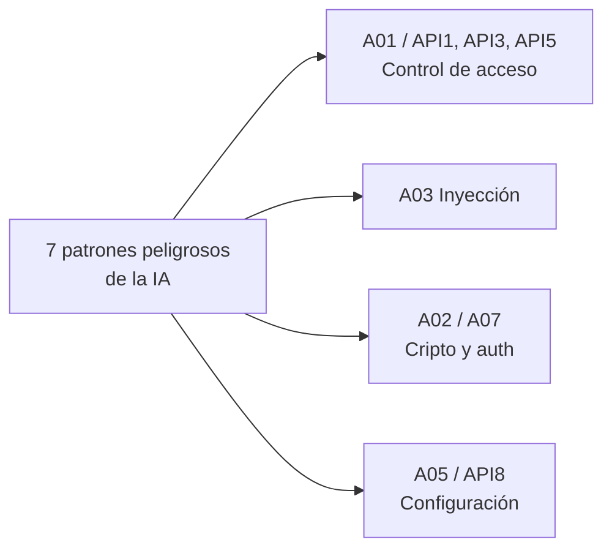

# 🧱 OWASP Top 10 web y API en Node y .NET — De cero a experto

> Esta lectura amplía *Patrones peligrosos del código generado por IA* con **las listas de referencia de OWASP** (Top 10 web y API Security Top 10), aplicadas a **Node.js (Express) y .NET (ASP.NET Core)**, con el código vulnerable que suele generar la IA y su corrección.
>
> **Idea central:** los siete patrones peligrosos son la punta del iceberg. OWASP recoge, a partir de datos reales, **las categorías de fallo que más se explotan**. Conocerlas te da un vocabulario común y una lista para revisar código, propio o generado. La pregunta es:
>
> **¿En qué categoría de OWASP podría caer este cambio, y la he comprobado?**

> [!NOTE]
> Los diagramas usan **Mermaid**, que se renderiza en GitHub y en VS Code.

> [!IMPORTANT]
> Las listas se actualizan cada pocos años. Aquí se usan **OWASP Top 10 (2021)** y **OWASP API Security Top 10 (2023)**; consulta *owasp.org* por si hay ediciones más recientes.

---

## 📑 Tabla de contenido

**Nivel 0 — Fundamentos**
1. [Las dos listas](#1-las-dos-listas)

**Nivel 1 — Control de acceso**
2. [Broken Object Level Authorization (IDOR)](#2-broken-object-level-authorization-idor)
3. [Broken Function Level Authorization](#3-broken-function-level-authorization)
4. [Mass assignment](#4-mass-assignment)

**Nivel 2 — Autenticación y criptografía**
5. [JWT mal validado](#5-jwt-mal-validado)
6. [Contraseñas y criptografía](#6-contraseñas-y-criptografía)
7. [Fuerza bruta y rate limiting](#7-fuerza-bruta-y-rate-limiting)

**Nivel 3 — Inyección y entrada**
8. [Inyecciones (SQL, NoSQL, comandos)](#8-inyecciones-sql-nosql-comandos)
9. [SSRF](#9-ssrf)
10. [Deserialización insegura](#10-deserialización-insegura)
11. [Subida de archivos](#11-subida-de-archivos)

**Nivel 4 — Configuración y operación**
12. [Cabeceras de seguridad y configuración](#12-cabeceras-de-seguridad-y-configuración)
13. [Consumo de recursos sin límite](#13-consumo-de-recursos-sin-límite)
14. [Logging y monitorización](#14-logging-y-monitorización)
15. [Inventario de APIs](#15-inventario-de-apis)
16. [Prompt de seguridad para Claude y checklist](#16-prompt-de-seguridad-para-claude-y-checklist)

---

## Nivel 0 — Fundamentos

## 1. Las dos listas

| OWASP Top 10 (2021) | OWASP API Security Top 10 (2023) |
|---------------------|----------------------------------|
| A01 Broken Access Control | API1 Broken Object Level Authorization |
| A02 Cryptographic Failures | API2 Broken Authentication |
| A03 Injection | API3 Broken Object Property Level Authorization |
| A04 Insecure Design | API4 Unrestricted Resource Consumption |
| A05 Security Misconfiguration | API5 Broken Function Level Authorization |
| A06 Vulnerable and Outdated Components | API6 Unrestricted Access to Sensitive Business Flows |
| A07 Identification and Authentication Failures | API7 Server Side Request Forgery |
| A08 Software and Data Integrity Failures | API8 Security Misconfiguration |
| A09 Security Logging and Monitoring Failures | API9 Improper Inventory Management |
| A10 Server-Side Request Forgery | API10 Unsafe Consumption of APIs |



---

## Nivel 1 — Control de acceso

## 2. Broken Object Level Authorization (IDOR)

**A01 / API1.** La vulnerabilidad nº 1 en APIs (ya vista como "permisos planos").

```csharp
// ❌ ASP.NET Core: autenticado, pero sin comprobar propietario
[Authorize]
[HttpGet("invoices/{id}")]
public async Task<IActionResult> Get(int id) =>
    Ok(await _db.Invoices.FindAsync(id));

// ✅ Filtrar por el usuario/tenant en la consulta
[Authorize]
[HttpGet("invoices/{id}")]
public async Task<IActionResult> Get(int id)
{
    var userId = User.FindFirstValue(ClaimTypes.NameIdentifier);
    var invoice = await _db.Invoices
        .Where(i => i.Id == id && i.OwnerId == userId)
        .FirstOrDefaultAsync();
    return invoice is null ? NotFound() : Ok(invoice);
}
```

> [!TIP]
> En aplicaciones multi-tenant, usa **filtros globales de consulta** de EF Core (`HasQueryFilter(e => e.TenantId == _tenant.Id)`) para que olvidar el filtro no exponga datos de otro cliente.

## 3. Broken Function Level Authorization

**API5.** Un usuario normal puede llamar a funciones de administrador.

```js
// ❌ Express: solo comprueba que hay sesión
router.delete('/admin/users/:id', requireAuth, deleteUser);

// ✅ Comprobar el rol
const requireRole = (...roles) => (req, res, next) =>
  roles.includes(req.user.role) ? next() : res.sendStatus(403);

router.delete('/admin/users/:id', requireAuth, requireRole('admin'), deleteUser);
```

```csharp
// ✅ ASP.NET Core: políticas
builder.Services.AddAuthorization(o =>
    o.AddPolicy("Admin", p => p.RequireRole("admin")));

[Authorize(Policy = "Admin")]
[HttpDelete("admin/users/{id}")]
public async Task<IActionResult> Delete(int id) { /* ... */ }
```

## 4. Mass assignment

**API3.** El cliente envía propiedades que no debería poder modificar.

```js
// ❌ PUT /profile con body { "name": "Ana", "role": "admin", "balance": 99999 }
await User.updateOne({ _id: req.user.id }, req.body);

// ✅ Lista blanca
const { name, bio } = ProfileSchema.parse(req.body); // zod .strict()
await User.updateOne({ _id: req.user.id }, { name, bio });
```

```csharp
// ❌ Bindear directamente la entidad
public async Task<IActionResult> Update(User user) { _db.Update(user); ... }

// ✅ DTO con solo los campos permitidos
public record UpdateProfileDto(
    [Required, MaxLength(100)] string Name,
    [MaxLength(500)] string? Bio);
```

La misma categoría cubre la **exposición excesiva de datos**: devolver la entidad entera (con `PasswordHash`, `IsAdmin`...) en lugar de un DTO de respuesta.

---

## Nivel 2 — Autenticación y criptografía

## 5. JWT mal validado

**A07 / API2.** Errores típicos del código generado:

| Error | Corrección |
|-------|-----------|
| `jwt.decode()` en vez de `jwt.verify()` | Verificar siempre la firma |
| Aceptar cualquier algoritmo (incluido `none`) | Fijar `algorithms: ['HS256']` o `RS256` |
| No validar `exp`, `iss`, `aud` | Validarlos explícitamente |
| Secreto débil o hardcodeado | Secreto largo y aleatorio desde un gestor de secretos |
| Tokens de larga duración sin revocación | Access token corto + refresh token rotado |

```js
// ✅ Node (jsonwebtoken)
const payload = jwt.verify(token, process.env.JWT_SECRET, {
  algorithms: ['HS256'],
  issuer: 'api.miempresa.com',
  audience: 'web-app',
});
```

```csharp
// ✅ ASP.NET Core
builder.Services.AddAuthentication(JwtBearerDefaults.AuthenticationScheme)
  .AddJwtBearer(o => o.TokenValidationParameters = new()
  {
      ValidateIssuer = true, ValidIssuer = "api.miempresa.com",
      ValidateAudience = true, ValidAudience = "web-app",
      ValidateLifetime = true, ClockSkew = TimeSpan.FromSeconds(30),
      ValidateIssuerSigningKey = true,
      IssuerSigningKey = new SymmetricSecurityKey(Encoding.UTF8.GetBytes(config["Jwt:Key"]!)),
      ValidAlgorithms = [SecurityAlgorithms.HmacSha256],
  });
```

## 6. Contraseñas y criptografía

**A02.**

| ❌ Generado a menudo | ✅ Correcto |
|---------------------|------------|
| `md5(password)`, `sha256(password)` | `bcrypt` / `argon2` (Node), `PasswordHasher<T>` de ASP.NET Identity (.NET) |
| `Math.random()` para tokens | `crypto.randomBytes(32)` / `RandomNumberGenerator.GetBytes(32)` |
| AES en modo ECB, IV fijo | AES-GCM con nonce aleatorio |
| Comparar tokens con `===` | `crypto.timingSafeEqual` / `CryptographicOperations.FixedTimeEquals` |
| HTTP en producción | HTTPS + HSTS |

## 7. Fuerza bruta y rate limiting

**A07 / API2 / API4.**

```js
// ✅ Express
import rateLimit from 'express-rate-limit';
app.use('/api/login', rateLimit({ windowMs: 15 * 60_000, limit: 5, standardHeaders: true }));
```

```csharp
// ✅ ASP.NET Core (.NET 7+). En .NET 6: AspNetCoreRateLimit o un proxy (API Gateway, nginx)
builder.Services.AddRateLimiter(o => o.AddFixedWindowLimiter("login", l =>
{
    l.PermitLimit = 5; l.Window = TimeSpan.FromMinutes(15);
}));
app.MapPost("/api/login", Login).RequireRateLimiting("login");
```

Además: mensajes de error idénticos para "usuario no existe" y "contraseña incorrecta", bloqueo progresivo y MFA en cuentas privilegiadas.

---

## Nivel 3 — Inyección y entrada

## 8. Inyecciones (SQL, NoSQL, comandos)

**A03.**

| Tipo | ❌ Vulnerable | ✅ Seguro |
|------|--------------|----------|
| SQL (Node) | `` db.query(`... WHERE id=${id}`) `` | `db.query('... WHERE id=$1', [id])` |
| SQL (EF Core) | `FromSqlRaw($"... {id}")` | `FromSql($"... {id}")` / LINQ |
| SQL (Dapper) | `conn.Query("... '" + name + "'")` | `conn.Query("... @name", new { name })` |
| NoSQL (Mongo) | `User.find({ email: req.body.email })` con `{ "$ne": null }` | Validar que es string; `mongo-sanitize` |
| Comandos | `exec(\`convert ${file}\`)` / `Process.Start("cmd", "/c " + x)` | `execFile('convert', [file])` / `ProcessStartInfo.ArgumentList` |
| LDAP / XPath | Concatenación | Escapado específico o API parametrizada |

## 9. SSRF

**A10 / API7.** El servidor hace peticiones a URLs que controla el usuario (webhooks, "importar desde URL", vista previa de enlaces).

```js
// ❌
const r = await fetch(req.body.url); // http://169.254.169.254/latest/meta-data/

// ✅ Lista blanca + bloquear IPs privadas tras resolver DNS
import { lookup } from 'node:dns/promises';
import ipaddr from 'ipaddr.js';

const url = new URL(req.body.url);
if (!['https:'].includes(url.protocol) || !ALLOWED_HOSTS.has(url.hostname)) throw new Error('URL no permitida');
const { address } = await lookup(url.hostname);
if (ipaddr.parse(address).range() !== 'unicast') throw new Error('Destino no permitido');
const r = await fetch(url, { redirect: 'error' });
```

## 10. Deserialización insegura

**A08.**

| Plataforma | ❌ Peligroso | ✅ Alternativa |
|-----------|-------------|---------------|
| .NET | `BinaryFormatter` (obsoleto), `TypeNameHandling.All` en Newtonsoft.Json | `System.Text.Json` sin polimorfismo arbitrario |
| Node | `node-serialize`, `eval(JSON)`, `vm` con datos del usuario | `JSON.parse` + validación de esquema |
| Node | *Prototype pollution* al fusionar objetos (`merge(obj, req.body)` con `__proto__`) | Validar esquema; `Object.create(null)`; librerías actualizadas |

## 11. Subida de archivos

- Validar **tipo real** (magic bytes), no solo la extensión ni el `Content-Type`.
- Limitar tamaño (`multer({ limits: { fileSize } })`, `[RequestSizeLimit]`).
- Generar el nombre en el servidor; nunca usar el nombre original como ruta (*path traversal*).
- Guardar **fuera del webroot** o en almacenamiento de objetos; servir con `Content-Disposition: attachment`.
- Escanear con antivirus si los archivos los descargan otros usuarios.

---

## Nivel 4 — Configuración y operación

## 12. Cabeceras de seguridad y configuración

**A05 / API8.**

```js
// ✅ Express
import helmet from 'helmet';
app.use(helmet());               // CSP, HSTS, X-Content-Type-Options, frame-ancestors...
app.disable('x-powered-by');
```

```csharp
// ✅ ASP.NET Core
if (!app.Environment.IsDevelopment())
{
    app.UseExceptionHandler("/error");   // nunca DeveloperExceptionPage en producción
    app.UseHsts();
}
app.UseHttpsRedirection();
app.Use(async (ctx, next) =>
{
    ctx.Response.Headers["X-Content-Type-Options"] = "nosniff";
    ctx.Response.Headers["Content-Security-Policy"] = "default-src 'self'; frame-ancestors 'none'";
    await next();
});
```

Otros: CORS con lista blanca, Swagger deshabilitado o protegido en producción, cuentas y contraseñas por defecto eliminadas, mensajes de error genéricos.

## 13. Consumo de recursos sin límite

**API4 / API6.**

- **Paginación obligatoria** con tamaño máximo (`take = Math.min(req.query.limit ?? 20, 100)`).
- Límite de tamaño de body (`express.json({ limit: '100kb' })`).
- Timeouts en llamadas externas y consultas.
- Protección de **flujos de negocio sensibles** (registro, compra, envío de SMS/email) contra automatización: rate limiting por usuario, CAPTCHA, colas.
- Regex sin *backtracking* catastrófico (ReDoS).

## 14. Logging y monitorización

**A09.**

| Registrar | No registrar |
|-----------|--------------|
| Logins (éxito y fallo), cambios de permisos, accesos denegados (403), acciones administrativas, errores de validación repetidos | Contraseñas, tokens, cadenas de conexión, datos de tarjeta, datos personales completos |

Usa logs estructurados (`pino`, `Serilog`) con id de correlación y alertas sobre patrones anómalos (muchos 401/403 desde una IP).

## 15. Inventario de APIs

**API9 / API10.**

- Documenta todas las versiones y entornos (`/v1`, `/v2`, `staging`); retira las antiguas.
- Las APIs "olvidadas" (beta, debug, endpoints internos expuestos) suelen ser las menos protegidas.
- Trata las respuestas de **APIs de terceros** como input no confiable: valida su esquema, usa timeouts y no sigas redirecciones a ciegas.

## 16. Prompt de seguridad para Claude y checklist

Plantilla para pedir código de backend:

```text
Implementa <funcionalidad> en <Express/ASP.NET Core> cumpliendo OWASP:
- Auth obligatoria y autorización por recurso (propietario/tenant) y por rol.
- DTO/esquema de entrada con lista blanca de campos y límites; DTO de salida sin campos internos.
- Consultas parametrizadas / LINQ; nada de concatenación.
- Rate limiting si es login, registro o un flujo sensible; paginación con máximo.
- Errores genéricos al cliente, detalle en logs estructurados sin datos sensibles.
- Si haces peticiones salientes, lista blanca de destinos.
Al final, indica para cada categoría de OWASP API Top 10 si aplica y cómo la cubriste.
```

Checklist:

- [ ] API1 · ¿Cada acceso a un objeto comprueba propietario/tenant?
- [ ] API2 · ¿JWT verificado (firma, algoritmo, `exp`, `iss`, `aud`) y login con rate limiting?
- [ ] API3 · ¿DTOs de entrada y salida con lista blanca de propiedades?
- [ ] API4 · ¿Paginación, límites de tamaño y timeouts?
- [ ] API5 · ¿Las funciones administrativas comprueban el rol?
- [ ] API6 · ¿Los flujos sensibles están protegidos contra automatización?
- [ ] API7 · ¿Peticiones salientes con lista blanca y sin IPs internas?
- [ ] API8 · ¿Cabeceras de seguridad, CORS restrictivo, sin páginas de error de desarrollo?
- [ ] API9 · ¿Están inventariadas todas las versiones y endpoints?
- [ ] API10 · ¿Valido las respuestas de APIs de terceros?
