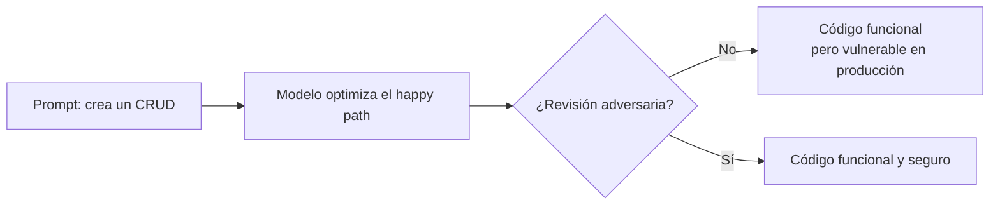
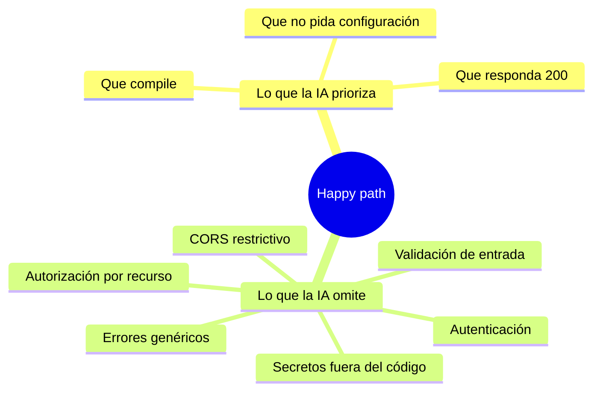

# ⚠️ Patrones peligrosos del código generado por IA

> Cuando trabajas con un asistente de IA para escribir código de backend, el resultado suele ser funcional a la primera: el endpoint responde, el CRUD guarda en base de datos, el login devuelve un token. Pero **"funciona" y "es seguro" son dos cosas muy distintas**, y los modelos de lenguaje tienden a optimizar para lo primero.
>
> **Idea central:** generar código que responde correctamente al *happy path* es lo que maximiza la probabilidad de que el usuario acepte la respuesta. Todo lo demás —autorización, validación, manejo de errores, configuración de CORS— son capas que no se ven hasta que se rompen. Y cuando se rompen, suele ser tarde.

> [!NOTE]
> Los diagramas usan **Mermaid**, que se renderiza en GitHub y en VS Code (vista previa de Markdown o la extensión *Markdown Preview Mermaid Support*).

---

## 📑 Tabla de contenido

1. [Los siete patrones de un vistazo](#1-los-siete-patrones-de-un-vistazo)
2. [Autenticación olvidada](#2-autenticación-olvidada)
3. [SQL Injection](#3-sql-injection)
4. [Secrets hardcodeados](#4-secrets-hardcodeados)
5. [Error leaking](#5-error-leaking)
6. [Validación ausente](#6-validación-ausente)
7. [CORS abierto](#7-cors-abierto)
8. [Permisos planos (IDOR)](#8-permisos-planos-idor)
9. [El patrón detrás de los patrones](#9-el-patrón-detrás-de-los-patrones)
10. [Cómo prevenirlo con Claude Code](#10-cómo-prevenirlo-con-claude-code)
11. [Checklist de revisión](#11-checklist-de-revisión)

---

## 1. Los siete patrones de un vistazo

| # | Patrón | Ejemplo típico | Por qué lo genera la IA |
|---|--------|----------------|-------------------------|
| 1 | Autenticación olvidada | `router.get('/users/:id', handler)` | Los tutoriales de CRUD no incluyen middleware |
| 2 | SQL Injection | `` `SELECT ... WHERE id = ${id}` `` | La concatenación "parece" más legible |
| 3 | Secrets hardcodeados | `const JWT_SECRET = "super-secret-key"` | Optimiza para que se ejecute sin configurar nada |
| 4 | Error leaking | `res.json({ error: err.message, stack: err.stack })` | Mezcla ejemplos de depuración y producción |
| 5 | Validación ausente | `db.insert(req.body)` | Asume que el input es válido |
| 6 | CORS abierto | `cors({ origin: '*' })` | Quiere evitar fricción en desarrollo |
| 7 | Permisos planos | Auth sí, autorización no | La autorización depende del dominio, no del patrón |



---

## 2. Autenticación olvidada

El caso más típico. Le pides al modelo que genere un CRUD completo para un recurso y lo hace bien: las cuatro rutas, la validación mínima, la conexión a base de datos. Lo que se le olvida es el **middleware de autenticación**.

```js
// ❌ Generado por IA
router.get('/users/:id', async (req, res) => { /* ... */ }) // sin auth
```

**Por qué ocurre:** la autenticación es una preocupación transversal que no forma parte del patrón CRUD "clásico" que el modelo ha visto miles de veces en su entrenamiento. Los tutoriales y snippets de ejemplo casi nunca incluyen el middleware, así que el modelo reproduce fielmente esa ausencia.

```js
// ✅ Corregido: auth aplicada a todo el router (deny by default)
router.use(requireAuth);
router.get('/users/:id', async (req, res) => { /* ... */ });
```

> [!TIP]
> Aplica la autenticación a nivel de router o app (**deny by default**) y marca explícitamente las rutas públicas. Así, olvidar algo deja la ruta *cerrada*, no *abierta*.

---

## 3. SQL Injection

El modelo escribe consultas más "legibles" interpolando variables directamente en la cadena SQL, en lugar de usar consultas parametrizadas.

```js
// ❌ Generado por IA
const rows = await db.query(`SELECT * FROM users WHERE id = ${req.params.id}`);
```

**Por qué ocurre:** la versión concatenada parece más directa y natural. El modelo prioriza la legibilidad aparente sobre la seguridad, y te regala una inyección SQL de manual. Basta con `GET /users/1 OR 1=1` para leer toda la tabla.

```js
// ✅ Node (pg): consulta parametrizada
const { rows } = await db.query('SELECT * FROM users WHERE id = $1', [req.params.id]);
```

```csharp
// ✅ C# (SqlClient): parámetros, nunca concatenación
using var cmd = new SqlCommand("SELECT * FROM Users WHERE Id = @id", conn);
cmd.Parameters.Add("@id", SqlDbType.Int).Value = id;
```

> [!WARNING]
> En C#, `FromSqlRaw($"... {id}")` con EF Core también es vulnerable. Usa `FromSqlInterpolated` o `FromSql`, que sí parametrizan.

---

## 4. Secrets hardcodeados

Cuando el código necesita un valor para ejecutarse (clave JWT, API key, contraseña de BD), el modelo tiene dos opciones: dejar un placeholder claro o inventarse un valor para que "funcione ya". Casi siempre elige lo segundo.

```js
// ❌ Generado por IA
const JWT_SECRET = "super-secret-key";
```

**Por qué ocurre:** el modelo optimiza para que el código sea ejecutable sin configuración adicional. El resultado es que acabas con secretos incrustados en el repositorio si no los sustituyes antes del primer commit.

```js
// ✅ Leer de entorno y fallar rápido si falta
const JWT_SECRET = process.env.JWT_SECRET;
if (!JWT_SECRET) throw new Error('JWT_SECRET no configurado');
```

> [!IMPORTANT]
> Un secreto que llegó a un commit **está comprometido** aunque lo borres después: queda en el historial de Git. Rótalo.

---

## 5. Error leaking

Cuando algo falla, el modelo tiende a devolver al cliente toda la información disponible: el mensaje, el stack trace y a veces datos internos.

```js
// ❌ Generado por IA
res.status(500).json({ error: err.message, stack: err.stack });
```

**Por qué ocurre:** los ejemplos que ha absorbido mezclan código de desarrollo, depuración y producción sin distinguir. Para el modelo, un error detallado es un error "útil". Para un atacante, es **un mapa de la aplicación** (rutas de archivos, versiones, nombres de tablas, consultas).

```js
// ✅ Detalle al log, mensaje genérico al cliente
app.use((err, req, res, next) => {
  const id = crypto.randomUUID();
  logger.error({ id, err });
  res.status(500).json({ error: 'Error interno', id });
});
```

---

## 6. Validación ausente

El modelo genera el handler, destructura el body y lo inserta directamente en la base de datos.

```js
// ❌ Generado por IA
const { title, content } = req.body;
await db.insert({ title, content }); // sin validar
```

**Por qué ocurre:** el modelo asume implícitamente que el input es válido: que `title` tiene una longitud razonable, que `content` no contiene HTML malicioso, que no llegan campos extra. Esa suposición es exactamente lo que **no** debe hacer un backend.

```js
// ✅ Esquema explícito (zod): tipos, longitudes y rechazo de campos extra
const PostSchema = z.object({
  title: z.string().trim().min(1).max(200),
  content: z.string().max(10_000),
}).strict();

const data = PostSchema.parse(req.body);
```

> [!TIP]
> Cuidado también con el **mass assignment**: `db.update(user, req.body)` permite que alguien envíe `{ "role": "admin" }`. Usa listas blancas de campos.

---

## 7. CORS abierto

Cuando le pides al modelo que configure CORS para que "no dé problemas", la salida habitual es la configuración más permisiva posible.

```js
// ❌ Generado por IA
app.use(cors({ origin: '*' }));
```

**Por qué ocurre:** el modelo quiere que el código funcione en desarrollo sin fricciones, y `origin: '*'` garantiza que nada se rompe en pruebas locales. El coste es que esa misma configuración se queda en producción permitiendo peticiones desde cualquier dominio.

```js
// ✅ Lista blanca desde configuración
const allowed = process.env.CORS_ORIGINS.split(',');
app.use(cors({ origin: allowed, credentials: true }));
```

---

## 8. Permisos planos (IDOR)

Este es el patrón **más sutil y posiblemente el más peligroso**. El modelo verifica que el usuario está *autenticado*, pero no comprueba que esté *autorizado* sobre el recurso concreto que pide.

```js
// ❌ Hay auth, pero cualquier token válido accede a cualquier factura
router.get('/invoices/:id', requireAuth, async (req, res) => {
  const invoice = await Invoice.findById(req.params.id);
  res.json(invoice);
});
```

El código parece correcto porque hay middleware de autenticación; la realidad es que cualquier usuario autenticado puede leer, modificar o borrar datos de otros **simplemente cambiando el ID en la URL**. Es lo que OWASP llama *Broken Object Level Authorization* (IDOR), la vulnerabilidad nº 1 en APIs. No se detecta hasta que alguien la explota, porque técnicamente "todo funciona".

```js
// ✅ Filtrar por propietario en la propia consulta
const invoice = await Invoice.findOne({ _id: req.params.id, ownerId: req.user.id });
if (!invoice) return res.sendStatus(404); // 404, no 403: no confirmes que existe
```

---

## 9. El patrón detrás de los patrones

Si miras los siete casos juntos, emerge una regularidad clara: **la IA optimiza para que el código se ejecute sin fricciones en el happy path**. Autenticación, validación, manejo de errores y permisos son exactamente las capas que solo estorban al happy path y que solo importan cuando algo va mal o alguien va con mala intención.



El modelo no tiene incentivos internos para pensar en el escenario adversario, porque nadie le ha pedido explícitamente que lo haga. La única forma de corregirlo es hacerlo tú: cuando generes código de backend con ayuda de IA, la revisión no debe preguntarse *"¿funciona?"*, sino:

> **¿Qué ha asumido el modelo que yo no le he pedido verificar?**

Esa es la pregunta que cierra el hueco.

---

## 10. Cómo prevenirlo con Claude Code

Puedes convertir esta lección en **reglas que Claude aplica siempre**, en lugar de depender de acordarte en cada revisión.

### 10.1 Reglas en `CLAUDE.md`

```markdown
## Seguridad (obligatorio en todo código de backend)
- Toda ruta nueva requiere autenticación salvo que se indique lo contrario.
- Toda consulta a un recurso filtra por propietario/tenant del usuario.
- Consultas SQL SIEMPRE parametrizadas; prohibida la interpolación.
- Ningún secreto en código: leer de variables de entorno y fallar si falta.
- Errores al cliente: mensaje genérico + id de correlación; detalle solo en logs.
- Validar todo input con esquema estricto (longitud, tipo, campos permitidos).
- CORS con lista blanca de orígenes, nunca '*'.
```

### 10.2 Pedir la revisión adversaria explícitamente

```text
Revisa este endpoint como si fueras un atacante. Para cada uno de estos puntos
dime si está cubierto y cómo romperlo si no: auth, autorización por recurso,
inyección, validación, fuga de errores, secretos, CORS.
```

### 10.3 Usar `/security-review` y hooks

- **`/security-review`** analiza los cambios pendientes de la rama en busca de vulnerabilidades.
- Un **hook `PreToolUse`** puede bloquear escrituras que contengan patrones peligrosos (ver la lectura *Ciberseguridad en Hooks*).

---

## 11. Checklist de revisión

- [ ] ¿Todas las rutas tienen autenticación (o son públicas a propósito)?
- [ ] ¿Cada acceso a un recurso verifica que pertenece al usuario/tenant?
- [ ] ¿Todas las consultas están parametrizadas?
- [ ] ¿Hay algún string que parezca una clave, token o contraseña?
- [ ] ¿Los errores al cliente ocultan stack, SQL y rutas internas?
- [ ] ¿El input se valida con un esquema estricto?
- [ ] ¿CORS usa una lista blanca?
- [ ] ¿Qué ha asumido el modelo que yo no le pedí verificar?
