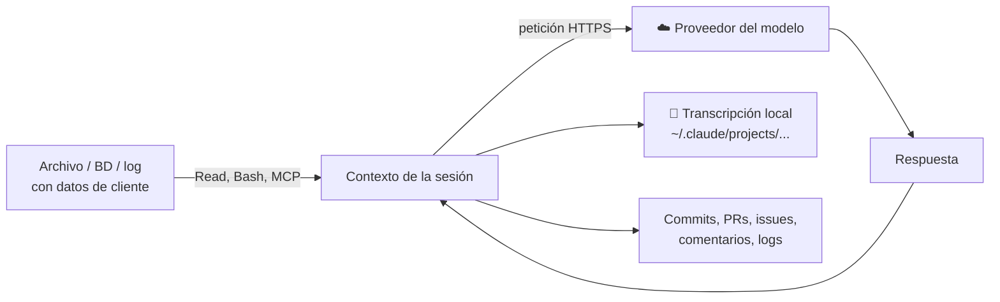

# 🕵️ Privacidad y datos sensibles con IA — De cero a experto

> Esta lectura explica **qué datos salen de tu equipo cuando trabajas con Claude Code, dónde quedan y cómo protegerlos**, desde *qué es un dato personal* hasta **anonimización, cumplimiento normativo (Ley 1581 de 2012, GDPR) y políticas de empresa**.
>
> **Idea central:** todo lo que entra en el contexto del modelo —tu prompt, los archivos que lee, la salida de los comandos, los resultados de MCP— **se envía al proveedor del modelo** para generar la respuesta y, además, puede quedar en transcripciones locales. La pregunta no es *"¿es seguro el proveedor?"*, sino:
>
> **¿Este dato necesita estar en el contexto para hacer la tarea? Y si está, ¿tengo permiso para enviarlo?**

> [!NOTE]
> Los diagramas usan **Mermaid**, que se renderiza en GitHub y en VS Code.

> [!IMPORTANT]
> Esta lectura es formativa, **no es asesoría legal**. Las condiciones de retención y uso de datos dependen del plan contratado (individual, Team, Enterprise, API) y cambian con el tiempo: consulta las condiciones comerciales, la política de privacidad vigente y a tu área legal o de seguridad.

---

## 📑 Tabla de contenido

**Nivel 0 — Fundamentos**
1. [Tipos de datos sensibles](#1-tipos-de-datos-sensibles)
2. [El recorrido de un dato](#2-el-recorrido-de-un-dato)

**Nivel 1 — Dónde se filtran los datos**
3. [Vías de entrada al contexto](#3-vías-de-entrada-al-contexto)
4. [Datos en reposo en tu equipo](#4-datos-en-reposo-en-tu-equipo)
5. [Datos en el proveedor](#5-datos-en-el-proveedor)

**Nivel 2 — Prácticas**
6. [Minimización](#6-minimización)
7. [Anonimización y datos sintéticos](#7-anonimización-y-datos-sintéticos)
8. [Bases de datos y MCP](#8-bases-de-datos-y-mcp)
9. [Bloquear datos sensibles con permisos y hooks](#9-bloquear-datos-sensibles-con-permisos-y-hooks)

**Nivel 3 — Cumplimiento y empresa**
10. [Marco normativo](#10-marco-normativo)
11. [Política de uso de IA con datos](#11-política-de-uso-de-ia-con-datos)
12. [Checklist final](#12-checklist-final)

---

## Nivel 0 — Fundamentos

## 1. Tipos de datos sensibles

| Categoría | Ejemplos | Riesgo |
|-----------|----------|--------|
| **Datos personales** | Nombre, cédula, email, teléfono, dirección | Normativo (habeas data) |
| **Datos personales sensibles** | Salud, biometría, orientación, datos de menores | Normativo agravado |
| **Datos financieros** | Tarjetas, cuentas, nóminas, facturas | PCI-DSS, fraude |
| **Secretos técnicos** | Tokens, contraseñas, cadenas de conexión, certificados | Acceso a sistemas |
| **Información confidencial de negocio** | Contratos, precios, código propietario de clientes, estrategia | Contractual (NDA) |

## 2. El recorrido de un dato



Un dato que entra al contexto puede acabar en **cuatro sitios**: el proveedor, tu disco, el repositorio y cualquier sistema externo al que el agente escriba.

---

## Nivel 1 — Dónde se filtran los datos

## 3. Vías de entrada al contexto

| Vía | Ejemplo involuntario |
|-----|---------------------|
| Prompt | Pegar un log de producción con emails de clientes |
| Lectura de archivos | Claude lee `appsettings.Production.json` o un CSV de exportación |
| Salida de comandos | `SELECT * FROM Clientes` sin `TOP` ni columnas concretas |
| MCP | El MCP de BD, de Jira o de email devuelve datos reales |
| Capturas de pantalla | Una imagen del ERP con datos de cliente |
| Memoria | Claude guarda en auto memory un dato que vio en la sesión |

> [!WARNING]
> La vía más común **no es el prompt**, sino la salida de herramientas: pides "revisa por qué falla esta consulta" y Claude la ejecuta y lee 500 filas reales.

## 4. Datos en reposo en tu equipo

- **Transcripciones** de las sesiones en `~/.claude/projects/` (se usan para `--resume`). Contienen todo lo que pasó por el contexto.
- **Auto memory** y `CLAUDE.md`.
- **Logs de hooks** de auditoría (ver *Ciberseguridad en Hooks*).
- **Checkpoints** con copias de archivos editados.

Medidas:
- Cifrado de disco (BitLocker / FileVault).
- Ajustar la retención local de transcripciones (`cleanupPeriodDays` en settings).
- No sincronizar `~/.claude` con nubes personales.
- Revisar la memoria periódicamente (`/memory`).

## 5. Datos en el proveedor

Aspectos a conocer de tu plan (consúltalos en las condiciones vigentes):

| Pregunta | Por qué importa |
|----------|-----------------|
| ¿Se usan mis datos para entrenar modelos? | Planes comerciales y de API suelen excluirlo por defecto; en planes de consumo puede ser una opción configurable |
| ¿Cuánto tiempo se retienen? | Determina tu exposición ante una brecha |
| ¿Existe *Zero Data Retention* (ZDR)? | Disponible en ciertos acuerdos empresariales |
| ¿Dónde se procesan (región)? | Relevante para la transferencia internacional de datos |
| ¿Se usa vía Bedrock / Vertex / Foundry? | Los datos quedan bajo el contrato y la región de tu nube |
| ¿Feedback (`/bug`, valoraciones) envía la transcripción? | Puede incluir datos de la sesión |

---

## Nivel 2 — Prácticas

## 6. Minimización

El principio más eficaz: **lo que no entra en el contexto no se puede filtrar**.

```text
❌ "Revisa por qué falla el proceso de facturación" (y Claude lee la BD de producción)

✅ "Revisa por qué falla el proceso de facturación. Usa solo el código y el
    esquema de la BD. No ejecutes consultas contra datos reales; si necesitas
    ejemplos, genera datos sintéticos."
```

- Trabaja contra **entornos de desarrollo** con datos falsos.
- Pide **esquemas y agregados** (`COUNT`, `GROUP BY`), no filas.
- Selecciona **columnas concretas**, nunca `SELECT *` sobre tablas de personas.
- Recorta logs antes de compartirlos.

## 7. Anonimización y datos sintéticos

| Técnica | Ejemplo | Reversible |
|---------|---------|------------|
| Enmascaramiento | `juan.perez@cliente.com` → `j***@c***.com` | No |
| Seudonimización | `CC 1020304050` → `CLIENTE_0042` (tabla de mapeo aparte) | Sí, con la tabla |
| Generalización | Fecha de nacimiento → rango de edad | No |
| Datos sintéticos | Faker / Bogus generan datos realistas falsos | No aplica |

```js
// Node: datos sintéticos para reproducir un bug
import { faker } from '@faker-js/faker/locale/es';
const clientes = Array.from({ length: 50 }, () => ({
  nombre: faker.person.fullName(),
  email: faker.internet.email(),
  nit: faker.string.numeric(9),
}));
```

```csharp
// C#: Bogus
var clientes = new Faker<Cliente>("es")
    .RuleFor(c => c.Nombre, f => f.Name.FullName())
    .RuleFor(c => c.Email, f => f.Internet.Email())
    .Generate(50);
```

> [!TIP]
> Pide a Claude que **genere el script de anonimización**, lo revisas y lo ejecutas tú, en lugar de que Claude lea los datos reales para anonimizarlos.

## 8. Bases de datos y MCP

- Usuario de BD **de solo lectura** y limitado a **vistas** sin columnas sensibles.
- **Enmascaramiento dinámico** en SQL Server para columnas personales:

```sql
ALTER TABLE Clientes ALTER COLUMN Email
  ADD MASKED WITH (FUNCTION = 'email()');
ALTER TABLE Clientes ALTER COLUMN Documento
  ADD MASKED WITH (FUNCTION = 'partial(0,"XXXXXX",4)');
-- El usuario del MCP no tiene permiso UNMASK
```

- En MCPs de terceros (Jira, email, CRM), recuerda que **todo lo que devuelven va al contexto**: tickets con datos de clientes incluidos.

## 9. Bloquear datos sensibles con permisos y hooks

```json
{
  "permissions": {
    "deny": [
      "Read(./**/exports/**)", "Read(./**/*.csv)", "Read(./**/backups/**)",
      "Read(./**/appsettings.Production.json)"
    ]
  }
}
```

Hook `UserPromptSubmit` para detectar datos personales pegados por error:

```js
// .claude/hooks/detectar-pii.js
const chunks = [];
for await (const c of process.stdin) chunks.push(c);
const { prompt = '' } = JSON.parse(Buffer.concat(chunks));

const patrones = {
  'tarjeta de crédito': /\b(?:\d[ -]?){13,16}\b/,
  'email': /[\w.+-]+@[\w-]+\.[\w.]{2,}/,
  'cédula / NIT': /\b\d{8,10}(-\d)?\b/,
};
const hallados = Object.entries(patrones).filter(([, re]) => re.test(prompt)).map(([n]) => n);
if (hallados.length) {
  console.error(`El prompt parece contener datos personales (${hallados.join(', ')}). Anonimízalos antes de enviarlo.`);
  process.exit(2); // bloquea el envío del prompt
}
process.exit(0);
```

> [!NOTE]
> Estos patrones dan falsos positivos (cualquier número largo). Ajústalos a tu caso o cámbialos por un aviso no bloqueante.

---

## Nivel 3 — Cumplimiento y empresa

## 10. Marco normativo

| Norma | Ámbito | Puntos clave para IA |
|-------|--------|----------------------|
| **Ley 1581 de 2012 y Decreto 1377 de 2013** (Colombia) | Protección de datos personales (habeas data) | Finalidad autorizada, principio de circulación restringida, transferencia internacional solo a países con nivel adecuado o con garantías, deber de seguridad. Supervisa la SIC |
| **GDPR** (UE) | Datos de personas en la UE | Base legal, minimización, encargados del tratamiento (DPA), transferencias internacionales |
| **PCI-DSS** | Datos de tarjetas | Los datos de tarjeta nunca deben llegar a un contexto de IA |
| **Contratos y NDA con clientes** | Código y datos de clientes | Pueden prohibir expresamente el uso de herramientas de IA externas |

Preguntas que el área legal suele hacer:
1. ¿Hay un acuerdo de tratamiento de datos (DPA) con el proveedor?
2. ¿Dónde se procesan los datos y existe transferencia internacional?
3. ¿Se usan los datos para entrenar modelos?
4. ¿Qué retención tienen y se puede reducir?
5. ¿Los clientes autorizaron esta finalidad?

## 11. Política de uso de IA con datos

Clasificación simple (tipo semáforo) para el equipo:

| Nivel | Ejemplos | ¿Puede ir a la IA? |
|-------|----------|--------------------|
| 🟢 Público | Documentación pública, código open source | Sí |
| 🟡 Interno | Código propio, arquitectura, tickets sin datos de clientes | Sí, con el plan corporativo aprobado |
| 🟠 Confidencial | Código de clientes, contratos, precios | Solo si el contrato lo permite y con minimización |
| 🔴 Restringido | Datos personales reales, salud, tarjetas, secretos | **No**, salvo acuerdo específico (ZDR/DPA) y aprobación |

Llévalo al `CLAUDE.md` del equipo:

```markdown
## Datos
- Nunca leas ni consultes datos reales de clientes; usa la BD de desarrollo.
- Consultas: columnas concretas y agregados, nunca SELECT * sobre tablas de personas.
- Si necesitas ejemplos, genera datos sintéticos.
- No guardes en memoria datos personales ni secretos.
```

## 12. Checklist final

- [ ] ¿Este dato es necesario para la tarea?
- [ ] ¿Trabajo contra datos de desarrollo o sintéticos?
- [ ] ¿Los MCP de BD usan usuarios de solo lectura y con enmascaramiento?
- [ ] ¿Archivos de exportación, backups y configuraciones de producción están en `deny`?
- [ ] ¿Conozco las condiciones de retención y entrenamiento de mi plan?
- [ ] ¿Mi disco está cifrado y reviso transcripciones y memoria?
- [ ] ¿El contrato con el cliente permite usar IA sobre su código o sus datos?
- [ ] ¿Existe una política de clasificación de datos en mi equipo?
