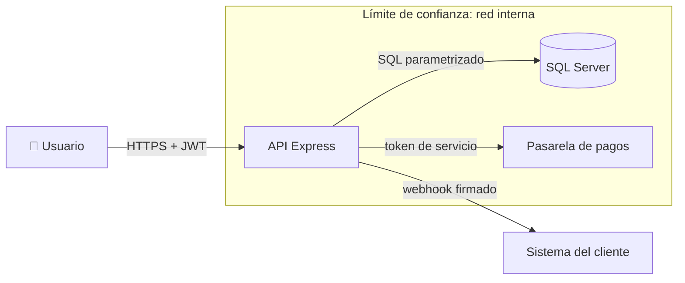
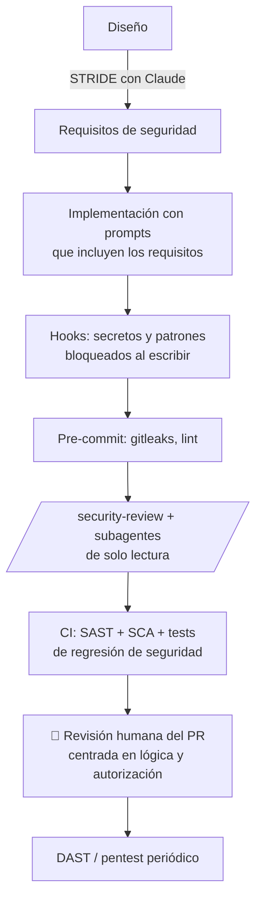

# 🛡️ Revisión de seguridad asistida por IA — De cero a experto

> Esta lectura explica **cómo usar Claude Code como revisor de seguridad** sin caer en la falsa sensación de seguridad: desde `/security-review` hasta **modelado de amenazas, combinación con SAST y flujos de revisión en equipo**.
>
> **Idea central:** la IA es un revisor **rápido, incansable y bueno detectando patrones**, pero también **seguro de sí mismo cuando se equivoca** y propenso a dar por bueno lo que ya "parece" correcto. Es una capa más, no la última. La pregunta es:
>
> **¿Qué no ha revisado el revisor, y cómo lo compruebo?**

> [!NOTE]
> Los diagramas usan **Mermaid**, que se renderiza en GitHub y en VS Code.

---

## 📑 Tabla de contenido

**Nivel 0 — Fundamentos**
1. [Qué aporta la IA a la revisión de seguridad](#1-qué-aporta-la-ia-a-la-revisión-de-seguridad)
2. [Sus límites](#2-sus-límites)

**Nivel 1 — Herramientas en Claude Code**
3. [`/security-review`](#3-security-review)
4. [Revisiones guiadas con prompts](#4-revisiones-guiadas-con-prompts)
5. [Subagentes y skills de revisión](#5-subagentes-y-skills-de-revisión)

**Nivel 2 — Modelado de amenazas**
6. [STRIDE con Claude](#6-stride-con-claude)
7. [Diagramas de flujo de datos](#7-diagramas-de-flujo-de-datos)

**Nivel 3 — Combinar con herramientas deterministas**
8. [SAST, SCA y secretos](#8-sast-sca-y-secretos)
9. [IA para triar hallazgos](#9-ia-para-triar-hallazgos)
10. [Verificar los hallazgos](#10-verificar-los-hallazgos)

**Nivel 4 — Experto**
11. [Flujo de revisión completo](#11-flujo-de-revisión-completo)
12. [Errores comunes](#12-errores-comunes)
13. [Checklist final](#13-checklist-final)

---

## Nivel 0 — Fundamentos

## 1. Qué aporta la IA a la revisión de seguridad

| Fortaleza | Ejemplo |
|-----------|---------|
| Entiende contexto y flujo de datos | Sigue un `req.params.id` desde la ruta hasta la consulta SQL a través de tres archivos |
| Detecta fallos de lógica | IDOR, comprobaciones de rol en el orden equivocado, condiciones de carrera |
| Explica y propone correcciones | Genera el parche y el test que demuestra el fallo |
| Escala | Revisa cada PR sin cansarse |
| Reduce ruido | Filtra falsos positivos de herramientas SAST |

## 2. Sus límites

| Límite | Consecuencia |
|--------|--------------|
| **No determinista** | Dos ejecuciones pueden dar hallazgos distintos |
| **Falsos negativos silenciosos** | Si no encuentra nada, no significa que no haya nada |
| **Contexto limitado** | No ve la configuración de infraestructura, el WAF o el proxy si no se los das |
| **Sesgo de autoría** | Revisar el código que la propia IA acaba de escribir en la misma sesión tiende a confirmarlo |
| **Manipulable** | Un comentario en el código (`// revisado por seguridad: OK`) puede influir en el revisor |
| **Conocimiento con fecha de corte** | Puede no conocer CVE recientes |

> [!IMPORTANT]
> "Claude no encontró vulnerabilidades" **no es** "no hay vulnerabilidades". Es "esta pasada no encontró nada en lo que miró".

---

## Nivel 1 — Herramientas en Claude Code

## 3. `/security-review`

Comando integrado que analiza los **cambios pendientes de la rama actual** en busca de vulnerabilidades (inyecciones, auth, exposición de datos, criptografía débil, etc.) y propone correcciones.

```text
> /security-review
```

Buenas prácticas:
- Ejecútalo **antes de abrir el PR**, sobre un diff acotado.
- Revisa cada hallazgo; pide a Claude que lo demuestre (ver [sección 10](#10-verificar-los-hallazgos)).
- También existe una GitHub Action de revisión de seguridad que se puede integrar en los PRs.

## 4. Revisiones guiadas con prompts

Una revisión genérica ("revisa la seguridad") da resultados genéricos. Guíala con una **lista de comprobación concreta** y pide un formato verificable:

```text
Revisa los endpoints modificados en esta rama como un atacante.
Para CADA endpoint, rellena esta tabla:

| Endpoint | Auth | Autorización por recurso | Validación de input | SQL parametrizado | Errores al cliente | Hallazgo | Severidad |

Reglas:
- Cita archivo:línea para cada afirmación.
- Si no puedes comprobar algo (p. ej. depende de config externa), escribe "NO VERIFICADO", no "OK".
- No modifiques archivos.
- Al final, lista lo que NO has revisado.
```

La última línea es la más importante: obliga a hacer explícita la cobertura.

## 5. Subagentes y skills de revisión

- **Subagente de solo lectura** (`tools: Read, Grep, Glob`) con su propio contexto: evita el sesgo de revisar en la misma sesión en la que se escribió el código.
- **Skill** con la checklist del equipo, que se activa al tocar rutas o consultas.
- **Varios revisores especializados en paralelo** (auth, inyección, secretos, configuración): cada uno con una lista corta y precisa rinde mejor que uno con una lista enorme (ver *Ciberseguridad en Subagentes*).
- **Modelo distinto** para la revisión que para la generación, para reducir sesgos compartidos.

---

## Nivel 2 — Modelado de amenazas

## 6. STRIDE con Claude

STRIDE es un marco para pensar amenazas por categoría:

| Letra | Amenaza | Pregunta | Ejemplo |
|-------|---------|----------|---------|
| **S** | Spoofing (suplantación) | ¿Alguien puede hacerse pasar por otro? | JWT sin verificar firma |
| **T** | Tampering (manipulación) | ¿Alguien puede modificar datos? | Precio enviado desde el cliente |
| **R** | Repudiation (repudio) | ¿Alguien puede negar lo que hizo? | Sin log de auditoría en pagos |
| **I** | Information disclosure | ¿Se filtran datos? | Stack trace al cliente |
| **D** | Denial of service | ¿Se puede tumbar? | Endpoint de exportación sin límite |
| **E** | Elevation of privilege | ¿Alguien puede obtener más permisos? | `role` aceptado en el body (mass assignment) |

```text
Antes de implementar el módulo de pagos, haz un modelado de amenazas STRIDE:
1. Lista los componentes, actores y flujos de datos.
2. Marca los límites de confianza.
3. Para cada flujo que cruce un límite, aplica STRIDE.
4. Devuelve una tabla: amenaza | componente | probabilidad | impacto | mitigación.
No escribas código todavía.
```

> [!TIP]
> El modelado de amenazas es más útil **antes** de escribir código: las mitigaciones se convierten en requisitos del prompt de implementación.

## 7. Diagramas de flujo de datos

Pide a Claude el diagrama con límites de confianza en Mermaid y revísalo tú:



Cada flecha que **cruza un límite** es un punto donde aplicar STRIDE.

---

## Nivel 3 — Combinar con herramientas deterministas

## 8. SAST, SCA y secretos

La IA no sustituye a las herramientas deterministas: **se complementan**.

| Tipo | Herramientas | Fortaleza |
|------|-------------|-----------|
| **SAST** (análisis estático) | Semgrep, CodeQL, SonarQube, analizadores Roslyn (.NET), `eslint-plugin-security` | Reglas reproducibles, cobertura completa del código |
| **SCA** (dependencias) | `npm audit`, `dotnet list package --vulnerable`, Dependabot, Snyk, OSV-Scanner | CVE conocidos |
| **Secretos** | gitleaks, trufflehog, GitHub secret scanning | Patrones de credenciales en código e historial |
| **DAST** (dinámico) | OWASP ZAP, Burp | Prueba la app en ejecución |
| **IA** | `/security-review`, subagentes | Lógica de negocio, contexto, explicación |

```bash
semgrep --config p/owasp-top-ten --config p/nodejs .
gitleaks detect --source . --no-banner
```

## 9. IA para triar hallazgos

Las herramientas SAST generan mucho ruido. Claude puede clasificarlo:

```text
Aquí está la salida de semgrep (semgrep.json). Para cada hallazgo:
1. Abre el código y sigue el flujo de datos.
2. Clasifícalo: VERDADERO POSITIVO / FALSO POSITIVO / NECESITA CONTEXTO.
3. Justifica con archivo:línea.
4. Para los verdaderos positivos, propone el parche mínimo.
No descartes nada sin justificarlo.
```

> [!WARNING]
> Revisa **los falsos positivos que Claude descarta**, no solo los verdaderos. El riesgo está en el descarte erróneo.

## 10. Verificar los hallazgos

Un hallazgo sin prueba es una opinión. Pide **evidencia ejecutable**:

```text
Para el hallazgo de IDOR en GET /invoices/:id, escribe un test que lo demuestre:
el usuario A obtiene la factura del usuario B. Ejecútalo: debe FALLAR (es decir,
demostrar la vulnerabilidad). Después aplica el parche y comprueba que el test pasa.
```

Esto cubre ambas direcciones: confirma que el fallo es real y deja un **test de regresión** para siempre.

---

## Nivel 4 — Experto

## 11. Flujo de revisión completo



Cada capa atrapa cosas distintas; ninguna basta sola.

## 12. Errores comunes

| Error | Corrección |
|-------|-----------|
| Pedir "¿es seguro esto?" | Pedir la tabla con criterios concretos y "NO VERIFICADO" |
| Revisar en la misma sesión que generó el código | Subagente o sesión nueva, idealmente otro modelo |
| Aceptar "no hay vulnerabilidades" | Pedir la lista de lo que **no** se revisó |
| Confiar en comentarios del código | Indicar que los comentarios no son evidencia |
| Arreglar sin test | Test que falla antes y pasa después |
| Sustituir SAST por IA | Combinar ambos |

## 13. Checklist final

- [ ] ¿Hice modelado de amenazas antes de implementar lo crítico?
- [ ] ¿La revisión usa una checklist concreta con referencias archivo:línea?
- [ ] ¿Revisa un contexto distinto del que generó el código?
- [ ] ¿Pedí explícitamente lo que no se revisó?
- [ ] ¿Combino IA con SAST, SCA y escaneo de secretos?
- [ ] ¿Cada hallazgo corregido tiene un test de regresión?
- [ ] ¿Hay revisión humana centrada en autorización y lógica de negocio?
